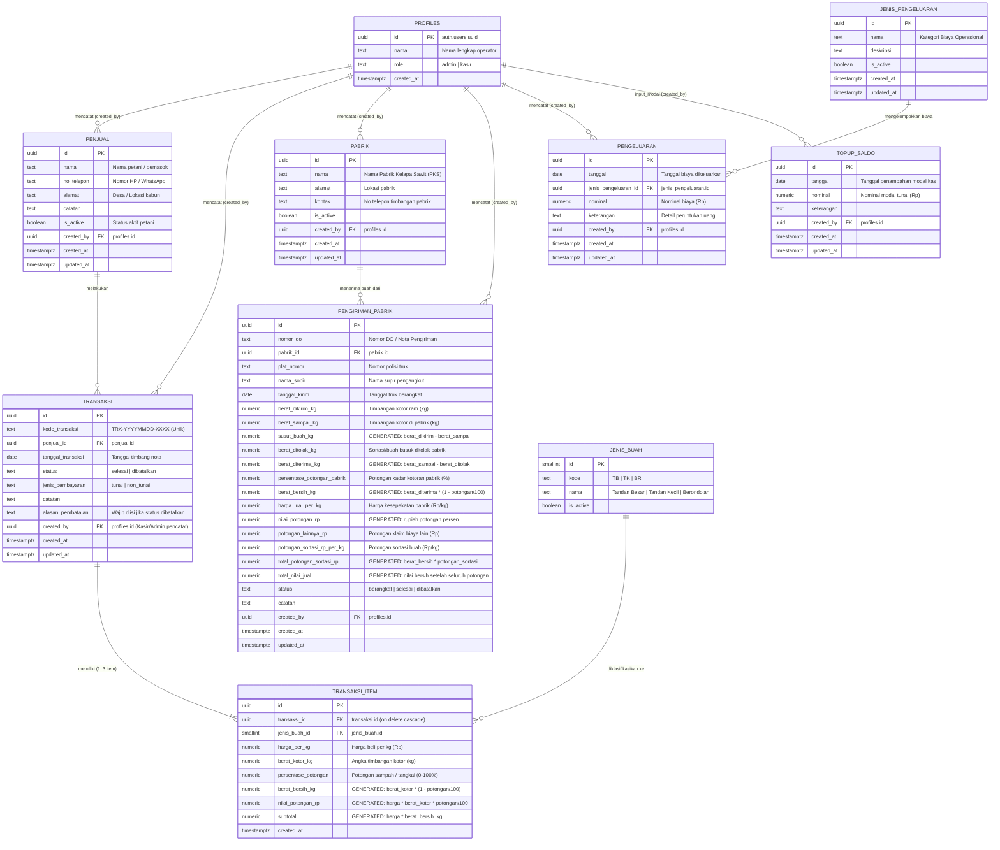
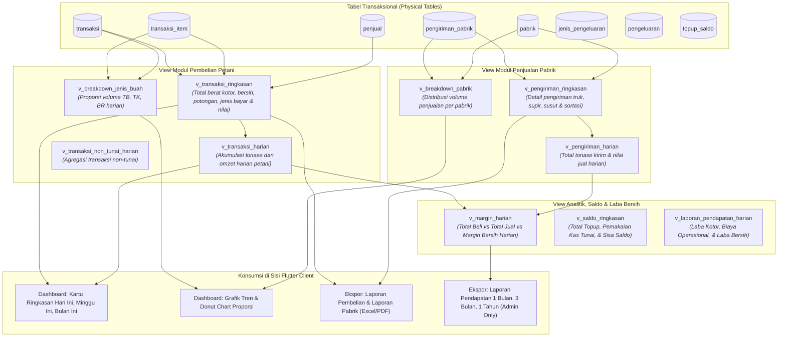
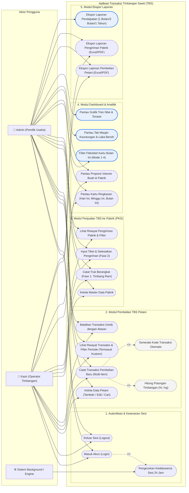
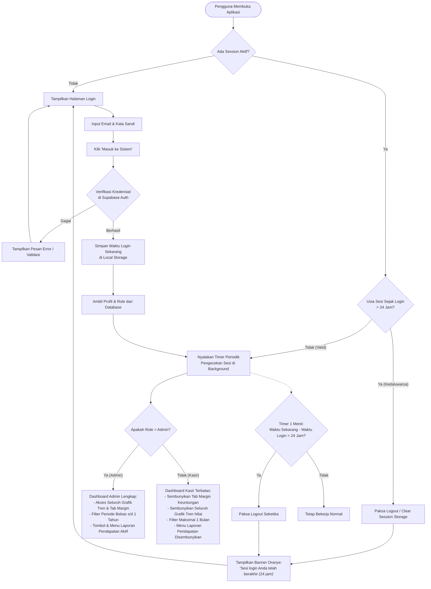
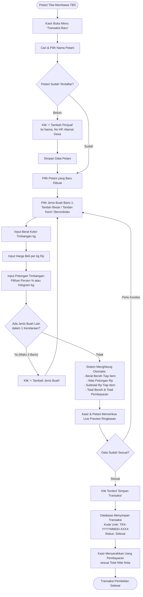
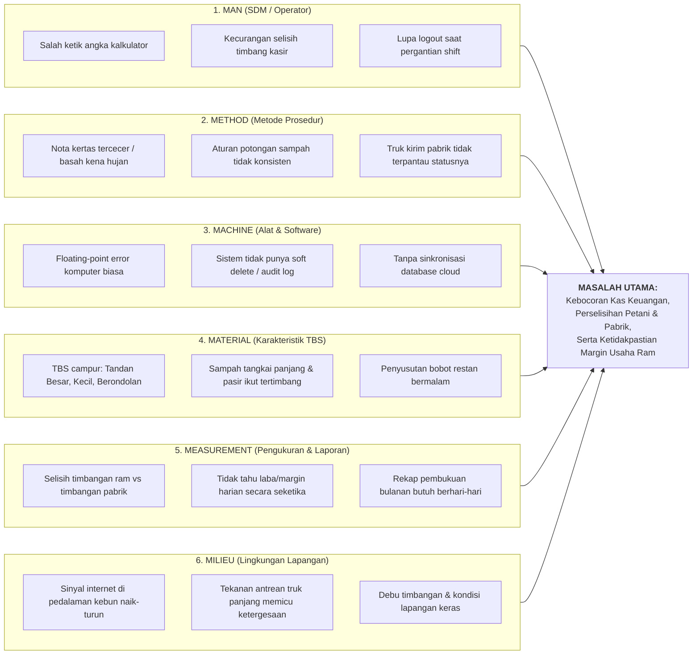

# ARSITEKTUR VISUAL & DIAGRAM SISTEM
# Aplikasi Transaksi Timbangan Sawit (TBS)

> **Dokumen Diagram Resmi: ERD, Use Case Diagram, Flowchart Alur Kerja, dan Analisis Fishbone (Ishikawa)**  
> *Versi Sistem: 1.8.1 | Database: PostgreSQL (Supabase) | Framework: Flutter*

---

## DAFTAR ISI DIAGRAM

1. [Entity Relationship Diagram (ERD) Lengkap](#1-entity-relationship-diagram-erd-lengkap)
   - 1.1 Diagram ERD Relasi Tabel Fisik
   - 1.2 Diagram Arsitektur Database View (Reporting & Analitik)
2. [Use Case Diagram Sistem](#2-use-case-diagram-sistem)
   - 2.1 Diagram Use Case Global (Admin, Kasir, & Sistem)
   - 2.2 Matriks Hak Akses Aktor (Role-Based Access Control)
   - 2.3 Rincian Deskripsi Aktor & Skenario Use Case
3. [Flowchart Sistem & Alur Kerja Bisnis](#3-flowchart-sistem--alur-kerja-bisnis)
   - 3.1 Alur Autentikasi & Keamanan Sesi 24 Jam
   - 3.2 Alur Transaksi Pembelian TBS Petani (Multi-Item & Potongan)
   - 3.3 Alur Pembatalan Transaksi Pembelian (Void)
   - 3.4 Alur Penjualan ke Pabrik (Alur Dua Fase Pengiriman)
   - 3.5 Alur Ekspor Laporan Pendapatan (Khusus Admin)
4. [Diagram Fishbone (Ishikawa) — Akar Masalah & Solusi](#4-diagram-fishbone-ishikawa--akar-masalah--solusi)
   - 4.1 Diagram Tulang Ikan (6M: Man, Method, Machine, Material, Measurement, Milieu)
   - 4.2 Matriks Masalah vs Solusi Aplikasi

---

## 1. Entity Relationship Diagram (ERD) Lengkap

### 1.1 Diagram ERD Relasi Tabel Fisik

Database dinormalisasi hingga 3NF dengan prinsip *Single Source of Truth*. Seluruh nilai turunan (`subtotal`, `berat_bersih_kg`, `total_nilai_jual`) menggunakan kolom `GENERATED ALWAYS AS ... STORED` agar anti-floating point error dan mencegah anomali pembaruan.



---

### 1.2 Diagram Arsitektur Database View (Reporting & Analitik)

Untuk menjaga performa dan integritas matematis, Flutter client membaca agregasi data melalui Database Views yang terisolasi:



---

## 2. Use Case Diagram Sistem

Use Case Diagram menggambarkan interaksi antara para pengguna sistem (**Aktor**) dengan fungsi-fungsi utama aplikasi, lengkap dengan relasi kepemilikan dan batas hak akses (*Role-Based Access Control*).

### 2.1 Diagram Use Case Global (Admin, Kasir, & Sistem)



---

### 2.2 Matriks Hak Akses Aktor (Role-Based Access Control)

| Modul & Use Case | Kasir (Operator) | Admin (Pemilik) | Keterangan Akses |
|---|:---:|:---:|---|
| **Masuk Akun (Login) & Keluar Sesi (Logout)** | Ya | Ya | Didukung pengecekan usia sesi maksimal 24 jam. |
| **Kelola Data Petani (Tambah / Edit / Cari)** | Ya | Ya | Pencarian cepat berbasis nama, telepon, atau alamat desa. |
| **Catat Pembelian TBS Petani (Multi-Item)** | Ya | Ya | Mendukung hingga 3 baris jenis buah dalam 1 nota timbang. |
| **Hitung Potongan Timbangan (% atau kg)** | Ya | Ya | Sistem otomatis menghitung potongan berat & berat bersih. |
| **Riwayat Transaksi Petani & Filter Periode** | Ya | Ya | Filter: Hari Ini, 1 & 2 Minggu, 1, 3, 6 Bulan, 1 Tahun, Semua, serta Kustom Tanggal. |
| **Batalkan Transaksi (Void) dengan Alasan** | Ya | Ya | Wajib mencantumkan alasan pembatalan demi audit pembukuan. |
| **Kelola Master Pabrik Kelapa Sawit** | Ya | Ya | Mendaftarkan nama pabrik, kontak, dan alamat PKS. |
| **Catat Keberangkatan Truk (Fase 1: Timbang Ram)** | Ya | Ya | Truk berangkat dengan status *Dalam Perjalanan*. |
| **Input Tiket Pabrik & Sortasi (Fase 2: Selesai)** | Ya | Ya | Input berat ditolak, potongan %, dan harga final pabrik. |
| **Lihat Riwayat Pengiriman ke Pabrik** | Ya | Ya | Memantau tonase & status truk dengan filter periode standar & kustom. |
| **Lihat Kartu Ringkasan Dashboard** | Ya | Ya | Ringkasan omzet dan tonase Hari Ini, Minggu Ini, Bulan Ini. |
| **Atur Filter Khusus Kartu Bulan Ini** | **Tidak** | **Ya** | Mode bulan berjalan, pilih bulan, 1 tahun penuh, atau rentang kustom. |
| **Lihat Proporsi Donut Chart (Buah & Pabrik)** | Ya | Ya | Distribusi volume Tandan Besar/Kecil/Berondolan & pabrik tujuan. |
| **Lihat Tab Margin Keuntungan Usaha** | **Tidak** | **Ya** | Disembunyikan dari Kasir demi kerahasiaan profit ram sawit. |
| **Lihat Grafik Tren Nilai & Tonase** | **Tidak** | **Ya** | Disembunyikan dari Kasir, hanya tampak pada Dashboard Admin. |
| **Ekspor Laporan Pembelian & Pengiriman Pabrik** | Ya | Ya | Format Microsoft Excel (.xlsx) dan Dokumen PDF (.pdf). |
| **Ekspor Laporan Pendapatan (Laba Rugi)** | **Tidak** | **Ya** | Khusus Admin: Agregasi 1 Bulan (mingguan), 3 Bulan, 1 Tahun (kuartalan). |

---

### 2.3 Rincian Deskripsi Aktor & Skenario Use Case

#### Aktor Sistem:
1. **Kasir (Operator Timbangan)**:
   - Pengguna operasional harian yang bertugas di lokasi jembatan timbang ram sawit.
   - Bertanggung jawab menimbang buah petani, mendaftarkan petani baru, mencatat truk kirim ke pabrik, dan memasukkan tiket timbang pabrik yang kembali.
   - Tidak memiliki akses ke angka keuntungan bersih (*margin*) maupun laporan laba pendapatan.
2. **Admin (Pemilik Pengepul / Pimpinan Ram)**:
   - Pengguna dengan hak akses tertinggi (*super user*).
   - Memiliki seluruh kewenangan Kasir ditambah kemampuan mengevaluasi kesehatan finansial, memantau tren harga beli vs harga jual, mengontrol filter kartu dashboard, dan mengunduh Laporan Pendapatan berkala.
3. **Sistem (Background Engine / Supabase Auth)**:
   - Entitas otomatis yang memvalidasi otentikasi, menjalankan timer periodik pengecekan kedaluwarsa sesi (24 jam), melakukan komputasi generated column database, serta menyusun nomor urut kode transaksi (`TRX-...` / `KRM-...`).

---

## 3. Flowchart Sistem & Alur Kerja Bisnis

### 3.1 Alur Autentikasi & Keamanan Sesi 24 Jam

Flowchart ini menggambarkan mekanisme login, pengecekan usia sesi (maksimal 24 jam) di dua titik (saat aplikasi dibuka & timer periodik), serta pembatasan peran (*Role-Based Access Control*).



---

### 3.2 Alur Transaksi Pembelian TBS Petani (Multi-Item & Potongan)



---

### 3.3 Alur Pembatalan Transaksi Pembelian (Void)

```mermaid
flowchart TD
    A([Kasir Menyadari Salah Input Nota]) --> B[Buka Menu 'Riwayat Transaksi']
    B --> C[Pilih Transaksi yang Ingin Dibatalkan]
    C --> D[Buka Halaman Detail Nota]
    D --> E[Klik Tombol Merah 'Batalkan Transaksi']
    
    E --> F[Muncul Dialog Konfirmasi Pembatalan]
    F --> G[Kasir Wajib Mengisi 'Alasan Pembatalan'<br/><i>Contoh: Kelebihan digit nol pada berat kotor</i>]
    
    G --> H{Alasan Sudah Diisi?}
    H -- Kosong --> I[Tombol Konfirmasi Tetap Dinonaktifkan]
    I --> G
    H -- Terisi --> J[Klik 'Konfirmasi Batal']
    
    J --> K[Database Memperbarui Status:<br/>status = 'dibatalkan'<br/>alasan_pembatalan = text<br/>updated_at = now()]
    
    K --> L[View Menarik Kembali Nilai Rupiah & Tonase<br/>dari Perhitungan Omzet & Laporan]
    L --> M[Nota Ditandai Merah: 'DIBATALKAN'<br/><i>(Data Tidak Dihapus Permanen Demi Audit)</i>]
    M --> End([Pembatalan Selesai])
```

---

### 3.4 Alur Penjualan ke Pabrik (Alur Dua Fase Pengiriman)

```mermaid
flowchart TD
    subgraph FASE_1 ["FASE 1: Keberangkatan Truk dari Ram Timbangan"]
        A1([Buah Dimuat ke Truk]) --> B1[Kasir Buka 'Pengiriman ke Pabrik']
        B1 --> C1[Klik '+ Kirim TBS ke Pabrik']
        C1 --> D1[Pilih Pabrik Tujuan, Plat Nomor, Nama Supir]
        D1 --> E1[Timbang Truk di Ram:<br/>Input Berat Kotor Ram kg]
        E1 --> F1[Input Estimasi Harga Jual/kg]
        F1 --> G1[Klik 'Simpan Pengiriman']
        G1 --> H1[Status Pengiriman:<br/>KUNING 'Dalam Perjalanan'<br/>Kode: KRM-YYYYMMDD-XXXX]
        H1 --> I1([Truk Berangkat ke Pabrik])
    end

    subgraph FASE_2 ["FASE 2: Kepulangan Supir Membawa Tiket Timbangan Pabrik (SPB)"]
        I1 -. Perjalanan & Timbang di PKS .-> A2([Supir Pulang Membawa Tiket Pabrik])
        A2 --> B2[Kasir Buka 'Riwayat Pengiriman']
        B2 --> C2[Cari Truk Berstatus 'Dalam Perjalanan']
        C2 --> D2[Klik 'Selesaikan / Input Nota Pabrik']
        D2 --> E2[Input Berat Ditolak / Sortasi kg<br/><i>(Otomatis divalidasi: <= Berat Kotor)</i>]
        E2 --> F2[Input Potongan Wajib Pabrik %]
        F2 --> G2[Input Harga Resmi Final Pabrik Rp/kg]
        G2 --> H2[Sistem Otomatis Menghitung:<br/>1. Berat Diterima = Kotor - Ditolak<br/>2. Berat Bersih = Diterima * (1 - Potongan%)<br/>3. Total Nilai Jual = Harga * Berat Bersih]
        H2 --> I2[Klik 'Konfirmasi Selesai']
        I2 --> J2[Status Berubah: HIJAU 'Selesai']
        J2 --> K2([Pencatatan Penjualan Pabrik Lengkap])
    end
```

---

### 3.5 Alur Ekspor Laporan Pendapatan (Khusus Admin)

```mermaid
flowchart TD
    A([Pemilik / Admin Buka Aplikasi]) --> B[Klik 'Laporan Pendapatan' di Header/Sidebar]
    B --> C[Muncul Modal Dialog 'Ekspor Laporan Pendapatan']
    
    C --> D[Pilih Cakupan Periode Evaluasi]
    
    D --> E1[Pilihan '1 Bulan']
    D --> E2[Pilihan '3 Bulan']
    D --> E3[Pilihan '1 Tahun']
    
    E1 --> F1[Pilih Bulan & Tahun<br/><i>Contoh: September 2026</i>]
    F1 --> G1[Agregasi Sisi Flutter (Per Minggu):<br/>- Minggu 1: tgl 1-7<br/>- Minggu 2: tgl 8-14<br/>- Minggu 3: tgl 15-21<br/>- Minggu 4: tgl 22-28<br/>- Minggu 5: tgl 29-akhir bulan]
    
    E2 --> F2[Pilih Kuartal & Tahun<br/><i>Contoh: Kuartal 3 (Jul-Sep) 2026</i>]
    F2 --> G2[Agregasi Sisi Flutter (Per Bulan):<br/>- Bulan 1 (Juli)<br/>- Bulan 2 (Agustus)<br/>- Bulan 3 (September)]
    
    E3 --> F3[Pilih Tahun Kalender<br/><i>Contoh: Tahun 2026</i>]
    F3 --> G3[Agregasi Sisi Flutter (Per Kuartal):<br/>- Kuartal 1: Jan-Mar<br/>- Kuartal 2: Apr-Jun<br/>- Kuartal 3: Jul-Sep<br/>- Kuartal 4: Okt-Des]
    
    G1 & G2 & G3 --> H[Sistem Menghitung untuk Setiap Baris:<br/>1. Total Pembelian Petani Rp<br/>2. Total Penjualan Pabrik Rp<br/>3. Margin Bersih = Penjualan - Pembelian<br/>4. Baris TOTAL KESELURUHAN]
    
    H --> I[Pratinjau Tabel Muncul Seketika di Layar<br/>- Angka Surplus berwarna Hijau/Biru<br/>- Angka Defisit berwarna Merah minus]
    
    I --> J{Pilih Format Dokumen}
    
    J -- Excel (.xlsx) --> K[Klik 'Unduh EXCEL'<br/>Laporan Pendapatan berformat XLSX IBM Carbon]
    J -- PDF (.pdf) --> L[Klik 'Unduh PDF'<br/>Dokumen Cetak Resmi A4 Portrait]
    
    K & L --> M[Browser / HP Mengunduh File Laporan]
    M --> End([Laporan Siap untuk Arsip / Rapat Evaluasi])
```

---

## 4. Diagram Fishbone (Ishikawa) — Akar Masalah & Solusi

Diagram Fishbone ini mengurai mengapa operasional timbangan sawit konvensional (menggunakan buku nota kertas & kalkulator manual) kerap mengalami kebocoran kas, perselisihan hitungan, dan ketidakpastian laba, serta bagaimana sistem ini menyelesaikannya secara tuntas.

### 4.1 Diagram Tulang Ikan (6M)



---

### 4.2 Matriks Masalah vs Solusi Aplikasi Transaksi Sawit

Berikut adalah rangkuman bagaimana fitur-fitur yang dibangun dari Bagian 1 hingga Bagian 19 menuntaskan setiap akar masalah di atas:

| Kategori 6M | Akar Masalah Lapangan | Solusi Nyata pada Aplikasi (v1.8.1) |
|---|---|---|
| **MAN (SDM)** | Kasir salah hitung atau curang | Perhitungan otomatis tanpa kalkulator, hak akses Kasir dibatasi (RBAC), pembatalan nota wajib isi alasan audit. |
| **MAN (SDM)** | Komputer timbangan ditinggal terbuka | **Keamanan Sesi 24 Jam**: Aplikasi otomatis logout jika sesi sudah lebih dari 24 jam. |
| **METHOD** | Nota kertas hilang atau sobek | Seluruh transaksi tersimpan permanen di cloud database Supabase dengan nomor kode unik (`TRX-...`). |
| **METHOD** | Pengiriman truk ke pabrik tidak terkontrol | **Alur Dua Fase Pengiriman**: Memisahkan fase keberangkatan truk dan fase pengembalian tiket timbang pabrik. |
| **MACHINE** | Selisih desimal uang pada komputasi digital | Menggunakan tipe data presisi tinggi `Decimal` (anti-*floating point error*) dan formula `GENERATED ALWAYS AS STORED` di database. |
| **MATERIAL** | Petani membawa aneka jenis buah sawit | **Form Multi-Item**: Mendukung 3 jenis buah (Tandan Besar, Tandan Kecil, Berondolan) dalam 1 nota timbang. |
| **MATERIAL** | Pemotongan sampah pasir/tangkai panjang | **Potongan Level Item**: Bisa diisi persen (%) atau kilogram (kg) per jenis buah secara adil dan transparan. |
| **MEASUREMENT**| Susut timbangan & sortasi pabrik | Form pengiriman mencatat berat kotor ram, buah ditolak/sortasi, dan potongan kadar air PKS secara terpisah. |
| **MEASUREMENT**| Pemilik tidak tahu keuntungan bersih | **Dashboard Analitik & Margin**: Real-time memantau selisih jual pabrik vs beli petani per hari/bulan/tahun. |
| **MEASUREMENT**| Rekapitulasi laporan pembukuan lambat | **Ekspor 1-Klik**: Laporan Pendapatan (mingguan, bulanan, kuartalan) langsung terbit dalam format Excel dan PDF siap cetak. |
| **MILIEU** | Koneksi internet minim di area perkebunan | Arsitektur responsif, caching lokal cepat, dan persiapan integrasi *Offline-First* (PowerSync). |

---

*Dokumen ini merupakan spesifikasi visual resmi arsitektur sistem Aplikasi Transaksi Timbangan Sawit (TBS).*
