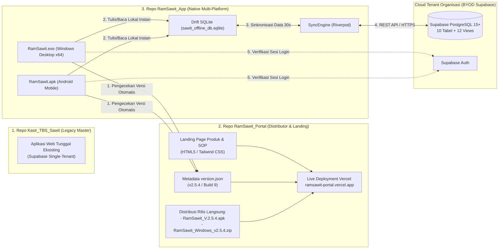
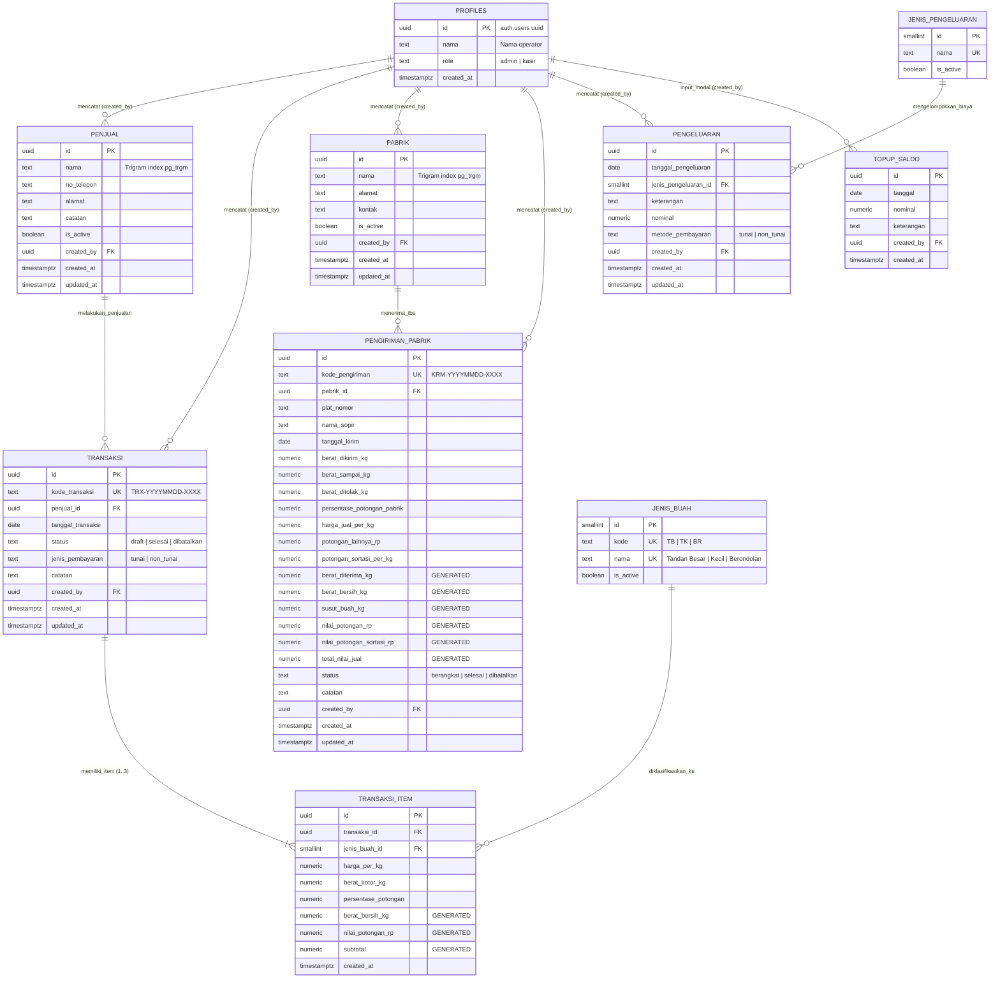
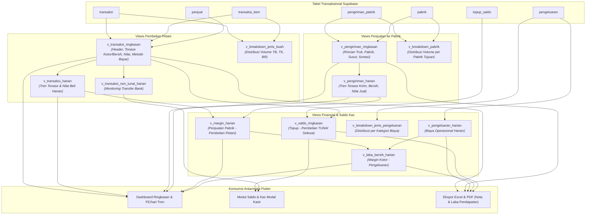
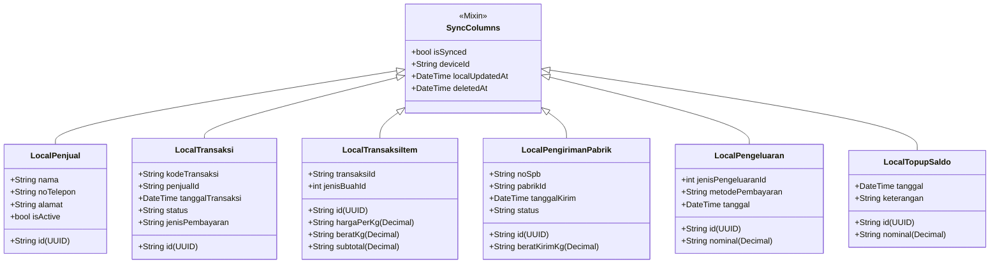
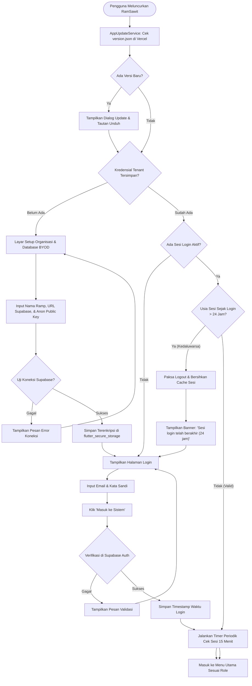
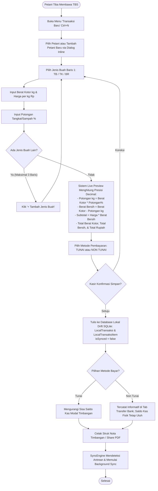
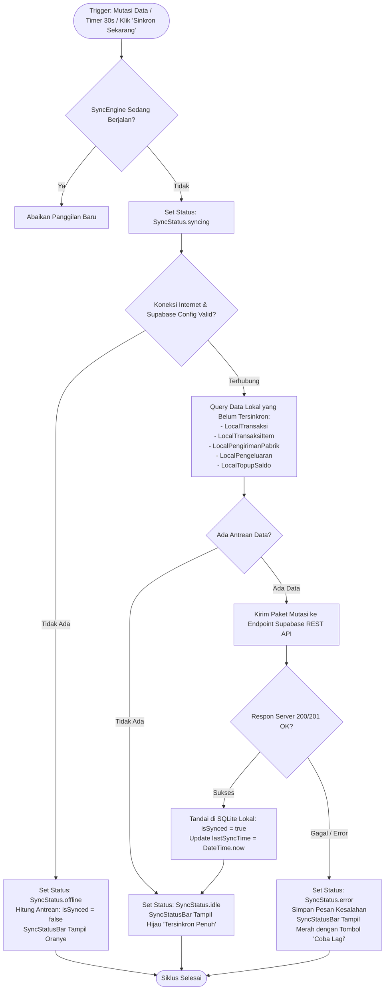
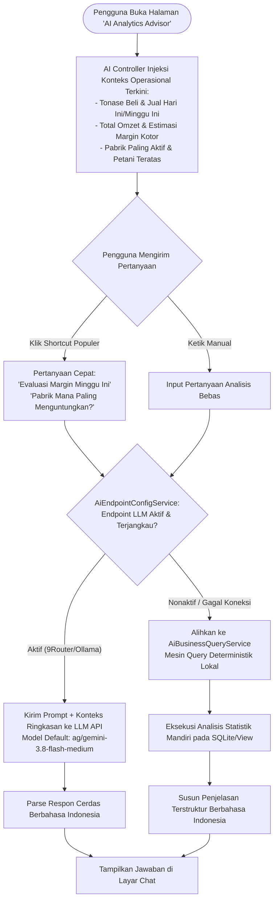
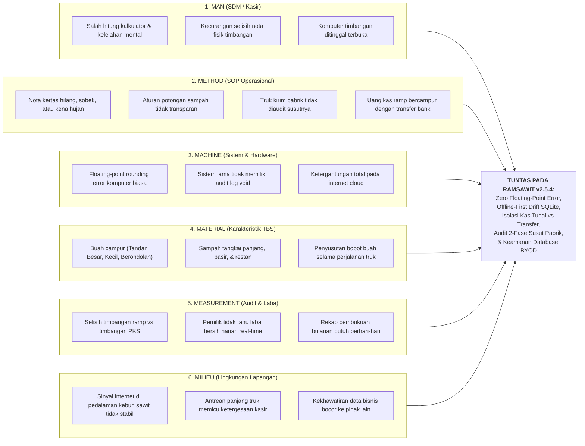

# ARSITEKTUR VISUAL & DIAGRAM SISTEM — RAMSAWIT
## Aplikasi Kasir & Manajemen Loading Ramp Transaksi Buah Kelapa Sawit (TBS)

> **Dokumen Diagram Resmi: Arsitektur Ekosistem 3-Repo, ERD Cloud & Lokal, Use Case RBAC, Flowchart Alur Bisnis, Offline Sync Engine, dan Analisis Fishbone (Ishikawa)**  
> *Versi Sistem: 2.5.4 (Build 9) | Database: PostgreSQL 15+ (Supabase) + SQLite (Drift) | Framework: Flutter Native*

---

## DAFTAR ISI DIAGRAM

1. [Arsitektur Ekosistem Sistem Terdistribusi (3-Repo)](#1-arsitektur-ekosistem-sistem-terdistribusi-3-repo)
2. [Entity Relationship Diagram (ERD) Lengkap](#2-entity-relationship-diagram-erd-lengkap)
   - 2.1 Diagram ERD 10 Tabel Fisik Cloud (Supabase PostgreSQL)
   - 2.2 Diagram Arsitektur 12 Database Views (Analitik & Agregasi)
   - 2.3 Diagram Skema Basis Data Lokal Drift SQLite (Offline-First)
3. [Use Case Diagram Sistem & Matriks RBAC](#3-use-case-diagram-sistem--matriks-rbac)
   - 3.1 Use Case Global (Admin, Kasir, & Sistem)
   - 3.2 Matriks Hak Akses Aktor (Role-Based Access Control)
4. [Flowchart Sistem & Alur Kerja Bisnis](#4-flowchart-sistem--alur-kerja-bisnis)
   - 4.1 Alur Autentikasi, Setup Organisasi BYOD, & Sesi 24 Jam
   - 4.2 Alur Transaksi Pembelian TBS Petani (Multi-Item & Metode Bayar)
   - 4.3 Alur Pembatalan Transaksi Pembelian (Void)
   - 4.4 Alur Penjualan Pabrik (Dua Fase Pengiriman & Audit Susut/Sortasi)
   - 4.5 Alur Offline-First & Sinkronisasi Dua Arah (`SyncEngine`)
   - 4.6 Alur Konsultasi AI Analytics Advisor & Fallback Deterministik
   - 4.7 Alur Ekspor Laporan Pendapatan Berjenjang
5. [Diagram Fishbone (Ishikawa) — Akar Masalah & Solusi Nyata](#5-diagram-fishbone-ishikawa--akar-masalah--solusi-nyata)

---

## 1. Arsitektur Ekosistem Sistem Terdistribusi (3-Repo)

Sistem RamSawit dikelola dalam tiga repositori mandiri yang saling terintegrasi:



---

## 2. Entity Relationship Diagram (ERD) Lengkap

### 2.1 Diagram ERD 10 Tabel Fisik Cloud (Supabase PostgreSQL)



### 2.2 Diagram Arsitektur 12 Database Views (Analitik & Agregasi)



### 2.3 Diagram Skema Basis Data Lokal Drift SQLite (Offline-First)



---

## 3. Use Case Diagram Sistem & Matriks RBAC

### 3.1 Use Case Global (Admin, Kasir, & Sistem)

```mermaid
flowchart LR
    Admin["👤 Admin (Pemilik Usaha)"]
    Kasir["👤 Kasir (Operator Timbangan)"]
    Sistem["⚙️ Sistem Engine (Drift, Sync, Vercel)"]

    subgraph SISTEM_RAMSAWIT ["Aplikasi RamSawit (v2.5.4)"]
        subgraph UC_TENANT ["Setup Organisasi & Keamanan"]
            UC_BYOD(["Setup Organisasi & Database BYOD"])
            UC_AUTH(["Masuk Akun (Login Email/Password)"])
            UC_SESSION(["Validasi Usia Sesi (Maksimal 24 Jam)"])
            UC_UPDATE(["Cek & Dialog Auto-Update Versi Baru"])
        end

        subgraph UC_OPERASIONAL ["Modul Operasional Timbangan"]
            UC_PETANI(["Kelola & Cari Petani (Trigram Search)"])
            UC_TRX(["Input Pembelian TBS (Multi-Item & Potongan %)"])
            UC_BAYAR(["Pilih Metode Pembayaran (Tunai / Non Tunai)"])
            UC_VOID(["Batalkan Transaksi (Void) dengan Alasan"])
            UC_PABRIK1(["Catat Truk Berangkat (Fase 1: Ramp)"])
            UC_PABRIK2(["Input Hasil Tiket PKS (Fase 2: Sortasi & Susut)"])
            UC_PENGELUARAN(["Catat Biaya Operasional (BBM, Upah, Konsumsi)"])
        end

        subgraph UC_EKSEKUTIF ["Modul Eksekutif & Analitik Bisnis"]
            UC_SALDO(["Pantau Sisa Saldo Kas Modal & Mutasi Harian"]):::adminOnly
            UC_TOPUP(["Input Top Up Saldo Kas Modal"]):::adminOnly
            UC_MARGIN(["Pantau Tab Margin & Laba Bersih"]):::adminOnly
            UC_TREN(["Pantau Grafik Tren Nilai & Tonase"]):::adminOnly
            UC_EXP_REV(["Ekspor Laporan Pendapatan Berjenjang"]):::adminOnly
            UC_AI(["Konsultasi AI Analytics Advisor"])
        end

        subgraph UC_SYNC ["Engine Offline-First"]
            UC_OFFLINE(["Simpan Transaksi ke SQLite Lokal"])
            UC_BG_SYNC(["Sinkronisasi Dua Arah Otomatis (30s)"])
        end
    end

    classDef adminOnly fill:#e8f0fe,stroke:#0f62fe,stroke-width:2px;

    Kasir --> UC_AUTH
    Kasir --> UC_PETANI
    Kasir --> UC_TRX
    Kasir --> UC_BAYAR
    Kasir --> UC_VOID
    Kasir --> UC_PABRIK1
    Kasir --> UC_PABRIK2
    Kasir --> UC_PENGELUARAN
    Kasir --> UC_AI

    Admin --> UC_BYOD
    Admin --> UC_AUTH
    Admin --> UC_PETANI
    Admin --> UC_TRX
    Admin --> UC_BAYAR
    Admin --> UC_VOID
    Admin --> UC_PABRIK1
    Admin --> UC_PABRIK2
    Admin --> UC_PENGELUARAN
    Admin --> UC_SALDO
    Admin --> UC_TOPUP
    Admin --> UC_MARGIN
    Admin --> UC_TREN
    Admin --> UC_EXP_REV
    Admin --> UC_AI

    Sistem --> UC_SESSION
    Sistem --> UC_UPDATE
    Sistem --> UC_OFFLINE
    Sistem --> UC_BG_SYNC
```



### 3.2 Matriks Hak Akses Aktor (Role-Based Access Control)

| Modul & Fitur Sistem | Kasir Timbangan | Pemilik Usaha (Admin) | Batasan & Keamanan |
|---|:---:|:---:|---|
| **Setup Organisasi BYOD** | Ya | Ya | Diperlukan saat awal inisialisasi aplikasi di perangkat |
| **Login & Sesi 24 Jam** | Ya | Ya | Auto-logout paksa setelah 24 jam berturut-turut |
| **Transaksi Pembelian TBS** | Full Akses | Full Akses | Input berat kotor, harga, potongan %, cetak struk |
| **Metode Pembayaran (Tunai/Non Tunai)** | Ya | Ya | Default Tunai; Non Tunai tidak memotong saldo kas fisik |
| **Pembatalan Transaksi (Void)** | Ya (Wajib Alasan) | Ya (Wajib Alasan) | Status berubah jadi `dibatalkan`, tercatat di audit trail |
| **Pengiriman Pabrik (Fase 1 & 2)** | Full Akses | Full Akses | Audit susut buah, potongan sortasi, dan nilai jual |
| **Pencatatan Biaya Operasional** | Full Akses | Full Akses | Input biaya harian tunai maupun non-tunai |
| **Kelola Master Kategori Biaya** | **Disembunyikan** | **Ya** | Hanya Admin yang boleh menambah/mengubah kategori biaya |
| **Modul Saldo & Kas Modal Ramp** | **Disembunyikan** | **Ya** | Sisa saldo kas = Total Top Up − Total Pembelian TUNAI |
| **Dashboard — Tab Margin & Laba** | **Disembunyikan** | **Ya** | Demi kerahasiaan omzet & laba bersih loading ramp |
| **Dashboard — Grafik Tren Nilai** | **Disembunyikan** | **Ya** | Kasir hanya melihat kartu tonase & volume buah |
| **Filter Periode Dashboard** | Maksimal 1 Bulan | Bebas (s/d 1 Tahun) | Kasir difokuskan pada pemantauan operasional berjalan |
| **Filter Khusus "Bulan Ini"** | **Disembunyikan** | **Ya** | Admin dapat memilih bulan/tahun komparasi historis |
| **Ekspor Laporan Pendapatan** | **Disembunyikan** | **Ya** | Laporan pendapatan berjenjang hanya untuk pemilik |
| **AI Analytics Advisor** | Ya | Ya | Konsultasi bisnis interaktif (read-only context) |
| **Bilah Status Sinkronisasi** | Ya | Ya | Menampilkan status tersinkron, antrean, dan mode offline |

---

## 4. Flowchart Sistem & Alur Kerja Bisnis

### 4.1 Alur Autentikasi, Setup Organisasi BYOD, & Sesi 24 Jam



### 4.2 Alur Transaksi Pembelian TBS Petani (Multi-Item & Metode Bayar)



### 4.3 Alur Pembatalan Transaksi Pembelian (Void)

```mermaid
flowchart TD
    A([Kasir / Admin Menemukan Kesalahan Nota]) --> B[Buka Menu 'Riwayat Transaksi']
    B --> C[Pilih Nota & Buka Halaman Detail]
    C --> D[Klik Tombol Merah 'Batalkan Transaksi']
    D --> E[Muncul Dialog: Wajib Mengisi 'Alasan Pembatalan']
    E --> F{Alasan Diisi?}
    F -- Kosong --> G[Tombol Konfirmasi Tetap Dinonaktifkan] --> E
    F -- Terisi --> H[Klik 'Konfirmasi Pembatalan']
    
    H --> I[Update Status di Database Lokal Drift:<br/>status = 'dibatalkan'<br/>alasan_batal = text<br/>isSynced = false]
    I --> J[Nilai Transaksi Ditarik dari Agregasi Omzet & Perhitungan Saldo]
    J --> K[Nota Ditandai Badge Merah 'DIBATALKAN' (Audit Trail Tetap Utuh)]
    K --> L[SyncEngine Mengirim Mutasi Status ke Cloud Supabase]
    L --> End([Pembatalan Selesai])
```

### 4.4 Alur Penjualan Pabrik (Dua Fase Pengiriman & Audit Susut/Sortasi)

```mermaid
flowchart TD
    subgraph FASE_1 ["FASE 1: Keberangkatan Truk dari Loading Ramp"]
        A1([Truk Selesai Memuat TBS di Ramp]) --> B1[Buka Menu 'Pengiriman Pabrik' -> Form Keberangkatan]
        B1 --> C1[Pilih Pabrik Tujuan PKS, Nomor Polisi, & Nama Sopir]
        C1 --> D1[Input Berat Dikirim kg hasil Jembatan Timbang Ramp]
        D1 --> E1[Simpan: Kode Otomatis KRM-YYYYMMDD-XXXX<br/>Status: 'berangkat']
        E1 --> F1([Truk Berangkat Menuju PKS])
    end

    subgraph FASE_2 ["FASE 2: Rekonsiliasi Nota Slip Timbangan PKS"]
        F1 -. Perjalanan & Timbang di Pabrik .-> A2([Sopir Kembali Membawa Slip PKS])
        A2 --> B2[Buka 'Riwayat Pengiriman' -> Tab 'Dalam Perjalanan']
        B2 --> C2[Pilih Armada & Klik 'Input Hasil Pabrik']
        C2 --> D2[Input Data Slip PKS:<br/>- Berat Sampai kg<br/>- Berat Ditolak kg<br/>- Potongan Pabrik %<br/>- Harga Jual per kg Rp<br/>- Potongan Lainnya Rp & Potongan Sortasi Rp/kg]
        
        D2 --> E2[Validasi Sistem:<br/>Berat Ditolak <= Berat Sampai]
        E2 --> F2[Kalkulasi Otomatis Generated Columns:<br/>1. Berat Diterima = Sampai - Ditolak<br/>2. Berat Bersih = Diterima * (1 - Potongan%)<br/>3. Susut Buah = Dikirim - Sampai (Audit Selisih Timbangan)<br/>4. Potongan Sortasi Rp = Sortasi per kg * Berat Sampai<br/>5. Total Nilai Jual = (Harga * Bersih) - Potongan Lain - Sortasi]
        
        F2 --> G2[Simpan: Status Berubah menjadi 'selesai']
        G2 --> H2([Penjualan Pabrik Selesai & Tercatat di Dashboard Margin])
    end
```

### 4.5 Alur Offline-First & Sinkronisasi Dua Arah (`SyncEngine`)



### 4.6 Alur Konsultasi AI Analytics Advisor & Fallback Deterministik



### 4.7 Alur Ekspor Laporan Pendapatan Berjenjang

```mermaid
flowchart TD
    A([Admin Buka Menu 'Laporan Pendapatan']) --> B[Pilih Rentang Filter Evaluasi]
    
    B --> C1[Pilihan 1 Tahun]
    B --> C2[Pilihan 3 Bulan]
    B --> C3[Pilihan 1 Bulan]
    
    C1 --> D1[Agregasi Berjenjang Kuartalan (Per 3 Bulan):<br/>Q1 (Jan-Mar), Q2 (Apr-Jun), Q3 (Jul-Sep), Q4 (Okt-Des)]
    C2 --> D2[Agregasi Berjenjang Bulanan (Per 1 Bulan):<br/>Bulan 1, Bulan 2, Bulan 3]
    C3 --> D3[Agregasi Berjenjang Mingguan (Per 7 Hari):<br/>Minggu 1, Minggu 2, Minggu 3, Minggu 4, Minggu 5]
    
    D1 & D2 & D3 --> E[Komputasi Tiap Baris Periode:<br/>- Total Pembelian Petani Rp<br/>- Total Penjualan Pabrik Rp<br/>- Margin Kotor = Penjualan - Pembelian<br/>- Total Pengeluaran Operasional Rp<br/>- Laba Bersih = Margin - Pengeluaran<br/>- Baris Total Akumulasi di Bagian Akhir]
    
    E --> F[Pratinjau Tabel Live di Antarmuka Pengguna]
    F --> G{Pilih Format Ekspor}
    G -- Excel (.xlsx) --> H[Unduh Berkas Spreadsheet Microsoft Excel]
    G -- PDF (.pdf) --> I[Unduh Berkas Dokumen PDF Siap Cetak A4]
    H & I --> End([Ekspor Sukses])
```

---

## 5. Diagram Fishbone (Ishikawa) — Akar Masalah & Solusi Nyata

Diagram Ishikawa (6M) di bawah ini menguraikan bagaimana transformasi digital RamSawit v2.5.4 menuntaskan permasalahan kronis operasional loading ramp konvensional:



### Matriks Solusi Komprehensif RamSawit v2.5.4:
1. **Presisi Finansial Anti-Error:** Menggunakan package `Decimal` dan kolom `GENERATED ALWAYS AS STORED` di database.
2. **Offline-First:** Basis data lokal Drift SQLite (`sawit_offline_db.sqlite`) memungkinkan penimbangan tetap berjalan normal 100% tanpa internet.
3. **Pemisahan Kas Tunai & Transfer:** Pilihan metode pembayaran melindungi kas fisik modal kasir dari ketidaksesuaian saldo.
4. **Audit Susut & Sortasi Pabrik:** Alur 2-fase membandingkan berat timbangan ramp dengan hasil pabrik, mendeteksi selisih secara akurat.
5. **Kerahasiaan Bisnis (BYOD & RBAC):** Setiap loading ramp memiliki database Supabase sendiri, dan kasir dibatasi dari melihat margin laba pemilik.
6. **AI Analytics Advisor:** Pemilik usaha dapat mengevaluasi performa ramp, membandingkan pabrik, dan mendeteksi anomali biaya secara instan.

---
*Dokumen ini merupakan spesifikasi arsitektur visual resmi aplikasi RamSawit v2.5.4.*
