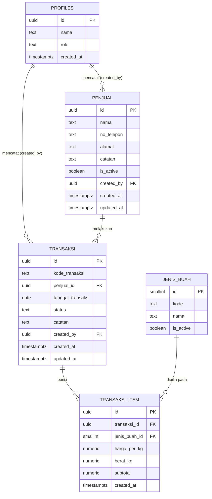
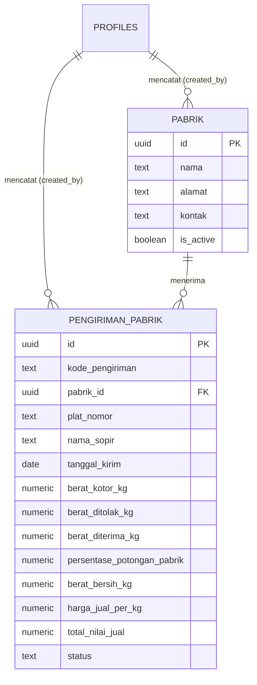

# Desain Database — Aplikasi Transaksi Jual Beli Buah Kelapa Sawit

**Database:** PostgreSQL (Supabase)
**Level normalisasi:** hingga 3NF

---

## 1. Entitas & Penjelasan

| Tabel | Fungsi | Catatan Normalisasi |
|---|---|---|
| `profiles` | Data user aplikasi (extend `auth.users` Supabase) | 1 baris = 1 user auth |
| `penjual` | Master data penjual/petani | Tidak ada pengulangan data penjual di transaksi (hanya FK) |
| `jenis_buah` | Master 3 jenis buah (Tandan Besar, Tandan Kecil, Berondolan) | Memisahkan nama jenis dari transaksi agar tidak redundan & mudah ditambah jenis baru |
| `transaksi` | Header transaksi (1 transaksi = 1 kejadian jual-beli dgn 1 penjual) | Tidak menyimpan total (nilai turunan) sebagai kolom fisik — dihitung via VIEW, sehingga tidak ada anomali update |
| `transaksi_item` | Detail per jenis buah dalam satu transaksi (harga & berat manual per transaksi) | Harga tidak disimpan di master karena memang berubah tiap transaksi (bukan atribut jenis buah, tapi atribut transaksi) |

Karena `total_harga` dan `total_berat` sepenuhnya dapat diturunkan dari `transaksi_item`, keduanya **tidak disimpan sebagai kolom** di tabel `transaksi` (menghindari update anomaly) — melainkan disediakan lewat VIEW (lihat §4). Jika nanti volume data besar dan butuh performa lebih cepat, bisa dipertimbangkan materialized view dengan refresh terjadwal, tanpa mengubah skema dasar.

**Kardinalitas relasi:**
- 1 Penjual → banyak Transaksi (1:N)
- 1 Transaksi → banyak Transaksi Item (1:N, minimal 1)
- 1 Jenis Buah → banyak Transaksi Item (1:N)
- 1 Profile (user) → banyak Penjual/Transaksi yang ia buat (audit `created_by`)

---

## 2. ERD (Mermaid)



---

## 3. DDL Supabase (PostgreSQL) — lengkap dengan trigger & RLS

```sql
-- ============================================
-- EXTENSIONS
-- ============================================
create extension if not exists "pgcrypto"; -- untuk gen_random_uuid()

-- ============================================
-- TABEL: profiles (extend auth.users)
-- ============================================
create table public.profiles (
    id uuid primary key references auth.users(id) on delete cascade,
    nama text not null,
    role text not null default 'kasir' check (role in ('admin','kasir')),
    created_at timestamptz not null default now()
);

-- Auto-create profile saat user baru register
create function public.handle_new_user()
returns trigger as $$
begin
    insert into public.profiles (id, nama, role)
    values (new.id, coalesce(new.raw_user_meta_data->>'nama', new.email), 'kasir');
    return new;
end;
$$ language plpgsql security definer;

create trigger on_auth_user_created
    after insert on auth.users
    for each row execute procedure public.handle_new_user();

-- ============================================
-- TABEL: penjual
-- ============================================
create table public.penjual (
    id uuid primary key default gen_random_uuid(),
    nama text not null,
    no_telepon text,
    alamat text,
    catatan text,
    is_active boolean not null default true,
    created_by uuid references public.profiles(id),
    created_at timestamptz not null default now(),
    updated_at timestamptz not null default now()
);

create index idx_penjual_nama on public.penjual using gin (nama gin_trgm_ops);
-- butuh extension pg_trgm untuk pencarian cepat:
create extension if not exists pg_trgm;

-- ============================================
-- TABEL: jenis_buah (master, fixed tapi bisa ditambah)
-- ============================================
create table public.jenis_buah (
    id smallint generated always as identity primary key,
    kode text not null unique,
    nama text not null unique,
    is_active boolean not null default true
);

insert into public.jenis_buah (kode, nama) values
    ('TB', 'Tandan Besar'),
    ('TK', 'Tandan Kecil'),
    ('BR', 'Berondolan');

-- ============================================
-- TABEL: transaksi (header)
-- ============================================
create table public.transaksi (
    id uuid primary key default gen_random_uuid(),
    kode_transaksi text not null unique,
    penjual_id uuid not null references public.penjual(id),
    tanggal_transaksi date not null default current_date,
    status text not null default 'selesai' check (status in ('draft','selesai','dibatalkan')),
    catatan text,
    created_by uuid references public.profiles(id),
    created_at timestamptz not null default now(),
    updated_at timestamptz not null default now()
);

create index idx_transaksi_tanggal on public.transaksi (tanggal_transaksi desc);
create index idx_transaksi_penjual on public.transaksi (penjual_id);
create index idx_transaksi_status on public.transaksi (status);

-- ============================================
-- TABEL: transaksi_item (detail per jenis buah)
-- ============================================
create table public.transaksi_item (
    id uuid primary key default gen_random_uuid(),
    transaksi_id uuid not null references public.transaksi(id) on delete cascade,
    jenis_buah_id smallint not null references public.jenis_buah(id),
    harga_per_kg numeric(12,2) not null check (harga_per_kg >= 0),
    berat_kg numeric(10,2) not null check (berat_kg > 0),
    subtotal numeric(14,2) generated always as (harga_per_kg * berat_kg) stored,
    created_at timestamptz not null default now(),
    unique (transaksi_id, jenis_buah_id) -- 1 jenis buah hanya boleh 1 baris per transaksi
);

create index idx_item_transaksi on public.transaksi_item (transaksi_id);

-- ============================================
-- TRIGGER: auto-generate kode_transaksi (TRX-YYYYMMDD-0001)
-- ============================================
create sequence if not exists transaksi_harian_seq;

create function public.generate_kode_transaksi()
returns trigger as $$
declare
    next_seq int;
    tanggal_str text;
begin
    if new.kode_transaksi is null then
        tanggal_str := to_char(coalesce(new.tanggal_transaksi, current_date), 'YYYYMMDD');
        select coalesce(max(
            (regexp_match(kode_transaksi, 'TRX-' || tanggal_str || '-(\d+)'))[1]::int
        ), 0) + 1
        into next_seq
        from public.transaksi
        where kode_transaksi like 'TRX-' || tanggal_str || '-%';

        new.kode_transaksi := 'TRX-' || tanggal_str || '-' || lpad(next_seq::text, 4, '0');
    end if;
    return new;
end;
$$ language plpgsql;

create trigger trg_generate_kode_transaksi
    before insert on public.transaksi
    for each row execute procedure public.generate_kode_transaksi();

-- ============================================
-- TRIGGER: auto-update updated_at
-- ============================================
create function public.set_updated_at()
returns trigger as $$
begin
    new.updated_at = now();
    return new;
end;
$$ language plpgsql;

create trigger trg_penjual_updated_at
    before update on public.penjual
    for each row execute procedure public.set_updated_at();

create trigger trg_transaksi_updated_at
    before update on public.transaksi
    for each row execute procedure public.set_updated_at();

-- ============================================
-- ROW LEVEL SECURITY
-- ============================================
alter table public.profiles enable row level security;
alter table public.penjual enable row level security;
alter table public.jenis_buah enable row level security;
alter table public.transaksi enable row level security;
alter table public.transaksi_item enable row level security;

-- Semua user yang login (authenticated) boleh baca & tulis data operasional
create policy "authenticated read profiles" on public.profiles
    for select using (auth.role() = 'authenticated');

create policy "authenticated all penjual" on public.penjual
    for all using (auth.role() = 'authenticated') with check (auth.role() = 'authenticated');

create policy "authenticated read jenis_buah" on public.jenis_buah
    for select using (auth.role() = 'authenticated');

create policy "authenticated all transaksi" on public.transaksi
    for all using (auth.role() = 'authenticated') with check (auth.role() = 'authenticated');

create policy "authenticated all transaksi_item" on public.transaksi_item
    for all using (auth.role() = 'authenticated') with check (auth.role() = 'authenticated');

-- Hanya admin yang boleh insert/update jenis_buah (master data sensitif)
create policy "admin manage jenis_buah" on public.jenis_buah
    for insert with check (
        exists (select 1 from public.profiles where id = auth.uid() and role = 'admin')
    );
```

> Catatan keamanan: policy di atas adalah baseline (semua user login punya akses penuh ke data operasional). Jika ke depan perlu pembatasan lebih ketat per role (misal kasir tidak boleh menghapus transaksi), tinggal perketat policy `for delete` khusus admin.

---

## 4. View untuk Dashboard / Reporting

```sql
-- Ringkasan per transaksi (total berat & total harga, dihitung dari item)
create view public.v_transaksi_ringkasan as
select
    t.id,
    t.kode_transaksi,
    t.tanggal_transaksi,
    t.status,
    p.id as penjual_id,
    p.nama as nama_penjual,
    coalesce(sum(ti.berat_kg), 0) as total_berat_kg,
    coalesce(sum(ti.subtotal), 0) as total_harga,
    t.created_at
from public.transaksi t
join public.penjual p on p.id = t.penjual_id
left join public.transaksi_item ti on ti.transaksi_id = t.id
group by t.id, t.kode_transaksi, t.tanggal_transaksi, t.status, p.id, p.nama, t.created_at;

-- Agregasi harian (untuk grafik tren dashboard)
create view public.v_transaksi_harian as
select
    tanggal_transaksi,
    count(distinct id) as jumlah_transaksi,
    sum(total_berat_kg) as total_berat_kg,
    sum(total_harga) as total_nilai
from public.v_transaksi_ringkasan
where status = 'selesai'
group by tanggal_transaksi
order by tanggal_transaksi;

-- Breakdown per jenis buah (untuk pie/bar chart)
create view public.v_breakdown_jenis_buah as
select
    jb.nama as jenis_buah,
    date_trunc('day', t.tanggal_transaksi) as tanggal,
    sum(ti.berat_kg) as total_berat_kg,
    sum(ti.subtotal) as total_nilai
from public.transaksi_item ti
join public.transaksi t on t.id = ti.transaksi_id
join public.jenis_buah jb on jb.id = ti.jenis_buah_id
where t.status = 'selesai'
group by jb.nama, date_trunc('day', t.tanggal_transaksi);
```

## 6. Migrasi Lanjutan — Potongan Dipindah ke Level Berat per Jenis Buah

**Ini menggantikan pendekatan di §5.** Potongan sekarang diterapkan pada berat tiap item (jenis buah), bukan pada total harga transaksi. `berat_kg` di `transaksi_item` diganti nama menjadi `berat_kotor_kg` (nilai input manual seperti sebelumnya), ditambah `persentase_potongan` per item, lalu `berat_bersih_kg` dan `subtotal` dihitung otomatis sebagai kolom generated dari keduanya.

```sql
-- 1. Ganti nama kolom berat_kg -> berat_kotor_kg (formula subtotal lama otomatis ikut menyesuaikan nama ini)
alter table public.transaksi_item rename column berat_kg to berat_kotor_kg;

-- 2. Tambah kolom potongan per item (default 0% = tidak ada potongan, opsional diisi manual)
alter table public.transaksi_item
    add column persentase_potongan numeric(5,2) not null default 0
    check (persentase_potongan >= 0 and persentase_potongan <= 100);

-- 3. Hapus kolom subtotal lama (generated, formulanya belum memperhitungkan potongan)
alter table public.transaksi_item drop column subtotal;

-- 4. Tambah kolom berat_bersih_kg (generated, hasil turunan berat kotor & potongan)
alter table public.transaksi_item
    add column berat_bersih_kg numeric(10,2)
    generated always as (round(berat_kotor_kg * (1 - persentase_potongan / 100), 2)) stored;

-- 5. Tambah kolom nilai_potongan_rp (generated, informasi berapa Rp yang "hilang" akibat potongan berat)
alter table public.transaksi_item
    add column nilai_potongan_rp numeric(14,2)
    generated always as (round(harga_per_kg * berat_kotor_kg * (persentase_potongan / 100), 2)) stored;

-- 6. Buat ulang kolom subtotal dengan formula baru: harga x berat BERSIH
alter table public.transaksi_item
    add column subtotal numeric(14,2)
    generated always as (round(harga_per_kg * berat_kotor_kg * (1 - persentase_potongan / 100), 2)) stored;

-- 7. Update view ringkasan transaksi
create or replace view public.v_transaksi_ringkasan as
select
    t.id,
    t.kode_transaksi,
    t.tanggal_transaksi,
    t.status,
    p.id as penjual_id,
    p.nama as nama_penjual,
    coalesce(sum(ti.berat_kotor_kg), 0) as total_berat_kotor_kg,
    coalesce(sum(ti.berat_bersih_kg), 0) as total_berat_bersih_kg,
    coalesce(sum(ti.nilai_potongan_rp), 0) as total_potongan_rp,
    coalesce(sum(ti.subtotal), 0) as total_nilai,
    t.created_at
from public.transaksi t
join public.penjual p on p.id = t.penjual_id
left join public.transaksi_item ti on ti.transaksi_id = t.id
group by t.id, t.kode_transaksi, t.tanggal_transaksi, t.status, p.id, p.nama, t.created_at;

-- 8. Update view harian
create or replace view public.v_transaksi_harian as
select
    tanggal_transaksi,
    count(distinct id) as jumlah_transaksi,
    sum(total_berat_kotor_kg) as total_berat_kotor_kg,
    sum(total_berat_bersih_kg) as total_berat_bersih_kg,
    sum(total_potongan_rp) as total_potongan_rp,
    sum(total_nilai) as total_nilai
from public.v_transaksi_ringkasan
where status = 'selesai'
group by tanggal_transaksi
order by tanggal_transaksi;

-- 9. Update view breakdown per jenis buah
create or replace view public.v_breakdown_jenis_buah as
select
    jb.nama as jenis_buah,
    date_trunc('day', t.tanggal_transaksi) as tanggal,
    sum(ti.berat_kotor_kg) as total_berat_kotor_kg,
    sum(ti.berat_bersih_kg) as total_berat_bersih_kg,
    sum(ti.subtotal) as total_nilai
from public.transaksi_item ti
join public.transaksi t on t.id = ti.transaksi_id
join public.jenis_buah jb on jb.id = ti.jenis_buah_id
where t.status = 'selesai'
group by jb.nama, date_trunc('day', t.tanggal_transaksi);
```

**Catatan penting soal data lama:**
- Karena kolom baru `persentase_potongan` di `transaksi_item` diberi default **0**, seluruh item transaksi lama otomatis mendapat berat_bersih_kg = berat_kotor_kg dan subtotal = harga × berat (sama persis dengan nilai lama sebelum ada fitur potongan). **Tidak ada transaksi lama yang berubah nilainya.**
- Kolom `persentase_potongan` di tabel **`transaksi`** (dari migrasi §5, level header) **sengaja tidak dihapus** — dibiarkan sebagai arsip historis, hanya sudah tidak dipakai lagi untuk transaksi baru. Menghapusnya berisiko menghilangkan jejak data tanpa manfaat berarti; membiarkannya tidak mengganggu apa pun karena tidak lagi direferensikan oleh view manapun.
- Nama kolom hasil agregasi di view berubah (`total_berat_kg` → `total_berat_kotor_kg` + `total_berat_bersih_kg`, dan `total_bersih` sekarang bernama `total_nilai`) — pastikan kode Flutter yang membaca view ini ikut disesuaikan (lihat prompt Bagian 10).

## 5. Migrasi Tambahan — Potongan Transaksi (5%) — *(digantikan oleh §6, disimpan sebagai arsip riwayat perubahan)*

Potongan disimpan sebagai **persentase per transaksi** (bukan angka tetap yang dihardcode di aplikasi maupun dihitung ulang manual), supaya kalau suatu saat persentasenya berubah, cukup ubah default-nya tanpa migrasi ulang struktur. Nilai potongan dan total bersih tetap **tidak disimpan sebagai kolom fisik** — konsisten dengan prinsip normalisasi di §1, keduanya derivable dan disediakan lewat view.

```sql
-- Tambah kolom persentase potongan di tabel transaksi (default 5%)
alter table public.transaksi
    add column persentase_potongan numeric(5,2) not null default 5.00
    check (persentase_potongan >= 0 and persentase_potongan <= 100);

-- Update view ringkasan agar menyertakan potongan & total bersih
create or replace view public.v_transaksi_ringkasan as
select
    t.id,
    t.kode_transaksi,
    t.tanggal_transaksi,
    t.status,
    p.id as penjual_id,
    p.nama as nama_penjual,
    coalesce(sum(ti.berat_kg), 0) as total_berat_kg,
    coalesce(sum(ti.subtotal), 0) as total_harga,
    t.persentase_potongan,
    round(coalesce(sum(ti.subtotal), 0) * t.persentase_potongan / 100, 2) as nilai_potongan,
    round(coalesce(sum(ti.subtotal), 0) * (1 - t.persentase_potongan / 100), 2) as total_bersih,
    t.created_at
from public.transaksi t
join public.penjual p on p.id = t.penjual_id
left join public.transaksi_item ti on ti.transaksi_id = t.id
group by t.id, t.kode_transaksi, t.tanggal_transaksi, t.status, p.id, p.nama, t.persentase_potongan, t.created_at;

-- Update view harian agar total_nilai dashboard memakai total_bersih (bukan total kotor)
create or replace view public.v_transaksi_harian as
select
    tanggal_transaksi,
    count(distinct id) as jumlah_transaksi,
    sum(total_berat_kg) as total_berat_kg,
    sum(total_harga) as total_kotor,
    sum(nilai_potongan) as total_potongan,
    sum(total_bersih) as total_nilai
from public.v_transaksi_ringkasan
where status = 'selesai'
group by tanggal_transaksi
order by tanggal_transaksi;
```

> Catatan: `create or replace view` aman dipakai selama urutan kolom lama tidak dihapus/diubah tipenya — di sini kita hanya menambah kolom baru di akhir, jadi tidak akan merusak query yang sudah ada di aplikasi.

Query dashboard yang disarankan (contoh, dipanggil dari Flutter via Supabase client):
- Kartu ringkasan hari ini → `select * from v_transaksi_harian where tanggal_transaksi = current_date`
- Tren 30 hari → `select * from v_transaksi_harian where tanggal_transaksi >= current_date - interval '30 days' order by tanggal_transaksi`
- Breakdown jenis buah bulan berjalan → agregasi dari `v_breakdown_jenis_buah`
- 10 transaksi terakhir → `select * from v_transaksi_ringkasan order by created_at desc limit 10`

---

## 7. Modul Baru — Penjualan ke Pabrik

Modul terpisah, **tidak menyentuh** tabel `transaksi`/`transaksi_item` yang sudah ada — hanya menambah 2 tabel baru. Alur berat yang disepakati: **Berat Kotor → dikurangi Berat Ditolak → hasilnya (Berat Diterima) baru dikenakan Potongan% dari pabrik → Berat Bersih** (dasar pembayaran), lalu Total Nilai Jual = Harga Jual/kg × Berat Bersih.

### 7.1 Entitas

| Tabel | Fungsi |
|---|---|
| `pabrik` | Master data pabrik tujuan (pola sama seperti `penjual`) |
| `pengiriman_pabrik` | Satu baris = satu pengiriman truk ke pabrik |

`berat_diterima_kg`, `berat_bersih_kg`, `nilai_potongan_rp`, dan `total_nilai_jual` semuanya kolom **generated** (turunan), konsisten dengan prinsip normalisasi di §1 — tidak ada nilai turunan yang disimpan manual/redundan.

### 7.2 ERD Tambahan (Mermaid)



### 7.3 DDL Supabase

```sql
-- ============================================
-- TABEL: pabrik (master data)
-- ============================================
create table public.pabrik (
    id uuid primary key default gen_random_uuid(),
    nama text not null,
    alamat text,
    kontak text,
    is_active boolean not null default true,
    created_by uuid references public.profiles(id),
    created_at timestamptz not null default now(),
    updated_at timestamptz not null default now()
);

create index idx_pabrik_nama on public.pabrik using gin (nama gin_trgm_ops);

create trigger trg_pabrik_updated_at
    before update on public.pabrik
    for each row execute procedure public.set_updated_at();

-- ============================================
-- TABEL: pengiriman_pabrik
-- ============================================
create table public.pengiriman_pabrik (
    id uuid primary key default gen_random_uuid(),
    kode_pengiriman text not null unique,
    pabrik_id uuid not null references public.pabrik(id),
    plat_nomor text not null,
    nama_sopir text not null,
    tanggal_kirim date not null default current_date,

    berat_kotor_kg numeric(10,2) not null check (berat_kotor_kg > 0),
    berat_ditolak_kg numeric(10,2) not null default 0 check (berat_ditolak_kg >= 0),
    berat_diterima_kg numeric(10,2)
        generated always as (round(berat_kotor_kg - berat_ditolak_kg, 2)) stored,

    persentase_potongan_pabrik numeric(5,2) not null default 0
        check (persentase_potongan_pabrik >= 0 and persentase_potongan_pabrik <= 100),
    berat_bersih_kg numeric(10,2)
        generated always as (
            round((berat_kotor_kg - berat_ditolak_kg) * (1 - persentase_potongan_pabrik / 100), 2)
        ) stored,

    harga_jual_per_kg numeric(12,2) not null check (harga_jual_per_kg >= 0),
    nilai_potongan_rp numeric(14,2)
        generated always as (
            round(harga_jual_per_kg * (berat_kotor_kg - berat_ditolak_kg) * persentase_potongan_pabrik / 100, 2)
        ) stored,
    total_nilai_jual numeric(14,2)
        generated always as (
            round(harga_jual_per_kg * (berat_kotor_kg - berat_ditolak_kg) * (1 - persentase_potongan_pabrik / 100), 2)
        ) stored,

    status text not null default 'selesai' check (status in ('draft','selesai','dibatalkan')),
    catatan text,
    created_by uuid references public.profiles(id),
    created_at timestamptz not null default now(),
    updated_at timestamptz not null default now(),

    check (berat_ditolak_kg <= berat_kotor_kg)
);

create index idx_pengiriman_tanggal on public.pengiriman_pabrik (tanggal_kirim desc);
create index idx_pengiriman_pabrik on public.pengiriman_pabrik (pabrik_id);
create index idx_pengiriman_status on public.pengiriman_pabrik (status);

create trigger trg_pengiriman_updated_at
    before update on public.pengiriman_pabrik
    for each row execute procedure public.set_updated_at();

-- Auto-generate kode_pengiriman (KRM-YYYYMMDD-0001), pola sama seperti kode_transaksi
create function public.generate_kode_pengiriman()
returns trigger as $$
declare
    next_seq int;
    tanggal_str text;
begin
    if new.kode_pengiriman is null then
        tanggal_str := to_char(coalesce(new.tanggal_kirim, current_date), 'YYYYMMDD');
        select coalesce(max(
            (regexp_match(kode_pengiriman, 'KRM-' || tanggal_str || '-(\d+)'))[1]::int
        ), 0) + 1
        into next_seq
        from public.pengiriman_pabrik
        where kode_pengiriman like 'KRM-' || tanggal_str || '-%';

        new.kode_pengiriman := 'KRM-' || tanggal_str || '-' || lpad(next_seq::text, 4, '0');
    end if;
    return new;
end;
$$ language plpgsql;

create trigger trg_generate_kode_pengiriman
    before insert on public.pengiriman_pabrik
    for each row execute procedure public.generate_kode_pengiriman();

-- RLS
alter table public.pabrik enable row level security;
alter table public.pengiriman_pabrik enable row level security;

create policy "authenticated all pabrik" on public.pabrik
    for all using (auth.role() = 'authenticated') with check (auth.role() = 'authenticated');

create policy "authenticated all pengiriman_pabrik" on public.pengiriman_pabrik
    for all using (auth.role() = 'authenticated') with check (auth.role() = 'authenticated');
```

### 7.4 View Reporting & Margin

```sql
-- Ringkasan per pengiriman
create view public.v_pengiriman_ringkasan as
select
    pp.id,
    pp.kode_pengiriman,
    pp.tanggal_kirim,
    pp.status,
    pb.id as pabrik_id,
    pb.nama as nama_pabrik,
    pp.plat_nomor,
    pp.nama_sopir,
    pp.berat_kotor_kg,
    pp.berat_ditolak_kg,
    pp.berat_diterima_kg,
    pp.persentase_potongan_pabrik,
    pp.berat_bersih_kg,
    pp.harga_jual_per_kg,
    pp.nilai_potongan_rp,
    pp.total_nilai_jual,
    pp.created_at
from public.pengiriman_pabrik pp
join public.pabrik pb on pb.id = pp.pabrik_id;

-- Agregasi harian (untuk grafik & kartu dashboard)
create view public.v_pengiriman_harian as
select
    tanggal_kirim,
    count(distinct id) as jumlah_pengiriman,
    sum(berat_kotor_kg) as total_berat_kotor_kg,
    sum(berat_ditolak_kg) as total_berat_ditolak_kg,
    sum(berat_bersih_kg) as total_berat_bersih_kg,
    sum(nilai_potongan_rp) as total_potongan_rp,
    sum(total_nilai_jual) as total_nilai_jual
from public.v_pengiriman_ringkasan
where status = 'selesai'
group by tanggal_kirim
order by tanggal_kirim;

-- Margin harian: total penjualan ke pabrik dikurangi total pembelian dari petani, per tanggal yang sama
create view public.v_margin_harian as
select
    coalesce(t.tanggal_transaksi, p.tanggal_kirim) as tanggal,
    coalesce(t.total_nilai, 0) as total_pembelian,
    coalesce(p.total_nilai_jual, 0) as total_penjualan,
    coalesce(p.total_nilai_jual, 0) - coalesce(t.total_nilai, 0) as margin
from public.v_transaksi_harian t
full outer join public.v_pengiriman_harian p on p.tanggal_kirim = t.tanggal_transaksi
order by tanggal;
```

Query dashboard tambahan yang disarankan:
- Kartu ringkasan penjualan ke pabrik hari ini → `select * from v_pengiriman_harian where tanggal_kirim = current_date`
- Kartu margin hari ini → `select * from v_margin_harian where tanggal = current_date`
- 10 pengiriman terakhir → `select * from v_pengiriman_ringkasan order by created_at desc limit 10`

---

## 8. Migrasi Lanjutan — Dashboard Gabungan & Alur 2 Fase Pengiriman Pabrik

### 8.1 View tambahan: breakdown per pabrik tujuan

Untuk kartu/chart dashboard lain (kartu ringkasan mingguan/bulanan, tren berat kotor/bersih) **tidak perlu SQL baru** — semuanya sudah tersedia dari kolom `total_berat_kotor_kg`/`total_berat_bersih_kg` di `v_transaksi_harian`, `v_pengiriman_harian`, dan `v_margin_harian` yang sudah dibuat di §4 dan §7.4. Filter periode (1 minggu/1 bulan/dst, termasuk custom range) tinggal diterapkan sebagai `WHERE tanggal BETWEEN ... AND ...` saat query dari Flutter — bukan lewat SQL baru.

Satu-satunya view baru yang dibutuhkan adalah breakdown per pabrik tujuan (paralel dengan `v_breakdown_jenis_buah` di §4):

```sql
create view public.v_breakdown_pabrik as
select
    pb.nama as nama_pabrik,
    date_trunc('day', pp.tanggal_kirim) as tanggal,
    sum(pp.berat_dikirim_kg) as total_berat_dikirim_kg,
    sum(pp.berat_bersih_kg) as total_berat_bersih_kg,
    sum(pp.total_nilai_jual) as total_nilai_jual
from public.pengiriman_pabrik pp
join public.pabrik pb on pb.id = pp.pabrik_id
where pp.status = 'selesai'
group by pb.nama, date_trunc('day', pp.tanggal_kirim);
```

### 8.2 Migrasi alur 2 fase pada `pengiriman_pabrik`

Kolom-kolom yang hanya diketahui setelah truk kembali dari pabrik (`berat_ditolak_kg`, `persentase_potongan_pabrik`, `harga_jual_per_kg`) diubah menjadi **boleh kosong (nullable)**, dan status baru `berangkat` ditambahkan sebagai tahap awal sebelum `selesai`. Kolom generated (`berat_diterima_kg`, `berat_bersih_kg`, `nilai_potongan_rp`, `total_nilai_jual`) otomatis bernilai `null` selama input pendukungnya belum lengkap — tidak perlu diubah formulanya.

```sql
-- 1. Jadikan kolom fase-2 boleh kosong
alter table public.pengiriman_pabrik
    alter column berat_ditolak_kg drop not null,
    alter column berat_ditolak_kg drop default,
    alter column persentase_potongan_pabrik drop not null,
    alter column persentase_potongan_pabrik drop default,
    alter column harga_jual_per_kg drop not null;

-- 2. Tambahkan status "berangkat" ke constraint (cek dulu nama constraint yang otomatis dibuat
--    Postgres, biasanya pengiriman_pabrik_status_check -- verifikasi lewat \d pengiriman_pabrik
--    atau information_schema.table_constraints sebelum menjalankan DROP CONSTRAINT)
alter table public.pengiriman_pabrik
    drop constraint pengiriman_pabrik_status_check;

alter table public.pengiriman_pabrik
    add constraint pengiriman_pabrik_status_check
    check (status in ('berangkat', 'selesai', 'dibatalkan'));

-- 3. Status default sekarang "berangkat" (fase 1), bukan langsung "selesai"
alter table public.pengiriman_pabrik
    alter column status set default 'berangkat';
```

**Catatan data lama:** seluruh pengiriman yang sudah tercatat sebelumnya berstatus `selesai` dengan seluruh kolom fase-2 sudah terisi — tidak terdampak sama sekali oleh migrasi ini, karena migrasi hanya melonggarkan constraint (boleh kosong), tidak mengosongkan data yang sudah ada.

---

## 9. Migrasi Koreksi — Alur & Field Penjualan ke Pabrik yang Benar

**Ini memperbaiki kesalahan konsep di §8.2, dan MENGGANTIKAN draft migrasi sebelumnya di versi dokumen ini yang juga masih salah (belum pernah dijalankan).** Tetap 2 fase (`berangkat` → `selesai`), seluruh field Fase 2 diisi bersamaan.

**Perbaikan field:**
- `berat_kotor_kg` → **rename** jadi `berat_dikirim_kg` (makna sama, hanya nama).
- **`berat_sampai_kg`** — **field BARU, manual** (ditimbang di pabrik), BUKAN turunan.
- `berat_diterima_kg` — sekarang **turunan** = `berat_sampai_kg − berat_ditolak_kg` (sebelumnya sempat salah dirancang sebagai manual di draft awal — versi final ini yang benar).
- `berat_bersih_kg`, `nilai_potongan_rp`, `total_nilai_jual` — formulanya diubah agar berbasis `berat_sampai_kg` (bukan lagi `berat_dikirim_kg`).
- **`susut_buah_kg`** — field BARU, turunan = `berat_dikirim_kg − berat_sampai_kg`.

```sql
begin;

-- 1. Rename berat_kotor_kg -> berat_dikirim_kg
alter table public.pengiriman_pabrik rename column berat_kotor_kg to berat_dikirim_kg;

-- 2. Tambah kolom BARU berat_sampai_kg (manual, nullable sampai Fase 2 diisi)
alter table public.pengiriman_pabrik
    add column berat_sampai_kg numeric(10,2)
    check (berat_sampai_kg is null or berat_sampai_kg > 0);

-- 3. Backfill untuk data lama yang SUDAH punya data Fase 2 (berat_ditolak_kg terisi):
--    set berat_sampai_kg = berat_dikirim_kg, supaya berat_diterima_kg hasil formula baru
--    (sampai - ditolak) menghasilkan angka IDENTIK dengan formula lama (dikirim - ditolak).
--    Efek sampingnya: susut_buah_kg data lama otomatis jadi 0 (wajar, karena susut memang
--    belum pernah ditrack sebelum migrasi ini -- bukan kehilangan data, hanya tidak diketahui).
update public.pengiriman_pabrik
set berat_sampai_kg = berat_dikirim_kg
where berat_ditolak_kg is not null;

-- 4. Drop 4 kolom generated lama (formula & basisnya berubah, generated column harus
--    di-drop+add ulang, tidak bisa diubah expression-nya langsung)
alter table public.pengiriman_pabrik drop column berat_diterima_kg;
alter table public.pengiriman_pabrik drop column berat_bersih_kg;
alter table public.pengiriman_pabrik drop column nilai_potongan_rp;
alter table public.pengiriman_pabrik drop column total_nilai_jual;

-- 5. Buat ulang ke-4 kolom itu dengan basis berat_sampai_kg (bukan berat_dikirim_kg lagi)
alter table public.pengiriman_pabrik
    add column berat_diterima_kg numeric(10,2)
    generated always as (round(berat_sampai_kg - berat_ditolak_kg, 2)) stored;

alter table public.pengiriman_pabrik
    add column berat_bersih_kg numeric(10,2)
    generated always as (
        round((berat_sampai_kg - berat_ditolak_kg) * (1 - persentase_potongan_pabrik / 100), 2)
    ) stored;

alter table public.pengiriman_pabrik
    add column nilai_potongan_rp numeric(14,2)
    generated always as (
        round(harga_jual_per_kg * (berat_sampai_kg - berat_ditolak_kg) * persentase_potongan_pabrik / 100, 2)
    ) stored;

alter table public.pengiriman_pabrik
    add column total_nilai_jual numeric(14,2)
    generated always as (
        round(harga_jual_per_kg * (berat_sampai_kg - berat_ditolak_kg) * (1 - persentase_potongan_pabrik / 100), 2)
    ) stored;

-- 6. Tambah kolom BARU susut_buah_kg (turunan, hanya butuh dikirim & sampai)
alter table public.pengiriman_pabrik
    add column susut_buah_kg numeric(10,2)
    generated always as (round(berat_dikirim_kg - berat_sampai_kg, 2)) stored;

-- 7. Ganti constraint lama "berat_ditolak_kg <= berat_kotor_kg" (CEK DULU nama aslinya lewat
--    information_schema.table_constraints sebelum drop -- jangan asumsikan nama di bawah ini benar)
alter table public.pengiriman_pabrik
    drop constraint pengiriman_pabrik_check; -- SESUAIKAN dengan nama constraint yang sebenarnya

alter table public.pengiriman_pabrik
    add constraint pengiriman_pabrik_ditolak_lte_sampai_check
    check (berat_sampai_kg is null or berat_ditolak_kg is null
           or berat_ditolak_kg <= berat_sampai_kg);

-- 8. Update view
create or replace view public.v_pengiriman_ringkasan as
select
    pp.id,
    pp.kode_pengiriman,
    pp.tanggal_kirim,
    pp.status,
    pb.id as pabrik_id,
    pb.nama as nama_pabrik,
    pp.plat_nomor,
    pp.nama_sopir,
    pp.berat_dikirim_kg,
    pp.berat_sampai_kg,
    pp.berat_ditolak_kg,
    pp.berat_diterima_kg,
    pp.persentase_potongan_pabrik,
    pp.berat_bersih_kg,
    pp.susut_buah_kg,
    pp.harga_jual_per_kg,
    pp.nilai_potongan_rp,
    pp.total_nilai_jual,
    pp.created_at
from public.pengiriman_pabrik pp
join public.pabrik pb on pb.id = pp.pabrik_id;

create or replace view public.v_pengiriman_harian as
select
    tanggal_kirim,
    count(distinct id) as jumlah_pengiriman,
    sum(berat_dikirim_kg) as total_berat_dikirim_kg,
    sum(berat_ditolak_kg) as total_berat_ditolak_kg,
    sum(berat_bersih_kg) as total_berat_bersih_kg,
    sum(susut_buah_kg) as total_susut_buah_kg,
    sum(nilai_potongan_rp) as total_potongan_rp,
    sum(total_nilai_jual) as total_nilai_jual
from public.v_pengiriman_ringkasan
where status = 'selesai'
group by tanggal_kirim
order by tanggal_kirim;

commit;
```

**Verifikasi wajib setelah migrasi:** untuk beberapa baris data lama yang berstatus `selesai`, bandingkan `berat_diterima_kg`, `berat_bersih_kg`, dan `total_nilai_jual` SEBELUM dan SESUDAH migrasi — harus identik. Kalau ada yang berbeda, migrasi punya kesalahan dan harus di-rollback (karena seluruh perintah dibungkus `begin`/`commit`, tinggal `rollback` kalau dijalankan di sesi yang sama sebelum commit).

---

## 10. Modul Baru — Pencatatan Pengeluaran

Modul independen, **hanya tabel baru**, tidak mengubah tabel manapun yang sudah ada.

> **Catatan sinkronisasi:** bagian ini sudah disesuaikan dengan versi yang benar-benar dijalankan Antigravity di production — ada beberapa penyesuaian dari desain awal (RLS admin dibuat lebih defensif dengan fallback berlapis, dan nama kolom view sedikit berbeda). Kalau membuat migration baru yang menyentuh view-view ini, acu ke nama kolom di §10.2 di bawah, BUKAN ke desain awal yang mungkin masih tersebut di riwayat percakapan/Bagian 21.

### 10.1 DDL

```sql
create table public.jenis_pengeluaran (
    id smallint generated always as identity primary key,
    nama text not null unique,
    is_active boolean not null default true
);

insert into public.jenis_pengeluaran (nama) values
    ('BBM/Transportasi'),
    ('Gaji/Upah'),
    ('Perawatan Kendaraan'),
    ('Operasional Kantor'),
    ('Lain-lain');

create table public.pengeluaran (
    id uuid primary key default gen_random_uuid(),
    tanggal_pengeluaran date not null default current_date,
    jenis_pengeluaran_id smallint not null references public.jenis_pengeluaran(id),
    keterangan text,
    nominal numeric(14,2) not null check (nominal > 0),
    created_by uuid references public.profiles(id),
    created_at timestamptz not null default now(),
    updated_at timestamptz not null default now()
);

create index idx_pengeluaran_tanggal on public.pengeluaran (tanggal_pengeluaran desc);

create trigger trg_pengeluaran_updated_at
    before update on public.pengeluaran
    for each row execute procedure public.set_updated_at();

alter table public.jenis_pengeluaran enable row level security;
alter table public.pengeluaran enable row level security;

-- Pastikan akun admin memiliki role 'admin' di tabel profiles (perbaikan data,
-- dijalankan sekali saat setup -- sesuaikan pola email dengan akun admin Anda sebenarnya)
update public.profiles
set role = 'admin'
where id in (
    select id from auth.users where email ilike '%admin%'
);

create policy "authenticated read jenis_pengeluaran" on public.jenis_pengeluaran
    for select using (auth.role() = 'authenticated');

-- Hanya admin yang boleh tambah/ubah jenis pengeluaran (FR-9.4).
-- Dibuat lebih defensif dengan 3 jalur verifikasi (profiles.role, JWT user_metadata, pola email)
-- karena deteksi role murni dari tabel profiles saja sempat tidak konsisten di production.
create policy "admin manage jenis_pengeluaran" on public.jenis_pengeluaran
    for insert with check (
        exists (select 1 from public.profiles where id = auth.uid() and role = 'admin')
        or (auth.jwt() -> 'user_metadata' ->> 'role') = 'admin'
        or (auth.jwt() ->> 'email') ilike '%admin%'
    );

create policy "admin update jenis_pengeluaran" on public.jenis_pengeluaran
    for update using (
        exists (select 1 from public.profiles where id = auth.uid() and role = 'admin')
        or (auth.jwt() -> 'user_metadata' ->> 'role') = 'admin'
        or (auth.jwt() ->> 'email') ilike '%admin%'
    );

create policy "authenticated all pengeluaran" on public.pengeluaran
    for all using (auth.role() = 'authenticated') with check (auth.role() = 'authenticated');
```

> Catatan: policy `pengeluaran` sengaja tetap terbuka untuk semua `authenticated` (bukan admin-only) — sesuai FR-9.5, modul pencatatan pengeluaran memang dapat diakses semua role. Hanya `jenis_pengeluaran` (kategori) yang dibatasi insert/update ke admin.

> Catatan: berbeda dari `transaksi`/`pengiriman_pabrik`, tabel `pengeluaran` TIDAK punya kolom `status` — pengeluaran boleh dihapus/diedit langsung (FR-9.3) karena hanya catatan internal, bukan dokumen transaksi dengan pihak lain yang butuh audit trail.

### 10.2 View

> **Nama kolom berbeda dari draf awal**: `tanggal` (bukan `tanggal_pengeluaran`) dan `total_pengeluaran` (bukan `total_nominal`) pada `v_pengeluaran_harian` — sesuaikan kalau ada kode Flutter yang merujuk nama lama.

```sql
create or replace view public.v_pengeluaran_harian as
select
    tanggal_pengeluaran as tanggal,
    coalesce(sum(nominal), 0)::numeric(14,2) as total_pengeluaran,
    count(*)::int as jumlah_transaksi_pengeluaran
from public.pengeluaran
group by tanggal_pengeluaran;

create or replace view public.v_breakdown_jenis_pengeluaran as
select
    jp.nama as jenis_pengeluaran,
    p.tanggal_pengeluaran as tanggal,
    coalesce(sum(p.nominal), 0)::numeric(14,2) as total_nominal
from public.pengeluaran p
join public.jenis_pengeluaran jp on jp.id = p.jenis_pengeluaran_id
group by jp.nama, p.tanggal_pengeluaran;

-- View gabungan Laba Bersih: Margin (dari v_margin_harian, §7) dikurangi Total Pengeluaran
create or replace view public.v_laba_bersih_harian as
select
    coalesce(m.tanggal, p.tanggal) as tanggal,
    coalesce(m.total_pembelian, 0)::numeric(14,2) as total_pembelian,
    coalesce(m.total_penjualan, 0)::numeric(14,2) as total_penjualan,
    coalesce(m.margin, 0)::numeric(14,2) as margin,
    coalesce(p.total_pengeluaran, 0)::numeric(14,2) as total_pengeluaran,
    (coalesce(m.margin, 0) - coalesce(p.total_pengeluaran, 0))::numeric(14,2) as laba_bersih
from public.v_margin_harian m
full outer join public.v_pengeluaran_harian p on m.tanggal = p.tanggal;
```

## 11. Modul Baru — Saldo/Dana Modal

Satu saldo gabungan (tidak per kasir). **Tanpa trigger** — sisa saldo dihitung sebagai turunan lewat view, konsisten dengan prinsip normalisasi sejak awal.

### 11.1 DDL

```sql
create table public.topup_saldo (
    id uuid primary key default gen_random_uuid(),
    tanggal date not null default current_date,
    nominal numeric(14,2) not null check (nominal > 0),
    keterangan text,
    created_by uuid references public.profiles(id),
    created_at timestamptz not null default now()
);

create index idx_topup_saldo_tanggal on public.topup_saldo (tanggal desc);

alter table public.topup_saldo enable row level security;

create policy "authenticated all topup_saldo" on public.topup_saldo
    for all using (auth.role() = 'authenticated') with check (auth.role() = 'authenticated');
```

### 11.2 View

```sql
create view public.v_saldo_ringkasan as
select
    (select coalesce(sum(nominal), 0) from public.topup_saldo) as total_topup,
    (select coalesce(sum(total_nilai), 0)
       from public.v_transaksi_ringkasan where status = 'selesai') as total_pemakaian,
    (select coalesce(sum(nominal), 0) from public.topup_saldo)
      - (select coalesce(sum(total_nilai), 0)
           from public.v_transaksi_ringkasan where status = 'selesai') as sisa_saldo;
```

> Catatan penting: `v_saldo_ringkasan` mengembalikan **1 baris tunggal** (tidak per tanggal) — karena tujuannya memang "sisa saldo saat ini", bukan tren harian.
>
> View ini otomatis benar kalau ada transaksi baru atau pembatalan transaksi, karena `v_transaksi_ringkasan` sudah memfilter `status = 'selesai'` — tidak perlu trigger untuk sinkronisasi manual.

### 11.3 Izin Akses (Grants) & Agregasi Periode/Harian

> **Langkah yang sempat terlewat di desain awal saya** — tanpa `GRANT` eksplisit ini, `v_saldo_ringkasan` tidak otomatis bisa diakses lewat API PostgREST Supabase meskipun RLS sudah benar. Kalau membuat view/tabel baru lagi ke depannya, WAJIB sertakan grant serupa, jangan asumsikan RLS saja cukup.

```sql
-- Hak akses untuk API PostgREST Supabase
grant all on public.topup_saldo to authenticated;
grant select on public.v_saldo_ringkasan to authenticated, anon;
notify pgrst, 'reload schema';
```

Untuk fitur pemantauan penggunaan saldo oleh kasir (FR-10.2 & FR-10.4), TIDAK dibuat sebagai view SQL terpisah — dihitung langsung dari query Flutter dengan filter rentang tanggal:
- **Kartu Total Top Up & Pemakaian Periode**: dari `topup_saldo` dan `v_transaksi_ringkasan`, difilter rentang tanggal aktif (`startDate` s/d `endDate`), default **Hari Ini**.
- **Pemakaian Kasir per Hari** (linimasa FR-10.4): dikelompokkan per tanggal (`date(tanggal_transaksi)`) dari `v_transaksi_ringkasan` dengan `status = 'selesai'`, mengembalikan tanggal, `sum(total_nilai)`, dan `count(*)` transaksi — dihitung di sisi client per rentang filter, bukan view tersendiri.

---

## 12. Migrasi Lanjutan — Potongan Lainnya & Potongan Sortasi pada Penjualan ke Pabrik

**Ini menambah 2 kolom manual opsional baru** ke `pengiriman_pabrik` (Potongan Lainnya, nominal Rp tetap; Potongan Sortasi, tarif Rp/kg dikalikan Berat Sampai), dan mengubah formula `total_nilai_jual` untuk mengurangkan keduanya. Field lain (Berat Dikirim/Sampai/Ditolak/Diterima/Bersih/Susut Buah dari §9) **tidak berubah**.

```sql
begin;

-- 1. Tambah 2 kolom baru, keduanya opsional (nullable, tanpa default -- boleh kosong)
alter table public.pengiriman_pabrik
    add column potongan_lainnya_rp numeric(14,2)
    check (potongan_lainnya_rp is null or potongan_lainnya_rp >= 0);

alter table public.pengiriman_pabrik
    add column potongan_sortasi_per_kg numeric(12,2)
    check (potongan_sortasi_per_kg is null or potongan_sortasi_per_kg >= 0);

-- 2. Drop kolom total_nilai_jual lama (formula berubah, generated column harus di-drop+add ulang)
alter table public.pengiriman_pabrik drop column total_nilai_jual;

-- 3. Tambah kolom baru: Nilai Potongan Sortasi (turunan) = Potongan Sortasi (Rp/kg) x Berat Sampai
--    coalesce(...,0) supaya baris yang belum/tidak mengisi field ini otomatis bernilai 0, bukan null
alter table public.pengiriman_pabrik
    add column nilai_potongan_sortasi_rp numeric(14,2)
    generated always as (round(coalesce(potongan_sortasi_per_kg, 0) * berat_sampai_kg, 2)) stored;

-- 4. Buat ulang total_nilai_jual dengan formula baru:
--    (Harga Jual/kg x Berat Bersih) - Potongan Lainnya - Nilai Potongan Sortasi
--    coalesce(...,0) pada potongan_lainnya_rp supaya baris lama/kosong tidak berubah nilainya
alter table public.pengiriman_pabrik
    add column total_nilai_jual numeric(14,2)
    generated always as (
        round(
            harga_jual_per_kg * (berat_sampai_kg - berat_ditolak_kg) * (1 - persentase_potongan_pabrik / 100)
            - coalesce(potongan_lainnya_rp, 0)
            - round(coalesce(potongan_sortasi_per_kg, 0) * berat_sampai_kg, 2)
        , 2)
    ) stored;

-- 5. Update view ringkasan (tambahkan kolom baru)
create or replace view public.v_pengiriman_ringkasan as
select
    pp.id,
    pp.kode_pengiriman,
    pp.tanggal_kirim,
    pp.status,
    pb.id as pabrik_id,
    pb.nama as nama_pabrik,
    pp.plat_nomor,
    pp.nama_sopir,
    pp.berat_dikirim_kg,
    pp.berat_sampai_kg,
    pp.berat_ditolak_kg,
    pp.berat_diterima_kg,
    pp.persentase_potongan_pabrik,
    pp.berat_bersih_kg,
    pp.susut_buah_kg,
    pp.harga_jual_per_kg,
    pp.potongan_lainnya_rp,
    pp.potongan_sortasi_per_kg,
    pp.nilai_potongan_sortasi_rp,
    pp.total_nilai_jual,
    pp.created_at
from public.pengiriman_pabrik pp
join public.pabrik pb on pb.id = pp.pabrik_id;

commit;
```

**Verifikasi wajib setelah migrasi:** untuk beberapa baris data lama berstatus `selesai` (yang tentu belum punya `potongan_lainnya_rp`/`potongan_sortasi_per_kg`, keduanya otomatis `null`), bandingkan `total_nilai_jual` SEBELUM dan SESUDAH migrasi — HARUS identik, karena `coalesce(...,0)` membuat kedua potongan baru ini tidak berpengaruh kalau kosong. Kalau ada yang berbeda, `rollback` dan jangan lanjut ke perubahan kode.

---

## 13. Migrasi Lanjutan — Jenis Pembayaran (Tunai/Non Tunai) pada Transaksi Pembelian

**Menambah 1 kolom baru** ke `transaksi` (bukan `pengiriman_pabrik`), dan mengubah `v_saldo_ringkasan` agar hanya menghitung transaksi Tunai. **Data lama otomatis diisi `tunai`** lewat `DEFAULT` saat kolom dibuat — bukan dibiarkan kosong, karena Sisa Saldo selama ini secara implisit sudah menghitung semua transaksi lama sebagai tunai.

```sql
begin;

-- 1. Tambah kolom jenis_pembayaran, NOT NULL DEFAULT 'tunai'
--    Postgres otomatis mengisi seluruh baris lama dengan 'tunai' saat kolom dibuat -- TIDAK perlu
--    UPDATE terpisah, dan operasi ini cepat (metadata-only) di Postgres versi modern.
alter table public.transaksi
    add column if not exists jenis_pembayaran text not null default 'tunai'
    check (jenis_pembayaran in ('tunai', 'non_tunai'));

-- 2. Update v_transaksi_ringkasan agar menyertakan kolom ini
--    Kolom diletakkan di akhir SELECT list agar tidak mengubah urutan kolom eksisting,
--    sehingga tidak memicu error Postgres 'cannot change name/order of view column'.
create or replace view public.v_transaksi_ringkasan as
select
    t.id,
    t.kode_transaksi,
    t.tanggal_transaksi,
    t.status,
    p.id as penjual_id,
    p.nama as nama_penjual,
    coalesce(sum(ti.berat_kotor_kg), 0) as total_berat_kotor_kg,
    coalesce(sum(ti.berat_bersih_kg), 0) as total_berat_bersih_kg,
    coalesce(sum(ti.nilai_potongan_rp), 0) as total_potongan_rp,
    coalesce(sum(ti.subtotal), 0) as total_nilai,
    t.created_at,
    t.jenis_pembayaran
from public.transaksi t
join public.penjual p on p.id = t.penjual_id
left join public.transaksi_item ti on ti.transaksi_id = t.id
group by t.id, t.kode_transaksi, t.tanggal_transaksi, t.status, p.id, p.nama, t.created_at, t.jenis_pembayaran;

-- 3. Update v_saldo_ringkasan: Total Pemakaian HANYA dari transaksi Tunai
--    Gunakan DROP VIEW IF EXISTS lalu CREATE VIEW untuk menghindari error 42P16
drop view if exists public.v_saldo_ringkasan;

create view public.v_saldo_ringkasan as
select
    (select coalesce(sum(nominal), 0) from public.topup_saldo) as total_topup,
    (select coalesce(sum(total_nilai), 0)
       from public.v_transaksi_ringkasan
       where status = 'selesai' and jenis_pembayaran = 'tunai') as total_pemakaian,
    (select coalesce(sum(nominal), 0) from public.topup_saldo)
      - (select coalesce(sum(total_nilai), 0)
           from public.v_transaksi_ringkasan
           where status = 'selesai' and jenis_pembayaran = 'tunai') as sisa_saldo;

-- 4. View baru untuk Tab "Non Tunai" (FR-10.10) -- agregasi harian
create or replace view public.v_transaksi_non_tunai_harian as
select
    tanggal_transaksi as tanggal,
    count(distinct id) as jumlah_transaksi,
    sum(total_nilai) as total_nilai
from public.v_transaksi_ringkasan
where status = 'selesai' and jenis_pembayaran = 'non_tunai'
group by tanggal_transaksi
order by tanggal_transaksi;

commit;
```

**Dampak terhadap Sisa Saldo yang WAJIB dipahami sebelum menjalankan migrasi ini:**
- SEBELUM migrasi: `v_saldo_ringkasan` menghitung Total Pemakaian dari **SEMUA** transaksi `selesai`, tanpa pembeda jenis pembayaran (karena kolomnya belum ada).
- SESUDAH migrasi: karena seluruh data lama otomatis terisi `tunai` (lewat `DEFAULT`, bukan `NULL`), **Sisa Saldo yang ditampilkan TIDAK berubah** dibanding sebelum migrasi — hanya transaksi BARU yang ditandai `non_tunai` (kalau ada) yang mulai tidak lagi mengurangi saldo ke depannya.
- **Verifikasi wajib**: bandingkan angka `sisa_saldo` dari `v_saldo_ringkasan` SEBELUM dan SESUDAH migrasi — harus identik pada saat migrasi baru selesai dijalankan (sebelum ada transaksi baru apa pun ditandai non-tunai). Kalau berbeda, ada yang salah, jangan lanjut.