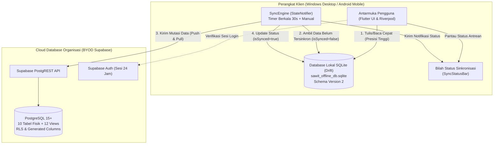
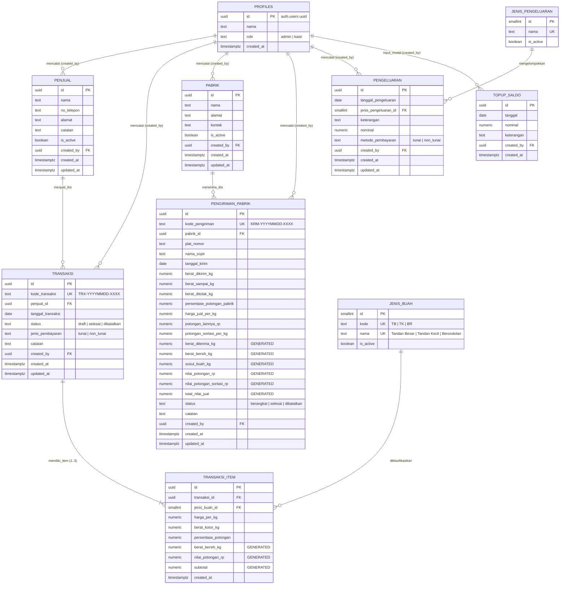

# Desain Database & Arsitektur Data — RamSawit
## Spesifikasi Database Cloud (Supabase PostgreSQL 15+) dan Database Lokal (Drift SQLite)

**Versi:** 2.5.4 (Build 9)  
**Status Skema:** Production Master Schema (Terkonsolidasi Penuh)  
**Tingkat Normalisasi Cloud:** 3NF (Third Normal Form) dengan Kolom Generated Stored  
**Database Cloud:** PostgreSQL 15+ (Supabase Auth, RLS, PostgREST, Trigram `pg_trgm`, UUID `pgcrypto`)  
**Database Lokal:** SQLite 3 via Drift ORM (`sawit_offline_db.sqlite`, Schema Version 2)  
**Engine Sinkronisasi:** Riverpod `SyncEngine` Dua Arah (Background Polling & Antrean Lokal)  

---

## 1. Arsitektur Data Hybrid (Dual-Database)

Aplikasi **RamSawit** beroperasi dengan arsitektur **Hybrid Offline-First**. Penyimpanan primer di perangkat klien menggunakan database lokal SQLite (Drift), sedangkan penyimpanan terpusat dan sinkronisasi lintas perangkat menggunakan database cloud PostgreSQL (Supabase) dengan model isolasi **Bring Your Own Database (BYOD)**.



### Keunggulan Arsitektur:
1. **Zero-Latency Write:** Transaksi penimbangan kasir langsung tersimpan ke SQLite lokal dalam hitungan milidetik tanpa menunggu respon jaringan internet.
2. **Kemandirian Jaringan:** Kasir di area perkebunan sawit terpencil dapat bekerja normal tanpa jaringan internet berhari-hari.
3. **Isolasi Mutlak Finansial (BYOD):** Setiap loading ramp memiliki instance project Supabase independen. Kredensial tidak pernah di-hardcode ke kode sumber, melainkan disimpan terenkripsi di `flutter_secure_storage`.

---

## 2. Diagram Relasi Entitas (ERD Cloud Supabase)

Berikut adalah relasi 10 tabel fisik di Supabase PostgreSQL 15+ (dinormalisasi 3NF):



---

## 3. Skema Fisik Cloud Supabase (PostgreSQL 15+)

Seluruh definisi skrip DDL SQL di bawah ini diambil langsung dari `supabase/master_tenant_schema.sql` (v2.5.4) yang siap dijalankan secara satu langkah (*one-click deploy*) pada setiap instance Supabase baru.

### 3.1 Extensions & Profil Pengguna
```sql
CREATE EXTENSION IF NOT EXISTS "pgcrypto"; -- UUID generator
CREATE EXTENSION IF NOT EXISTS pg_trgm;    -- Trigram search untuk pencarian teks cepat

-- Tabel: profiles (Extends auth.users Supabase)
CREATE TABLE IF NOT EXISTS public.profiles (
    id UUID PRIMARY KEY REFERENCES auth.users(id) ON DELETE CASCADE,
    nama TEXT NOT NULL,
    role TEXT NOT NULL DEFAULT 'kasir' CHECK (role IN ('admin', 'kasir')),
    created_at TIMESTAMPTZ NOT NULL DEFAULT NOW()
);

-- Function & Trigger: Otomatis membuat profile saat registrasi auth.users
CREATE OR REPLACE FUNCTION public.handle_new_user()
RETURNS TRIGGER AS $$
BEGIN
    INSERT INTO public.profiles (id, nama, role)
    VALUES (
        NEW.id,
        COALESCE(NEW.raw_user_meta_data->>'nama', NEW.email),
        COALESCE(NEW.raw_user_meta_data->>'role', 'kasir')
    )
    ON CONFLICT (id) DO NOTHING;
    RETURN NEW;
END;
$$ LANGUAGE plpgsql SECURITY DEFINER;

CREATE TRIGGER on_auth_user_created
    AFTER INSERT ON auth.users
    FOR EACH ROW EXECUTE PROCEDURE public.handle_new_user();

-- Trigger Helper: Auto-update updated_at pada tabel data
CREATE OR REPLACE FUNCTION public.set_updated_at()
RETURNS TRIGGER AS $$
BEGIN
    NEW.updated_at = NOW();
    RETURN NEW;
END;
$$ LANGUAGE plpgsql;
```

### 3.2 Tabel Master Data
```sql
-- Tabel Master: penjual (Petani / Supplier Sawit)
CREATE TABLE IF NOT EXISTS public.penjual (
    id UUID PRIMARY KEY DEFAULT gen_random_uuid(),
    nama TEXT NOT NULL,
    no_telepon TEXT,
    alamat TEXT,
    catatan TEXT,
    is_active BOOLEAN NOT NULL DEFAULT TRUE,
    created_by UUID REFERENCES public.profiles(id),
    created_at TIMESTAMPTZ NOT NULL DEFAULT NOW(),
    updated_at TIMESTAMPTZ NOT NULL DEFAULT NOW()
);
CREATE INDEX IF NOT EXISTS idx_penjual_nama ON public.penjual USING gin (nama gin_trgm_ops);

-- Tabel Master: jenis_buah (Fixed master TBS)
CREATE TABLE IF NOT EXISTS public.jenis_buah (
    id SMALLINT GENERATED ALWAYS AS IDENTITY PRIMARY KEY,
    kode TEXT NOT NULL UNIQUE,
    nama TEXT NOT NULL UNIQUE,
    is_active BOOLEAN NOT NULL DEFAULT TRUE
);
INSERT INTO public.jenis_buah (kode, nama) VALUES
    ('TB', 'Tandan Besar'),
    ('TK', 'Tandan Kecil'),
    ('BR', 'Berondolan')
ON CONFLICT (kode) DO NOTHING;

-- Tabel Master: pabrik (Pabrik Kelapa Sawit / PKS)
CREATE TABLE IF NOT EXISTS public.pabrik (
    id UUID PRIMARY KEY DEFAULT gen_random_uuid(),
    nama TEXT NOT NULL,
    alamat TEXT,
    kontak TEXT,
    is_active BOOLEAN NOT NULL DEFAULT TRUE,
    created_by UUID REFERENCES public.profiles(id),
    created_at TIMESTAMPTZ NOT NULL DEFAULT NOW(),
    updated_at TIMESTAMPTZ NOT NULL DEFAULT NOW()
);
CREATE INDEX IF NOT EXISTS idx_pabrik_nama ON public.pabrik USING gin (nama gin_trgm_ops);

-- Tabel Master: jenis_pengeluaran (Kategori Biaya Operasional)
CREATE TABLE IF NOT EXISTS public.jenis_pengeluaran (
    id SMALLINT GENERATED ALWAYS AS IDENTITY PRIMARY KEY,
    nama TEXT NOT NULL UNIQUE,
    is_active BOOLEAN NOT NULL DEFAULT TRUE
);
INSERT INTO public.jenis_pengeluaran (nama) VALUES
    ('BBM/Transportasi'),
    ('Gaji/Upah'),
    ('Perawatan Kendaraan'),
    ('Operasional Kantor'),
    ('Lain-lain')
ON CONFLICT (nama) DO NOTHING;
```

### 3.3 Tabel Transaksi Pembelian TBS Petani
```sql
-- Tabel Header: transaksi
CREATE TABLE IF NOT EXISTS public.transaksi (
    id UUID PRIMARY KEY DEFAULT gen_random_uuid(),
    kode_transaksi TEXT NOT NULL UNIQUE,
    penjual_id UUID NOT NULL REFERENCES public.penjual(id),
    tanggal_transaksi DATE NOT NULL DEFAULT CURRENT_DATE,
    status TEXT NOT NULL DEFAULT 'selesai' CHECK (status IN ('draft', 'selesai', 'dibatalkan')),
    jenis_pembayaran TEXT NOT NULL DEFAULT 'tunai' CHECK (jenis_pembayaran IN ('tunai', 'non_tunai')),
    catatan TEXT,
    created_by UUID REFERENCES public.profiles(id),
    created_at TIMESTAMPTZ NOT NULL DEFAULT NOW(),
    updated_at TIMESTAMPTZ NOT NULL DEFAULT NOW()
);
CREATE INDEX IF NOT EXISTS idx_transaksi_tanggal ON public.transaksi (tanggal_transaksi DESC);
CREATE INDEX IF NOT EXISTS idx_transaksi_penjual ON public.transaksi (penjual_id);
CREATE INDEX IF NOT EXISTS idx_transaksi_status ON public.transaksi (status);
CREATE INDEX IF NOT EXISTS idx_transaksi_jenis_pembayaran ON public.transaksi (jenis_pembayaran);

-- Trigger: Auto-generate kode transaksi TRX-YYYYMMDD-XXXX
CREATE OR REPLACE FUNCTION public.generate_kode_transaksi()
RETURNS TRIGGER AS $$
DECLARE
    next_seq INT;
    tanggal_str TEXT;
BEGIN
    IF NEW.kode_transaksi IS NULL OR NEW.kode_transaksi = '' THEN
        tanggal_str := TO_CHAR(COALESCE(NEW.tanggal_transaksi, CURRENT_DATE), 'YYYYMMDD');
        SELECT COALESCE(MAX(
            (REGEXP_MATCH(kode_transaksi, 'TRX-' || tanggal_str || '-(\d+)'))[1]::INT
        ), 0) + 1
        INTO next_seq
        FROM public.transaksi
        WHERE kode_transaksi LIKE 'TRX-' || tanggal_str || '-%';

        NEW.kode_transaksi := 'TRX-' || tanggal_str || '-' || LPAD(next_seq::TEXT, 4, '0');
    END IF;
    RETURN NEW;
END;
$$ LANGUAGE plpgsql;

CREATE TRIGGER trg_generate_kode_transaksi
    BEFORE INSERT ON public.transaksi
    FOR EACH ROW EXECUTE PROCEDURE public.generate_kode_transaksi();

-- Tabel Detail: transaksi_item (dengan generated columns)
CREATE TABLE IF NOT EXISTS public.transaksi_item (
    id UUID PRIMARY KEY DEFAULT gen_random_uuid(),
    transaksi_id UUID NOT NULL REFERENCES public.transaksi(id) ON DELETE CASCADE,
    jenis_buah_id SMALLINT NOT NULL REFERENCES public.jenis_buah(id),
    harga_per_kg NUMERIC(12,2) NOT NULL CHECK (harga_per_kg >= 0),
    berat_kotor_kg NUMERIC(10,2) NOT NULL CHECK (berat_kotor_kg > 0),
    persentase_potongan NUMERIC(5,2) NOT NULL DEFAULT 0 CHECK (persentase_potongan >= 0 AND persentase_potongan <= 100),
    
    -- Kolom Turunan Presisi Tinggi (Stored)
    berat_bersih_kg NUMERIC(10,2) GENERATED ALWAYS AS (
        ROUND(berat_kotor_kg * (1 - persentase_potongan / 100), 2)
    ) STORED,
    nilai_potongan_rp NUMERIC(14,2) GENERATED ALWAYS AS (
        ROUND(harga_per_kg * berat_kotor_kg * (persentase_potongan / 100), 2)
    ) STORED,
    subtotal NUMERIC(14,2) GENERATED ALWAYS AS (
        ROUND(harga_per_kg * berat_kotor_kg * (1 - persentase_potongan / 100), 2)
    ) STORED,
    
    created_at TIMESTAMPTZ NOT NULL DEFAULT NOW(),
    UNIQUE (transaksi_id, jenis_buah_id)
);
CREATE INDEX IF NOT EXISTS idx_item_transaksi ON public.transaksi_item (transaksi_id);
```

### 3.4 Tabel Penjualan ke Pabrik (PKS - Alur 2 Fase)
```sql
CREATE TABLE IF NOT EXISTS public.pengiriman_pabrik (
    id UUID PRIMARY KEY DEFAULT gen_random_uuid(),
    kode_pengiriman TEXT NOT NULL UNIQUE,
    pabrik_id UUID NOT NULL REFERENCES public.pabrik(id),
    plat_nomor TEXT NOT NULL,
    nama_sopir TEXT NOT NULL,
    tanggal_kirim DATE NOT NULL DEFAULT CURRENT_DATE,

    -- Fase 1: Data Pengiriman Ramp
    berat_dikirim_kg NUMERIC(10,2) NOT NULL CHECK (berat_dikirim_kg > 0),

    -- Fase 2: Hasil Timbangan & Slip PKS
    berat_sampai_kg NUMERIC(10,2) CHECK (berat_sampai_kg IS NULL OR berat_sampai_kg > 0),
    berat_ditolak_kg NUMERIC(10,2) CHECK (berat_ditolak_kg IS NULL OR berat_ditolak_kg >= 0),
    persentase_potongan_pabrik NUMERIC(5,2) CHECK (persentase_potongan_pabrik IS NULL OR (persentase_potongan_pabrik >= 0 AND persentase_potongan_pabrik <= 100)),
    harga_jual_per_kg NUMERIC(12,2) CHECK (harga_jual_per_kg IS NULL OR harga_jual_per_kg >= 0),
    potongan_lainnya_rp NUMERIC(14,2) CHECK (potongan_lainnya_rp IS NULL OR potongan_lainnya_rp >= 0),
    potongan_sortasi_per_kg NUMERIC(12,2) CHECK (potongan_sortasi_per_kg IS NULL OR potongan_sortasi_per_kg >= 0),

    -- Kolom Turunan Otomatis (Stored)
    berat_diterima_kg NUMERIC(10,2) GENERATED ALWAYS AS (
        ROUND(berat_sampai_kg - berat_ditolak_kg, 2)
    ) STORED,

    berat_bersih_kg NUMERIC(10,2) GENERATED ALWAYS AS (
        ROUND((berat_sampai_kg - berat_ditolak_kg) * (1 - persentase_potongan_pabrik / 100), 2)
    ) STORED,

    susut_buah_kg NUMERIC(10,2) GENERATED ALWAYS AS (
        ROUND(berat_dikirim_kg - berat_sampai_kg, 2)
    ) STORED,

    nilai_potongan_rp NUMERIC(14,2) GENERATED ALWAYS AS (
        ROUND(harga_jual_per_kg * (berat_sampai_kg - berat_ditolak_kg) * persentase_potongan_pabrik / 100, 2)
    ) STORED,

    nilai_potongan_sortasi_rp NUMERIC(14,2) GENERATED ALWAYS AS (
        ROUND(COALESCE(potongan_sortasi_per_kg, 0) * berat_sampai_kg, 2)
    ) STORED,

    total_nilai_jual NUMERIC(14,2) GENERATED ALWAYS AS (
        ROUND(
            harga_jual_per_kg * (berat_sampai_kg - berat_ditolak_kg) * (1 - persentase_potongan_pabrik / 100)
            - COALESCE(potongan_lainnya_rp, 0)
            - ROUND(COALESCE(potongan_sortasi_per_kg, 0) * berat_sampai_kg, 2)
        , 2)
    ) STORED,

    status TEXT NOT NULL DEFAULT 'berangkat' CHECK (status IN ('berangkat', 'selesai', 'dibatalkan')),
    catatan TEXT,
    created_by UUID REFERENCES public.profiles(id),
    created_at TIMESTAMPTZ NOT NULL DEFAULT NOW(),
    updated_at TIMESTAMPTZ NOT NULL DEFAULT NOW(),

    CONSTRAINT pengiriman_pabrik_ditolak_lte_sampai_check
        CHECK (berat_sampai_kg IS NULL OR berat_ditolak_kg IS NULL OR berat_ditolak_kg <= berat_sampai_kg)
);
CREATE INDEX IF NOT EXISTS idx_pengiriman_tanggal ON public.pengiriman_pabrik (tanggal_kirim DESC);
CREATE INDEX IF NOT EXISTS idx_pengiriman_pabrik ON public.pengiriman_pabrik (pabrik_id);
CREATE INDEX IF NOT EXISTS idx_pengiriman_status ON public.pengiriman_pabrik (status);

-- Trigger: Auto-generate kode pengiriman KRM-YYYYMMDD-XXXX
CREATE OR REPLACE FUNCTION public.generate_kode_pengiriman()
RETURNS TRIGGER AS $$
DECLARE
    next_seq INT;
    tanggal_str TEXT;
BEGIN
    IF NEW.kode_pengiriman IS NULL OR NEW.kode_pengiriman = '' THEN
        tanggal_str := TO_CHAR(COALESCE(NEW.tanggal_kirim, CURRENT_DATE), 'YYYYMMDD');
        SELECT COALESCE(MAX(
            (REGEXP_MATCH(kode_pengiriman, 'KRM-' || tanggal_str || '-(\d+)'))[1]::INT
        ), 0) + 1
        INTO next_seq
        FROM public.pengiriman_pabrik
        WHERE kode_pengiriman LIKE 'KRM-' || tanggal_str || '-%';

        NEW.kode_pengiriman := 'KRM-' || tanggal_str || '-' || LPAD(next_seq::TEXT, 4, '0');
    END IF;
    RETURN NEW;
END;
$$ LANGUAGE plpgsql;

CREATE TRIGGER trg_generate_kode_pengiriman
    BEFORE INSERT ON public.pengiriman_pabrik
    FOR EACH ROW EXECUTE PROCEDURE public.generate_kode_pengiriman();
```

### 3.5 Tabel Pengeluaran Operasional & Modal Kas
```sql
-- Tabel: pengeluaran
CREATE TABLE IF NOT EXISTS public.pengeluaran (
    id UUID PRIMARY KEY DEFAULT gen_random_uuid(),
    tanggal_pengeluaran DATE NOT NULL DEFAULT CURRENT_DATE,
    jenis_pengeluaran_id SMALLINT NOT NULL REFERENCES public.jenis_pengeluaran(id),
    keterangan TEXT,
    nominal NUMERIC(14,2) NOT NULL CHECK (nominal > 0),
    metode_pembayaran TEXT NOT NULL DEFAULT 'tunai' CHECK (metode_pembayaran IN ('tunai', 'non_tunai')),
    created_by UUID REFERENCES public.profiles(id),
    created_at TIMESTAMPTZ NOT NULL DEFAULT NOW(),
    updated_at TIMESTAMPTZ NOT NULL DEFAULT NOW()
);
CREATE INDEX IF NOT EXISTS idx_pengeluaran_tanggal ON public.pengeluaran (tanggal_pengeluaran DESC);
CREATE INDEX IF NOT EXISTS idx_pengeluaran_metode_pembayaran ON public.pengeluaran (metode_pembayaran);

-- Tabel: topup_saldo (Dana Modal Kas Ramp)
CREATE TABLE IF NOT EXISTS public.topup_saldo (
    id UUID PRIMARY KEY DEFAULT gen_random_uuid(),
    tanggal DATE NOT NULL DEFAULT CURRENT_DATE,
    nominal NUMERIC(14,2) NOT NULL CHECK (nominal > 0),
    keterangan TEXT,
    created_by UUID REFERENCES public.profiles(id),
    created_at TIMESTAMPTZ NOT NULL DEFAULT NOW()
);
CREATE INDEX IF NOT EXISTS idx_topup_saldo_tanggal ON public.topup_saldo (tanggal DESC);
```

---

## 4. Spesifikasi 12 Views Analitik & Pelaporan Cloud

Views SQL ini menyajikan *Single Source of Truth* untuk Dashboard, Rekonsiliasi Saldo, dan Ekspor Laporan tanpa beban kalkulasi di sisi Flutter:

| No | Nama View | Deskripsi & Fungsi Bisnis |
|---|---|---|
| 1 | `v_transaksi_ringkasan` | Ringkasan header transaksi pembelian: berat kotor, bersih, potongan kg/rp, total nilai rupiah, dan badge `jenis_pembayaran`. |
| 2 | `v_transaksi_harian` | Agregasi harian transaksi pembelian berstatus `selesai` untuk grafik tren tonase dan nilai. |
| 3 | `v_breakdown_jenis_buah` | Distribusi tonase dan nilai rupiah per jenis buah (TB, TK, BR) harian untuk pie chart dashboard. |
| 4 | `v_pengiriman_ringkasan` | Join lengkap nota pengiriman pabrik dengan data nama pabrik tujuan. |
| 5 | `v_pengiriman_harian` | Tren penjualan pabrik harian berstatus `selesai` (tonase kirim, diterima, susut, nilai jual). |
| 6 | `v_breakdown_pabrik` | Distribusi penjualan tonase dan rupiah per pabrik PKS tujuan. |
| 7 | `v_margin_harian` | Margin kotor harian: $\text{Total Penjualan Pabrik} - \text{Total Pembelian Petani}$ (Full Outer Join). |
| 8 | `v_pengeluaran_harian` | Rekapitulasi harian total nominal pengeluaran operasional dan jumlah nota. |
| 9 | `v_breakdown_jenis_pengeluaran` | Distribusi pengeluaran per kategori biaya operasional untuk pie chart Admin. |
| 10 | `v_laba_bersih_harian` | Laba bersih harian: $\text{Margin Kotor} - \text{Total Pengeluaran Operasional}$. |
| 11 | `v_saldo_ringkasan` | **Single-row view Sisa Saldo Kas Modal**: $\sum \text{Top Up} - \sum \text{Pembelian TUNAI selesai}$. |
| 12 | `v_transaksi_non_tunai_harian` | Rekapitulasi transaksi non-tunai (transfer bank) untuk monitoring terpisah dari kas fisik. |

### DDL Lengkap 12 Views:
```sql
-- 1. v_transaksi_ringkasan
CREATE VIEW public.v_transaksi_ringkasan AS
SELECT
    t.id,
    t.kode_transaksi,
    t.tanggal_transaksi,
    t.status,
    p.id AS penjual_id,
    p.nama AS nama_penjual,
    COALESCE(SUM(ti.berat_kotor_kg), 0)::NUMERIC(10,2) AS total_berat_kotor_kg,
    COALESCE(SUM(ti.berat_bersih_kg), 0)::NUMERIC(10,2) AS total_berat_bersih_kg,
    COALESCE(SUM(ti.nilai_potongan_rp), 0)::NUMERIC(14,2) AS total_potongan_rp,
    COALESCE(SUM(ti.subtotal), 0)::NUMERIC(14,2) AS total_nilai,
    t.created_at,
    t.jenis_pembayaran
FROM public.transaksi t
JOIN public.penjual p ON p.id = t.penjual_id
LEFT JOIN public.transaksi_item ti ON ti.transaksi_id = t.id
GROUP BY t.id, t.kode_transaksi, t.tanggal_transaksi, t.status, p.id, p.nama, t.created_at, t.jenis_pembayaran;

-- 2. v_transaksi_harian
CREATE VIEW public.v_transaksi_harian AS
SELECT
    tanggal_transaksi,
    COUNT(DISTINCT id)::INT AS jumlah_transaksi,
    SUM(total_berat_kotor_kg)::NUMERIC(10,2) AS total_berat_kotor_kg,
    SUM(total_berat_bersih_kg)::NUMERIC(10,2) AS total_berat_bersih_kg,
    SUM(total_potongan_rp)::NUMERIC(14,2) AS total_potongan_rp,
    SUM(total_nilai)::NUMERIC(14,2) AS total_nilai
FROM public.v_transaksi_ringkasan
WHERE status = 'selesai'
GROUP BY tanggal_transaksi
ORDER BY tanggal_transaksi;

-- 3. v_breakdown_jenis_buah
CREATE VIEW public.v_breakdown_jenis_buah AS
SELECT
    jb.nama AS jenis_buah,
    DATE_TRUNC('day', t.tanggal_transaksi)::DATE AS tanggal,
    SUM(ti.berat_kotor_kg)::NUMERIC(10,2) AS total_berat_kotor_kg,
    SUM(ti.berat_bersih_kg)::NUMERIC(10,2) AS total_berat_bersih_kg,
    SUM(ti.subtotal)::NUMERIC(14,2) AS total_nilai
FROM public.transaksi_item ti
JOIN public.transaksi t ON t.id = ti.transaksi_id
JOIN public.jenis_buah jb ON jb.id = ti.jenis_buah_id
WHERE t.status = 'selesai'
GROUP BY jb.nama, DATE_TRUNC('day', t.tanggal_transaksi)::DATE;

-- 4. v_pengiriman_ringkasan
CREATE VIEW public.v_pengiriman_ringkasan AS
SELECT
    pp.id,
    pp.kode_pengiriman,
    pp.tanggal_kirim,
    pp.status,
    pb.id AS pabrik_id,
    pb.nama AS nama_pabrik,
    pp.plat_nomor,
    pp.nama_sopir,
    pp.berat_dikirim_kg,
    pp.berat_sampai_kg,
    pp.berat_ditolak_kg,
    pp.berat_diterima_kg,
    pp.persentase_potongan_pabrik,
    pp.berat_bersih_kg,
    pp.susut_buah_kg,
    pp.harga_jual_per_kg,
    pp.nilai_potongan_rp,
    pp.potongan_lainnya_rp,
    pp.potongan_sortasi_per_kg,
    pp.nilai_potongan_sortasi_rp,
    pp.total_nilai_jual,
    pp.created_at
FROM public.pengiriman_pabrik pp
JOIN public.pabrik pb ON pb.id = pp.pabrik_id;

-- 5. v_pengiriman_harian
CREATE VIEW public.v_pengiriman_harian AS
SELECT
    tanggal_kirim,
    COUNT(DISTINCT id)::INT AS jumlah_pengiriman,
    SUM(berat_dikirim_kg)::NUMERIC(10,2) AS total_berat_dikirim_kg,
    SUM(berat_ditolak_kg)::NUMERIC(10,2) AS total_berat_ditolak_kg,
    SUM(berat_bersih_kg)::NUMERIC(10,2) AS total_berat_bersih_kg,
    SUM(susut_buah_kg)::NUMERIC(10,2) AS total_susut_buah_kg,
    SUM(nilai_potongan_rp)::NUMERIC(14,2) AS total_potongan_rp,
    SUM(total_nilai_jual)::NUMERIC(14,2) AS total_nilai_jual
FROM public.v_pengiriman_ringkasan
WHERE status = 'selesai'
GROUP BY tanggal_kirim
ORDER BY tanggal_kirim;

-- 6. v_breakdown_pabrik
CREATE VIEW public.v_breakdown_pabrik AS
SELECT
    pb.nama AS nama_pabrik,
    DATE_TRUNC('day', pp.tanggal_kirim)::DATE AS tanggal,
    SUM(pp.berat_dikirim_kg)::NUMERIC(10,2) AS total_berat_dikirim_kg,
    SUM(pp.berat_dikirim_kg)::NUMERIC(10,2) AS total_berat_kotor_kg,
    SUM(pp.berat_bersih_kg)::NUMERIC(10,2) AS total_berat_bersih_kg,
    SUM(pp.total_nilai_jual)::NUMERIC(14,2) AS total_nilai_jual
FROM public.pengiriman_pabrik pp
JOIN public.pabrik pb ON pb.id = pp.pabrik_id
WHERE pp.status = 'selesai'
GROUP BY pb.nama, DATE_TRUNC('day', pp.tanggal_kirim)::DATE;

-- 7. v_margin_harian
CREATE VIEW public.v_margin_harian AS
SELECT
    COALESCE(t.tanggal_transaksi, p.tanggal_kirim) AS tanggal,
    COALESCE(t.total_nilai, 0)::NUMERIC(14,2) AS total_pembelian,
    COALESCE(p.total_nilai_jual, 0)::NUMERIC(14,2) AS total_penjualan,
    (COALESCE(p.total_nilai_jual, 0) - COALESCE(t.total_nilai, 0))::NUMERIC(14,2) AS margin
FROM public.v_transaksi_harian t
FULL OUTER JOIN public.v_pengiriman_harian p ON p.tanggal_kirim = t.tanggal_transaksi
ORDER BY tanggal;

-- 8. v_pengeluaran_harian
CREATE VIEW public.v_pengeluaran_harian AS
SELECT
    tanggal_pengeluaran AS tanggal,
    COALESCE(SUM(nominal), 0)::NUMERIC(14,2) AS total_pengeluaran,
    COUNT(*)::INT AS jumlah_transaksi_pengeluaran
FROM public.pengeluaran
GROUP BY tanggal_pengeluaran;

-- 9. v_breakdown_jenis_pengeluaran
CREATE VIEW public.v_breakdown_jenis_pengeluaran AS
SELECT
    jp.nama AS jenis_pengeluaran,
    p.tanggal_pengeluaran AS tanggal,
    COALESCE(SUM(p.nominal), 0)::NUMERIC(14,2) AS total_nominal
FROM public.pengeluaran p
JOIN public.jenis_pengeluaran jp ON jp.id = p.jenis_pengeluaran_id
GROUP BY jp.nama, p.tanggal_pengeluaran;

-- 10. v_laba_bersih_harian
CREATE VIEW public.v_laba_bersih_harian AS
SELECT
    COALESCE(m.tanggal, p.tanggal) AS tanggal,
    COALESCE(m.total_pembelian, 0)::NUMERIC(14,2) AS total_pembelian,
    COALESCE(m.total_penjualan, 0)::NUMERIC(14,2) AS total_penjualan,
    COALESCE(m.margin, 0)::NUMERIC(14,2) AS margin,
    COALESCE(p.total_pengeluaran, 0)::NUMERIC(14,2) AS total_pengeluaran,
    (COALESCE(m.margin, 0) - COALESCE(p.total_pengeluaran, 0))::NUMERIC(14,2) AS laba_bersih
FROM public.v_margin_harian m
FULL OUTER JOIN public.v_pengeluaran_harian p ON m.tanggal = p.tanggal;

-- 11. v_saldo_ringkasan (Pemakaian Kas HANYA dari Transaksi Pembelian TUNAI)
CREATE VIEW public.v_saldo_ringkasan AS
SELECT
    (SELECT COALESCE(SUM(nominal), 0)::NUMERIC(14,2) FROM public.topup_saldo) AS total_topup,
    (SELECT COALESCE(SUM(total_nilai), 0)::NUMERIC(14,2)
       FROM public.v_transaksi_ringkasan
       WHERE status = 'selesai' AND jenis_pembayaran = 'tunai') AS total_pemakaian,
    (SELECT COALESCE(SUM(nominal), 0)::NUMERIC(14,2) FROM public.topup_saldo)
      - (SELECT COALESCE(SUM(total_nilai), 0)::NUMERIC(14,2)
           FROM public.v_transaksi_ringkasan
           WHERE status = 'selesai' AND jenis_pembayaran = 'tunai') AS sisa_saldo;

-- 12. v_transaksi_non_tunai_harian
CREATE VIEW public.v_transaksi_non_tunai_harian AS
SELECT
    tanggal_transaksi AS tanggal,
    COUNT(DISTINCT id)::INT AS jumlah_transaksi,
    SUM(total_nilai)::NUMERIC(14,2) AS total_nilai
FROM public.v_transaksi_ringkasan
WHERE status = 'selesai' AND jenis_pembayaran = 'non_tunai'
GROUP BY tanggal_transaksi
ORDER BY tanggal_transaksi;
```

---

## 5. Keamanan Row Level Security (RLS) & Hak Akses API

Seluruh tabel di cloud Supabase dilindungi RLS policies untuk membedakan hak akses `admin` vs `kasir`:

```sql
ALTER TABLE public.profiles ENABLE ROW LEVEL SECURITY;
ALTER TABLE public.penjual ENABLE ROW LEVEL SECURITY;
ALTER TABLE public.jenis_buah ENABLE ROW LEVEL SECURITY;
ALTER TABLE public.pabrik ENABLE ROW LEVEL SECURITY;
ALTER TABLE public.pengiriman_pabrik ENABLE ROW LEVEL SECURITY;
ALTER TABLE public.jenis_pengeluaran ENABLE ROW LEVEL SECURITY;
ALTER TABLE public.pengeluaran ENABLE ROW LEVEL SECURITY;
ALTER TABLE public.topup_saldo ENABLE ROW LEVEL SECURITY;
ALTER TABLE public.transaksi ENABLE ROW LEVEL SECURITY;
ALTER TABLE public.transaksi_item ENABLE ROW LEVEL SECURITY;

-- Policy Profiles: Semua user login boleh membaca profile
CREATE POLICY "authenticated read profiles" ON public.profiles
    FOR SELECT TO authenticated USING (TRUE);

-- Policy Penjual: Semua user login boleh membaca & menulis
CREATE POLICY "authenticated all penjual" ON public.penjual
    FOR ALL TO authenticated USING (TRUE) WITH CHECK (TRUE);

-- Policy Jenis Buah: Read semua, Insert/Update hanya Admin
CREATE POLICY "authenticated read jenis_buah" ON public.jenis_buah
    FOR SELECT TO authenticated USING (TRUE);

CREATE POLICY "admin manage jenis_buah" ON public.jenis_buah
    FOR INSERT TO authenticated WITH CHECK (
        EXISTS (SELECT 1 FROM public.profiles WHERE id = auth.uid() AND role = 'admin')
        OR (auth.jwt() -> 'user_metadata' ->> 'role') = 'admin'
        OR (auth.jwt() ->> 'email') ILIKE '%admin%'
    );

-- Policy Pabrik: Read & Write untuk user login
CREATE POLICY "authenticated read pabrik" ON public.pabrik
    FOR SELECT TO authenticated USING (TRUE);

CREATE POLICY "authenticated write pabrik" ON public.pabrik
    FOR INSERT TO authenticated WITH CHECK (TRUE);

CREATE POLICY "authenticated update pabrik" ON public.pabrik
    FOR UPDATE TO authenticated USING (TRUE);

-- Policy Pengiriman Pabrik: Full akses operasional
CREATE POLICY "authenticated all pengiriman_pabrik" ON public.pengiriman_pabrik
    FOR ALL TO authenticated USING (TRUE) WITH CHECK (TRUE);

-- Policy Jenis Pengeluaran: Read semua, Kelola kategori HANYA Admin
CREATE POLICY "authenticated read jenis_pengeluaran" ON public.jenis_pengeluaran
    FOR SELECT TO authenticated USING (TRUE);

CREATE POLICY "admin manage jenis_pengeluaran" ON public.jenis_pengeluaran
    FOR INSERT TO authenticated WITH CHECK (
        EXISTS (SELECT 1 FROM public.profiles WHERE id = auth.uid() AND role = 'admin')
        OR (auth.jwt() -> 'user_metadata' ->> 'role') = 'admin'
        OR (auth.jwt() ->> 'email') ILIKE '%admin%'
    );

CREATE POLICY "admin update jenis_pengeluaran" ON public.jenis_pengeluaran
    FOR UPDATE TO authenticated USING (
        EXISTS (SELECT 1 FROM public.profiles WHERE id = auth.uid() AND role = 'admin')
        OR (auth.jwt() -> 'user_metadata' ->> 'role') = 'admin'
        OR (auth.jwt() ->> 'email') ILIKE '%admin%'
    );

-- Policy Pengeluaran: Semua user login boleh mencatat operasional
CREATE POLICY "authenticated all pengeluaran" ON public.pengeluaran
    FOR ALL TO authenticated USING (TRUE) WITH CHECK (TRUE);

-- Policy Topup Saldo: HANYA Admin yang boleh melihat & mencatat modal
CREATE POLICY "admin read topup_saldo" ON public.topup_saldo
    FOR SELECT TO authenticated USING (
        EXISTS (SELECT 1 FROM public.profiles WHERE id = auth.uid() AND role = 'admin')
        OR (auth.jwt() -> 'user_metadata' ->> 'role') = 'admin'
        OR (auth.jwt() ->> 'email') ILIKE '%admin%'
    );

CREATE POLICY "admin insert topup_saldo" ON public.topup_saldo
    FOR INSERT TO authenticated WITH CHECK (
        EXISTS (SELECT 1 FROM public.profiles WHERE id = auth.uid() AND role = 'admin')
        OR (auth.jwt() -> 'user_metadata' ->> 'role') = 'admin'
        OR (auth.jwt() ->> 'email') ILIKE '%admin%'
    );

CREATE POLICY "admin update topup_saldo" ON public.topup_saldo
    FOR UPDATE TO authenticated USING (
        EXISTS (SELECT 1 FROM public.profiles WHERE id = auth.uid() AND role = 'admin')
        OR (auth.jwt() -> 'user_metadata' ->> 'role') = 'admin'
        OR (auth.jwt() ->> 'email') ILIKE '%admin%'
    );

CREATE POLICY "admin delete topup_saldo" ON public.topup_saldo
    FOR DELETE TO authenticated USING (
        EXISTS (SELECT 1 FROM public.profiles WHERE id = auth.uid() AND role = 'admin')
        OR (auth.jwt() -> 'user_metadata' ->> 'role') = 'admin'
        OR (auth.jwt() ->> 'email') ILIKE '%admin%'
    );

-- Policy Transaksi & Transaksi Item: Full akses operasional
CREATE POLICY "authenticated all transaksi" ON public.transaksi
    FOR ALL TO authenticated USING (TRUE) WITH CHECK (TRUE);

CREATE POLICY "authenticated all transaksi_item" ON public.transaksi_item
    FOR ALL TO authenticated USING (TRUE) WITH CHECK (TRUE);

-- Hak Akses PostgREST (Grants)
GRANT ALL ON ALL TABLES IN SCHEMA public TO authenticated;
GRANT ALL ON ALL SEQUENCES IN SCHEMA public TO authenticated;
GRANT ALL ON ALL ROUTINES IN SCHEMA public TO authenticated;

GRANT SELECT ON ALL TABLES IN SCHEMA public TO anon;
GRANT SELECT ON ALL SEQUENCES IN SCHEMA public TO anon;

NOTIFY pgrst, 'reload schema';
```

---

## 6. Skema Database Lokal Drift SQLite (`sawit_offline_db.sqlite`)

Database lokal dikelola melalui Drift ORM (`lib/core/database/tables.dart` & `app_database.dart`), dengan `schemaVersion = 2`.

### 6.1 Mixin Kolom Sinkronisasi (`SyncColumns`)
Seluruh tabel lokal mengimplementasikan `SyncColumns`:
```dart
mixin SyncColumns on Table {
  /// Flag status sinkronisasi: false = menunggu kirim, true = sudah ada di cloud
  BoolColumn get isSynced => boolean().withDefault(const Constant(false))();

  /// Identitas perangkat (misal: 'MOB-xxxx' atau 'DSK-xxxx')
  TextColumn get deviceId => text().nullable()();

  /// Timestamp mutasi lokal terakhir
  DateTimeColumn get localUpdatedAt => dateTime().withDefault(currentDateAndTime)();

  /// Soft delete flag untuk sinkronisasi penghapusan ke cloud
  DateTimeColumn get deletedAt => dateTime().nullable()();
}
```

### 6.2 Daftar 9 Tabel Lokal Drift
1. `LocalPenjual` (`id`, `nama`, `noTelepon`, `alamat`, `catatan`, `isActive`, `createdBy`, `createdAt`, `updatedAt`)
2. `LocalJenisBuah` (`id`, `kode`, `nama`, `isActive`)
3. `LocalPabrik` (`id`, `nama`, `lokasi`, `kontak`, `isActive`, `createdAt`, `updatedAt`)
4. `LocalJenisPengeluaran` (`id`, `nama`, `isActive`)
5. `LocalTransaksi` (`id`, `kodeTransaksi`, `penjualId`, `tanggalTransaksi`, `status`, `alasanBatal`, `jenisPembayaran`, `catatan`, `createdBy`, `createdAt`, `updatedAt`)
6. `LocalTransaksiItem` (`id`, `transaksiId`, `jenisBuahId`, `hargaPerKg`, `beratKg`, `beratKotorKg`, `persenPotongan`, `nilaiPotonganKg`, `subtotal`, `createdAt`) — Nilai finansial disimpan sebagai `String` berbasis `Decimal`.
7. `LocalPengirimanPabrik` (`id`, `noSpb`, `pabrikId`, `tanggalKirim`, `noKendaraan`, `namaSupir`, `status`, `beratKirimKg`, `beratTimbangPabrikKg`, `toleransiSusutPersen`, `hargaPerKg`, `potonganSortasiPersen`, `potonganSortasiKg`, `potonganLainnyaNominal`, `catatanPotonganLainnya`, `totalNilaiPenjualan`, `createdBy`, `createdAt`, `updatedAt`)
8. `LocalPengeluaran` (`id`, `jenisPengeluaranId`, `nominal`, `tanggal`, `keterangan`, `metodePembayaran`, `status`, `alasanBatal`, `createdBy`, `createdAt`, `updatedAt`)
9. `LocalTopupSaldo` (`id`, `nominal`, `tanggal`, `keterangan`, `status`, `alasanBatal`, `createdBy`, `createdAt`, `updatedAt`)

### 6.3 Strategi Migrasi Drift (`schemaVersion = 2`)
```dart
@override
int get schemaVersion => 2;

@override
MigrationStrategy get migration => MigrationStrategy(
  onCreate: (m) async {
    await m.createAll();
  },
  onUpgrade: (m, from, to) async {
    if (from < 2) {
      // Migrasi v1 -> v2: Penambahan kolom metodePembayaran pada tabel pengeluaran
      await m.addColumn(localPengeluaran, localPengeluaran.metodePembayaran);
    }
  },
);
```

---

## 7. Arsitektur Sinkronisasi Dua Arah (`SyncEngine`)

`SyncEngine` (`lib/core/sync/sync_engine.dart`) adalah StateNotifier Riverpod yang mengelola siklus hidup sinkronisasi:

1. **Pendeteksian Antrean Lokal:**  
   Metode `refreshUnsyncedCount()` menghitung total baris pada tabel `LocalTransaksi`, `LocalPengirimanPabrik`, `LocalPengeluaran`, dan `LocalTopupSaldo` yang memiliki `isSynced = false`.
2. **Periodic Background Polling:**  
   Metode `startPeriodicSync()` mengaktifkan timer berkala setiap 30 detik untuk mengeksekusi `syncNow()`.
3. **Mekanisme Eksekusi `syncNow()`:**
   - Cek ketersediaan konfigurasi `SupabaseConfig.isConfigured` dan konektivitas. Jika tidak ada koneksi, status berubah menjadi `SyncStatus.offline`.
   - Mengambil seluruh baris pending `isSynced = false`.
   - Mengirim mutasi data ke Supabase REST endpoint secara atomic.
   - Setelah server mengembalikan respon 200/201 OK, memanggil `markTransaksiSynced(id)` untuk mengubah `isSynced = true` di SQLite lokal.
4. **Indikator `SyncStatusBar`:**  
   Menyajikan visual status: Hijau (*Tersinkron Penuh*), Biru Animasi (*Menyinkronkan [n] item...*), Oranye (*Mode Offline - [n] antrean*), dan Merah (*Gagal Sinkron* dengan tombol manual retry).

---

## 8. Panduan Deployment Basis Data Tenant Baru (BYOD)

Untuk mendaftarkan organisasi / loading ramp baru:
1. Buat project baru di [https://supabase.com](https://supabase.com).
2. Buka menu **SQL Editor** di sidebar Supabase.
3. Buka berkas `supabase/master_tenant_schema.sql`, salin seluruh kodenya, tempelkan di SQL Editor, lalu klik tombol **Run**.
4. Di menu **Project Settings -> API**, salin:
   - **Project URL** (`https://xxxx.supabase.co`)
   - **anon public key** (`eyJh...`)
5. Buka aplikasi RamSawit (Windows Desktop / Android Mobile), pilih **Setup Organisasi & Database**, masukkan URL dan Anon Key tersebut, lalu simpan.
6. Buat user admin/kasir pertama di menu **Authentication -> Users**, dan aplikasi siap dipakai!
