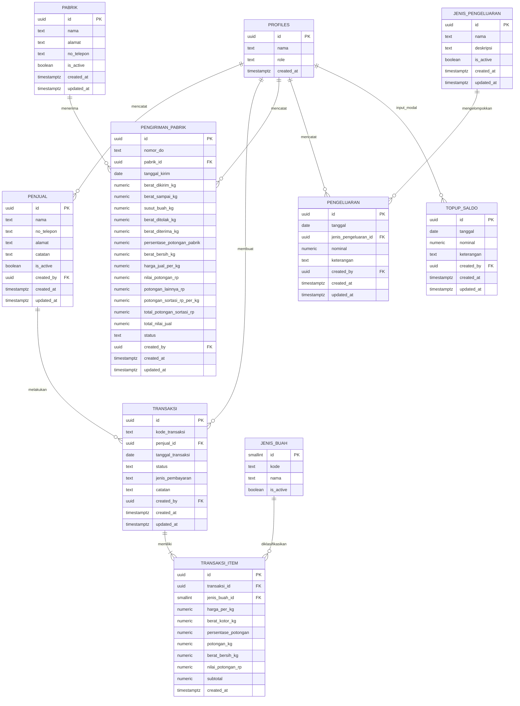

# PRD & Desain Database
## Aplikasi Pencatatan Transaksi Jual Beli Buah Kelapa Sawit

**Versi:** 1.0
**Stack:** Flutter (Mobile + Web) + Supabase (PostgreSQL, Auth, Realtime)
**Dokumen ini disiapkan sebagai acuan bagi AI Coding Agent untuk membangun sistem end-to-end.**

---

## 1. Ringkasan Proyek

Aplikasi internal untuk mencatat transaksi pembelian buah kelapa sawit dari penjual (petani/pengepul). Setiap transaksi dapat berisi kombinasi tiga jenis buah: **Tandan Besar**, **Tandan Kecil**, dan **Berondolan**, di mana harga per kg dan berat masing-masing jenis diinput manual saat transaksi berlangsung (harga tidak tetap/fluktuatif harian). Aplikasi menyediakan dashboard ringkasan dan grafik transaksi.

## 2. Tujuan

- Mendigitalkan pencatatan transaksi yang sebelumnya manual (buku/nota).
- Menghitung otomatis subtotal & total transaksi berdasarkan berat × harga/kg.
- Memberi visibilitas melalui dashboard (grafik & data transaksi terakhir).
- Dapat diakses lintas platform: aplikasi mobile (Android/iOS) dan web (laptop) dari satu basis kode Flutter.

## 3. Target Pengguna & Role

| Role | Deskripsi | Hak Akses |
|---|---|---|
| **Admin** | Pemilik usaha / penanggung jawab | Full akses: kelola penjual, kelola transaksi, kelola user, lihat dashboard |
| **Kasir / Operator** | Petugas input transaksi harian | Input & lihat transaksi, kelola penjual, lihat dashboard (tanpa kelola user) |

> Catatan: skema DB sudah mendukung multi-role. Jika di v1 hanya ada 1 user, role tetap disiapkan untuk pengembangan berikutnya.

## 4. Tech Stack

- **Frontend:** Flutter (target: Android, iOS, Web, Windows Desktop Native `.exe`) — satu codebase, responsive layout (mobile & desktop).
- **Backend/DB:** Supabase (PostgreSQL, Auth, Row Level Security, Realtime) & Drift (SQLite offline-first hybrid).
- **Offline Sync & Status:** Riverpod StateNotifier `SyncEngine` dua arah, background periodic polling, antrean lokal, dan bilah status interaktif `SyncStatusBar`.
- **Platform Targets:** Web Responsive, Windows Desktop Native (.exe x64), Android Native (.apk).
- **State management:** disarankan Riverpod atau Bloc (pilihan agent, konsisten di seluruh app).
- **Chart library Flutter:** `fl_chart` atau `syncfusion_flutter_charts`.

## 5. Ruang Lingkup

### 5.1 In Scope (v1)
- Login (Supabase Auth — email/password).
- CRUD data penjual.
- Input transaksi multi-item (1 transaksi bisa berisi 1–3 jenis buah).
- Riwayat transaksi + filter (tanggal, penjual, jenis buah).
- Edit/void transaksi (dengan audit sederhana).
- Dashboard: total transaksi hari ini/minggu/bulan, grafik tren, breakdown per jenis buah, list transaksi terakhir.

### 5.2 Out of Scope (v1)
- Manajemen stok gudang/pabrik.
- Integrasi pembayaran/perbankan.
- Cetak nota fisik (bisa jadi enhancement).
- Multi-cabang/lokasi (skema disiapkan agar mudah ditambah, tapi UI belum wajib).

## 6. Alur Pengguna (User Flow)

1. User login → masuk ke **Dashboard**.
2. User membuka menu **Transaksi Baru** → pilih/cari **Penjual** (atau tambah penjual baru inline).
3. User menambahkan item transaksi: pilih **jenis buah** (Tandan Besar/Kecil/Berondolan), isi **harga per kg**, isi **berat (kg)** → subtotal muncul otomatis.
4. User bisa menambah lebih dari satu jenis buah dalam transaksi yang sama.
5. Sistem menampilkan **total berat** & **total harga** otomatis.
6. User simpan → transaksi tercatat dengan kode unik & timestamp.
7. Dashboard & riwayat ter-update (realtime/refresh).

## 7. Daftar Fitur & Functional Requirements

### 7.1 Autentikasi
- FR-1.1: Login via email & password (Supabase Auth).
- FR-1.2: *(Diperbarui)* Sesi login berlaku maksimal **24 jam sejak login terakhir**, bukan tersimpan tanpa batas waktu. Setelah 24 jam terlampaui, sesi otomatis berakhir dan user diarahkan ke halaman login, terlepas dari apakah refresh token dari Supabase Auth secara teknis masih valid atau tidak.
- FR-1.3: Role user (admin/kasir) menentukan menu yang tampil dan cakupan data yang bisa dilihat di Dashboard (lihat §7.5).
- FR-1.4 *(baru)*: Pengecekan usia sesi (FR-1.2) dilakukan saat aplikasi dibuka/di-refresh, DAN secara berkala selama aplikasi terbuka (bukan hanya sekali saat login) — supaya sesi yang sudah lewat 24 jam tetap ter-logout meskipun tab/aplikasi tidak ditutup-buka ulang.

### 7.2 Manajemen Data Penjual
- FR-2.1: Tambah, edit, nonaktifkan (soft delete via `is_active`) data penjual.
- FR-2.2: Field: nama (wajib), no. telepon, alamat, catatan.
- FR-2.3: Pencarian penjual by nama saat input transaksi.

### 7.3 Input Transaksi
- FR-3.1: Pilih penjual (searchable dropdown / autocomplete).
- FR-3.2: Tambah 1–3 baris item, tiap baris: jenis buah (dropdown dari master `jenis_buah`), harga/kg (manual, numeric), berat kg (manual, numeric).
- FR-3.3: Subtotal per item dihitung otomatis (`harga_per_kg * berat_kg`), read-only.
- FR-3.4: Total transaksi (total berat & total harga) dihitung otomatis dari seluruh item.
- FR-3.5: Kode transaksi digenerate otomatis oleh sistem, format: `TRX-YYYYMMDD-XXXX`.
- FR-3.6: Validasi: berat > 0, harga ≥ 0, minimal 1 item per transaksi, jenis buah tidak boleh duplikat dalam 1 transaksi.
- FR-3.7: Transaksi bisa dibatalkan (status `dibatalkan`) — tidak dihapus fisik, untuk audit trail.
- FR-3.8 *(baru)*: **Jenis Pembayaran** — pilihan **Tunai** atau **Non Tunai**, wajib dipilih saat input transaksi, default **Tunai** (mayoritas transaksi diasumsikan tunai, kasir tinggal ubah kalau memang non-tunai). Transaksi **Tunai** mengurangi Sisa Saldo/Dana Modal (§7.10); transaksi **Non Tunai** TIDAK mengurangi saldo, hanya tercatat informatif (§7.10 FR-10.10). Kedua jenis pembayaran tetap tercatat penuh di modul Pembelian ini — perbedaannya hanya pada dampaknya ke modul Saldo.

### 7.4 Riwayat & Detail Transaksi
- FR-4.1: List transaksi dengan filter periode: **Semua, Hari Ini, 1 Minggu, 2 Minggu, 1 Bulan, 3 Bulan, 6 Bulan, 1 Tahun, dan Kustom Tanggal** (komponen sama dengan filter periode dashboard di §7.5, TERMASUK opsi custom range — ini standar filter periode final yang dipakai di SEMUA halaman riwayat dalam aplikasi ini: Transaksi, Pengiriman Pabrik, Pengeluaran, dan Top Up Saldo), ditambah filter penjual, status, dan **Jenis Pembayaran (Semua/Tunai/Non Tunai)** *(baru)*.
- FR-4.2 *(Diperbarui)*: Detail transaksi menampilkan seluruh item, subtotal, dan total — ditambah badge **Tunai/Non Tunai** yang jelas terlihat, supaya kalau ditanya "kenapa transaksi ini tidak mengurangi saldo", jawabannya langsung terlihat dari tampilan, tidak perlu menebak logika di baliknya. List riwayat juga menampilkan badge yang sama di tiap baris.
- FR-4.3: Edit transaksi (hanya status `draft`, opsional di v1) & pembatalan transaksi (status `selesai` → `dibatalkan`, dengan alasan).
- FR-4.4: Filter periode di FR-4.1 bekerja bersama fitur pagination (lihat catatan performa terkait) — mengganti filter mereset ke halaman pertama.

### 7.5 Dashboard

Dashboard menyajikan data dari **kedua modul** (Pembelian dari Petani §7.3 dan Penjualan ke Pabrik §7.8), bukan hanya pembelian. Semua grafik tren dan breakdown memakai **satu komponen filter periode yang sama** (reusable), dengan pilihan cepat: **Hari Ini**, 1 Minggu, 2 Minggu, 1 Bulan, 3 Bulan, 6 Bulan, 1 Tahun, dan opsi **pilih tanggal manual (custom range)**.

- FR-5.1: **Kartu Pembelian dari Petani** — untuk periode Hari ini / Minggu ini / Bulan ini, masing-masing menampilkan **Berat Kotor (kg)**, **Berat Bersih (kg)**, dan **Total Pembelian (Rp)** — nilai Total Pembelian (Rp) tidak berubah dari implementasi sebelumnya, hanya ditambah dua metrik berat di sampingnya.
- FR-5.2: **Kartu Penjualan ke Pabrik** *(baru)* — struktur sama seperti FR-5.1 tapi untuk data pengiriman ke pabrik yang sudah berstatus `selesai`: Berat Kotor (kg), Berat Bersih (kg), dan Total Penjualan (Rp), untuk Hari ini/Minggu ini/Bulan ini.
- FR-5.3: **Kartu Margin** (dari FR-8.7) — Total Penjualan − Total Pembelian, untuk Hari ini/Minggu ini/Bulan ini. **Hanya tampil untuk role Admin** (lihat FR-5.11).
- FR-5.4: **Grafik Tren Nilai (Rp)** — 2 garis dalam satu chart: Total Pembelian vs Total Penjualan, mengikuti filter periode yang dipilih. **Hanya tampil untuk role Admin** (lihat FR-5.11).
- FR-5.5: **Grafik Tren Berat Pembelian (kg)** — 2 garis: Berat Kotor & Berat Bersih dari modul pembelian, mengikuti filter periode. **Hanya tampil untuk role Admin.**
- FR-5.6: **Grafik Tren Berat Penjualan ke Pabrik (kg)** — 2 garis: Berat Kotor & Berat Bersih dari modul penjualan ke pabrik, mengikuti filter periode. **Hanya tampil untuk role Admin.**
- FR-5.7: **Breakdown Pembelian per Jenis Buah** (pie chart) — ikut filter periode yang sama. Tampil untuk **kedua role** (Admin & Kasir).
- FR-5.8: **Breakdown Penjualan per Pabrik Tujuan** (pie chart) — mengikuti filter periode yang sama. Tampil untuk **kedua role**.
- FR-5.9: List transaksi pembelian terbaru dan list pengiriman ke pabrik terbaru (masing-masing 10 terakhir) dengan tap-to-detail. Tampil untuk **kedua role**.
- FR-5.10: Data dashboard bersumber dari view agregasi di DB (§8.4, §7.4 modul pabrik), difilter berdasarkan rentang tanggal dari komponen filter periode — bukan dihitung ulang manual di client dan bukan query mentah ke tabel dasar.
- FR-5.11 *(baru)*: **Pembatasan role Kasir/Karyawan** di Dashboard Analitik:
  - Tab **"Margin Keuntungan" disembunyikan sepenuhnya** — kasir hanya melihat tab Pembelian dari Petani dan Penjualan ke Pabrik.
  - **Tidak ada grafik tren** (FR-5.4, FR-5.5, FR-5.6) yang ditampilkan untuk kasir — hanya kartu ringkasan, pie chart breakdown (FR-5.7/5.8), dan list transaksi terakhir yang tetap tampil.
  - Seluruh data yang bisa dilihat kasir di Dashboard Analitik **dibatasi maksimal periode 1 bulan terakhir** — opsi filter periode 3 Bulan/6 Bulan/1 Tahun/custom range **tidak tersedia** untuk kasir (baik disembunyikan di UI, maupun ditolak di level query sebagai lapisan keamanan tambahan kalau opsi itu tetap coba diakses langsung).
  - Role **Admin tidak mengalami perubahan apa pun** dari perilaku dashboard yang sudah ada.
- FR-5.12 *(baru)*: **Filter khusus pada kartu "Bulan Ini"** di setiap tab analytic (Pembelian, Penjualan ke Pabrik, dan Margin) — **khusus role Admin**. Filter ini terpisah dari filter periode utama (FR di atas) dan HANYA memengaruhi kartu "Bulan Ini" itu sendiri, tidak memengaruhi chart/kartu lain di tab yang sama. Opsi filter: pilih **Bulan** tertentu, **Tahun** tertentu, atau **rentang bulan custom** (misal Januari–Maret 2026). Untuk role Kasir, kartu "Bulan Ini" tetap terkunci ke bulan berjalan saja (konsisten dengan FR-5.11), tanpa filter tambahan ini.
- FR-5.13 *(baru)*: **Kartu Laba Bersih** — tampil di tab Margin, **khusus role Admin** (konsisten FR-5.11). Nilai = Margin Keuntungan − Total Pengeluaran (§7.9), untuk Hari ini/Minggu ini/Bulan ini. Ini metrik TAMBAHAN, tidak mengubah definisi/nilai Margin Keuntungan yang sudah ada.
- FR-5.14 *(baru)*: **Breakdown Pengeluaran per Jenis** (pie chart) — di tab Margin, khusus Admin, mengikuti filter periode yang sama seperti breakdown lain.

### 7.6 Potongan Berat per Jenis Buah
- FR-6.1: Potongan **tidak lagi** diterapkan pada total harga transaksi, melainkan pada **berat setiap jenis buah** di dalam transaksi.
- FR-6.2: Setiap baris item (Tandan Besar/Tandan Kecil/Berondolan) memiliki input **Berat Kotor (kg)** — nilai berat yang diinput manual seperti sebelumnya — dan input **Potongan (%)** yang diisi manual per item, bisa berbeda untuk tiap jenis buah dalam transaksi yang sama.
- FR-6.3: Dari kedua input itu, sistem menghitung otomatis **Berat Bersih (kg)** = Berat Kotor × (1 − Potongan%), dan **Subtotal** = Harga per kg × Berat Bersih.
- FR-6.4: Potongan bersifat opsional per item — jika tidak diisi/dibiarkan 0%, Berat Bersih sama dengan Berat Kotor (perilaku sama seperti sebelum fitur potongan ada).
- FR-6.5: Form input transaksi (§7.3) menampilkan, untuk tiap baris: Berat Kotor → Potongan (%) → Berat Bersih → Subtotal, semuanya update real-time saat user mengetik.
- FR-6.6: Validasi: Potongan per item harus di antara 0–100. Berat Kotor tetap harus > 0 seperti sebelumnya.
- FR-6.7: Riwayat dan detail transaksi (§7.4) menampilkan rincian Berat Kotor, Potongan%, dan Berat Bersih per item — bukan hanya satu angka berat seperti sebelumnya.
- FR-6.8: Dashboard dan laporan export (§7.5, §7.7) menampilkan total berat kotor, total berat bersih, dan total nilai potongan (dalam Rp, hasil turunan) sebagai informasi tambahan di samping total nilai transaksi.
- FR-6.9: *(Supersede fitur sebelumnya)* Field potongan persentase di level transaksi (dari revisi sebelumnya) tidak lagi dipakai untuk transaksi baru — digantikan sepenuhnya oleh potongan per item ini.

### 7.7 Export Laporan (Excel & PDF)
- FR-7.1: User dapat mengekspor laporan transaksi untuk rentang tanggal tertentu (harian/mingguan/bulanan/custom) dalam format **Excel (.xlsx)** dan **PDF**.
- FR-7.2: *(Diperbarui)* Isi laporan Excel/PDF untuk pembelian: **satu baris per jenis buah per transaksi** (bukan satu baris per transaksi), dengan kolom: kode transaksi, tanggal, nama penjual, jenis buah, harga/kg, berat kotor (kg), potongan (%), potongan (kg), berat bersih (kg), subtotal — ditambah baris total keseluruhan di akhir (sum kolom angka). Ini menggantikan format lama yang hanya menampilkan potongan dalam Rupiah tanpa rincian per item.
- FR-7.3: Isi laporan PDF: format ringkas siap cetak (kop judul, rentang tanggal laporan, tabel rincian per item seperti FR-7.2, total keseluruhan di akhir) — cocok untuk dibagikan ke pemilik usaha.
- FR-7.4: Tombol export tersedia di halaman Riwayat Transaksi (§7.4) dengan filter tanggal yang sudah aktif digunakan sebagai rentang laporan.
- FR-7.5: File hasil export dapat diunduh (web) atau dibagikan/disimpan (mobile, via share sheet).
- FR-7.6: Data laporan bersumber dari tabel `transaksi_item` (join ke `transaksi` dan `jenis_buah`) — bukan dari view ringkasan per transaksi — karena laporan sekarang butuh baris per item, bukan per transaksi.
- FR-7.7: Export yang sama juga tersedia untuk data Penjualan ke Pabrik (§7.8), dengan kolom: kode pengiriman, tanggal, pabrik, plat nomor, sopir, berat kotor, berat ditolak, berat diterima, potongan%, berat bersih, harga jual/kg, total nilai jual.
- FR-7.8 *(baru)*: **Laporan Pendapatan** — export ringkasan (bukan rincian per item/transaksi seperti FR-7.2), berisi rangkuman Total Pembelian, Total Penjualan, dan Margin per kelompok periode, dengan tingkat rangkuman otomatis menyesuaikan cakupan periode yang dipilih:
  - Cakupan **1 Tahun** → dirangkum **per 3 bulan** (kuartalan)
  - Cakupan **3 Bulan** → dirangkum **per 1 bulan**
  - Cakupan **1 Bulan** → dirangkum **per minggu**

  Setiap baris menampilkan label periode (misal "Kuartal 1 2026", "Januari 2026", atau "Minggu 1 (1–7 Jan 2026)"), Total Pembelian, Total Penjualan, dan Margin — ditambah baris Total Keseluruhan di akhir. Data bersumber dari agregasi harian yang sudah ada (`v_margin_harian`), dikelompokkan ulang sesuai tingkat rangkuman di atas — tidak perlu tabel/view baru. Tersedia dalam format Excel dan PDF, mengikuti mekanisme export yang sama seperti FR-7.1–FR-7.5.
- FR-7.9 *(baru)*: Laporan Pendapatan (FR-7.8) ditambah 2 kolom di tiap baris: **Total Pengeluaran** dan **Laba Bersih** (= Margin − Total Pengeluaran), bersumber dari view gabungan baru (§10) — bukan mengubah kolom yang sudah ada.

### 7.8 Modul Penjualan ke Pabrik

Modul untuk mencatat penjualan sawit (yang sudah dibeli dari petani) ke pabrik. **Tetap 2 fase** (Keberangkatan → Penyelesaian), seluruh data hasil pabrik diisi bersamaan di Fase Penyelesaian.

**Alur berat & potongan yang benar:**
1. **Berat Dikirim** — ditimbang di TBS/gudang sendiri sebelum truk berangkat (manual, Fase 1).
2. **Berat Sampai** — ditimbang langsung di pabrik saat truk tiba (manual, Fase 2 — BUKAN turunan).
3. **Berat Ditolak** — buah yang disortir pabrik untuk dibawa kembali (manual, Fase 2).
4. **Berat Diterima** *(turunan)* = Berat Sampai − Berat Ditolak.
5. **Potongan (%)** & **Harga Jual/kg** — ditentukan pabrik (manual, Fase 2) → **Berat Bersih** *(turunan)* = Berat Diterima × (1 − Potongan%).
6. **Susut Buah** *(turunan)* = Berat Dikirim − Berat Sampai — selisih timbangan sendiri di TBS dengan timbangan pabrik (transportasi), terpisah dari Berat Ditolak (hasil sortir kualitas).
7. **Potongan Lainnya (Rp)** *(baru, manual, opsional)* — nominal tetap, langsung mengurangi pendapatan (misal biaya administrasi lain di pabrik).
8. **Potongan Sortasi (Rp/kg)** *(baru, manual, opsional)* — tarif per kg, dikalikan dengan **Berat Sampai** → **Nilai Potongan Sortasi (Rp)** *(turunan)* = Potongan Sortasi (Rp/kg) × Berat Sampai (kg).
9. **Total Nilai Jual** *(turunan, formula diperbarui)* = (Harga Jual/kg × Berat Bersih) − Potongan Lainnya (Rp) − Nilai Potongan Sortasi (Rp). Kalau Potongan Lainnya dan/atau Potongan Sortasi dikosongkan, dianggap 0 (tidak mengurangi apa pun) — perilaku sama seperti sebelum kedua field ini ada.

- FR-8.1: Master data **Pabrik** — tidak berubah.
- FR-8.2: **Fase 1 — Keberangkatan.** Diisi saat truk berangkat, status `berangkat`: pabrik tujuan, plat nomor, sopir, tanggal kirim, **Berat Dikirim (kg)** (wajib > 0).
- FR-8.3 *(Diperbarui)*: **Fase 2 — Penyelesaian.** Diisi setelah truk kembali dengan hasil dari pabrik, SEMUA field berikut diisi bersamaan: **Berat Sampai (kg)** (wajib > 0), **Berat Ditolak (kg)** (opsional, default 0, tidak boleh lebih besar dari Berat Sampai), **Potongan (%)** (opsional, default 0), **Harga Jual/kg** (wajib), **Potongan Lainnya (Rp)** (opsional, boleh kosong, nominal manual ≥ 0), **Potongan Sortasi (Rp/kg)** (opsional, boleh kosong, tarif manual ≥ 0). Setelah disimpan, status berubah jadi `selesai`, dan seluruh nilai turunan (Berat Diterima, Berat Bersih, Nilai Potongan Sortasi, Total Nilai Jual, Susut Buah) langsung terhitung.
- FR-8.4: Kode pengiriman ter-generate otomatis saat Fase 1 disimpan, format `KRM-YYYYMMDD-0001`.
- FR-8.5 *(Diperbarui)*: Riwayat menampilkan daftar terpisah "Belum Selesai" (status `berangkat`). Detail pengiriman **selalu menampilkan seluruh field** (Berat Dikirim, Berat Sampai, Berat Ditolak, Berat Diterima, Potongan%, Berat Bersih, Harga Jual/kg, Potongan Lainnya, Potongan Sortasi (Rp/kg), Nilai Potongan Sortasi, Total Nilai Jual, Susut Buah) — field Fase 2 tampil "Belum diisi" kalau masih status `berangkat`, tidak disembunyikan. Potongan Lainnya/Sortasi yang dikosongkan tampil "Tidak ada", bukan "Belum diisi" (beda konteks: opsional-tidak-dipakai vs opsional-belum-sempat-diisi).
- FR-8.6: Pengiriman dapat dibatalkan (status `dibatalkan`) dari status `berangkat` maupun `selesai`, tidak dihapus fisik.
- FR-8.7: Dashboard (§7.5) — kartu dan grafik Penjualan ke Pabrik hanya menghitung pengiriman berstatus `selesai`.
- FR-8.8 *(Diperbarui)*: Export laporan (§7.7 FR-7.7) untuk data pabrik hanya menyertakan status `selesai`, dengan kolom: Berat Dikirim, Berat Sampai, Berat Ditolak, Berat Diterima, Potongan%, Berat Bersih, Susut Buah, Harga Jual/kg, Potongan Lainnya, Potongan Sortasi (Rp/kg), Nilai Potongan Sortasi, Total Nilai Jual.

### 7.9 Modul Pencatatan Pengeluaran

Halaman untuk mencatat pengeluaran operasional (bukan pembelian sawit), dipakai untuk menghitung Laba Bersih (FR-5.13, FR-7.9).

- FR-9.1: Form input pengeluaran, field: **Tanggal** (default hari ini), **Jenis Pengeluaran** (dropdown dari master, misal BBM/Transportasi, Gaji/Upah, Perawatan Kendaraan, Operasional Kantor, Lain-lain), **Keterangan** (teks bebas, opsional), **Nominal** (wajib, > 0).
- FR-9.2: Pengeluaran **tidak memengaruhi** Margin Keuntungan (§7.8, FR-5.3) secara langsung — hanya dipakai untuk metrik terpisah Laba Bersih (FR-5.13).
- FR-9.3: *(Diperbarui)* Riwayat pengeluaran: list dengan filter periode **Semua, Hari Ini, 1 Minggu, 2 Minggu, 1 Bulan, 3 Bulan, 6 Bulan, 1 Tahun, dan Kustom Tanggal** (standar sama seperti FR-4.1) dan filter jenis pengeluaran. Bisa diedit/dihapus (berbeda dari transaksi jual-beli, pengeluaran boleh dihapus fisik karena bukan dokumen transaksi finansial dengan pihak lain, hanya catatan internal).
- FR-9.4 *(Diperbarui)*: Master data **Jenis Pengeluaran** dapat dikelola lewat halaman **"Kelola Jenis Pengeluaran"** (tambah, edit nama, nonaktifkan via `is_active`) — **khusus role Admin**. Data awal tetap diisi lewat migration (BBM/Transportasi, Gaji/Upah, Perawatan Kendaraan, Operasional Kantor, Lain-lain), tapi Admin bisa menambah kategori baru sendiri tanpa perlu akses SQL langsung.
- FR-9.5 *(Diperbarui — supersede FR-9.5 sebelumnya)*: Halaman pencatatan & riwayat pengeluaran dapat diakses oleh **SEMUA role (Admin & Kasir)** — BUKAN admin-only lagi. Yang tetap admin-only hanya: (a) halaman "Kelola Jenis Pengeluaran" (FR-9.4), dan (b) kartu Laba Bersih & breakdown pengeluaran di Dashboard (FR-5.13/5.14, karena berada di tab Margin yang admin-only sesuai FR-5.11) — kasir tetap TIDAK melihat total pengeluaran dalam bentuk agregat/dashboard, hanya bisa mencatat & melihat daftar pengeluaran itu sendiri.
- FR-9.6 *(baru)*: **Export laporan pengeluaran** (Excel & PDF), mengikuti filter periode yang sedang aktif di halaman riwayat (FR-9.3). Kolom: Tanggal, Jenis Pengeluaran, Keterangan, Nominal — ditambah baris Total di akhir. Tersedia untuk semua role yang bisa mengakses modul ini (Admin & Kasir), mengikuti mekanisme export yang sama seperti §7.7.

### 7.10 Modul Saldo/Dana Modal

Halaman khusus Admin untuk memantau sisa dana modal yang diberikan ke kasir untuk pembelian sawit. **Satu saldo gabungan** untuk seluruh perusahaan (tidak dipisah per kasir). Sifatnya **monitoring saja** — tidak ada pemblokiran transaksi meskipun saldo tidak cukup.

- FR-10.1: Admin dapat mencatat **Top Up** (dana masuk): tanggal, nominal, keterangan opsional (misal "Modal awal bulan Oktober").
- FR-10.2 *(Diperbarui)*: Halaman menampilkan:
  - **Sisa Saldo Kas Modal** (paling menonjol): sisa dana kas modal fisik/aktif kumulatif perusahaan saat ini.
  - **Total Top Up Saldo**: mengikuti filter periode yang aktif (default: **Hari Ini**).
  - **Total Pemakaian Saldo**: mengikuti filter periode yang aktif (default: **Hari Ini**), dari transaksi pembelian status `selesai` **DAN jenis pembayaran Tunai saja** *(diperbarui — sebelumnya semua status selesai tanpa pembeda jenis pembayaran)*.
- FR-10.3 *(Diperbarui)*: **Sisa Saldo = Total Top Up − Total Pembelian TUNAI (status `selesai`)** — dihitung sebagai view/turunan, TIDAK disimpan sebagai kolom fisik yang di-update manual. Transaksi **Non Tunai** (§7.3 FR-3.8) **TIDAK ikut dihitung** dalam Total Pembelian di sini.
- FR-10.4 *(Diperbarui)*: Riwayat aktivitas dan penggunaan saldo kasir disajikan dalam linimasa mutasi terpadu — **KHUSUS transaksi Tunai**:
  - **Top Up (+)**: dicatat dan ditampilkan per transaksi/per aksi (kapan, berapa, oleh siapa, keterangan, aksi hapus) — *tidak dilebur/ditotalkan per hari*.
  - **Pemakaian Saldo Kasir (-)**: ditampilkan total per hari (tanda minus `-`, tanggal, total nominal pembelian TUNAI selesai hari itu, jumlah transaksi).
  - *Tidak ada selisih/net harian* — fokus murni memonitor sisa kas dan penggunaan saldo tunai oleh kasir per hari.
  - Filter periode standar: **Hari Ini (Default), 1 Minggu, 2 Minggu, 1 Bulan, 3 Bulan, 6 Bulan, 1 Tahun, Kustom Tanggal, dan Semua**, serta tab linimasa (**Semua Aktivitas, Top Up (+), dan Pemakaian Harian (-)**).
- FR-10.5: Halaman menyediakan link/shortcut ke Riwayat Transaksi Pembelian (§7.4) yang sudah ada untuk melihat rincian transaksi yang mengurangi saldo — TIDAK membuat halaman riwayat transaksi duplikat.
- FR-10.6: Kalau Sisa Saldo ≤ 0, tampilkan indikator visual peringatan (misal warna merah) di halaman ini — HANYA peringatan visual, TIDAK memblokir input transaksi pembelian di halaman manapun.
- FR-10.7: **Pendapatan dari Penjualan ke Pabrik TIDAK menambah Saldo** — modul ini murni melacak modal pembelian dari petani, terpisah dari alur penjualan ke pabrik.
- FR-10.8: Halaman ini dan seluruh datanya **hanya bisa diakses role Admin**.
- FR-10.9: **Export Laporan Saldo/Dana Modal** (Excel & PDF), untuk rentang periode sesuai filter di FR-10.4. Isi laporan: (a) ringkasan di bagian atas — Total Top Up, Total Terpakai (Tunai), dan Sisa Saldo di akhir periode; (b) rincian Top Up dalam periode tersebut (tanggal, nominal, keterangan); (c) rincian transaksi pembelian TUNAI dalam periode tersebut yang mengurangi saldo (tanggal, kode transaksi, penjual, nominal) — ringkas, bukan rincian per item seperti FR-7.2.
- FR-10.10 *(baru)*: **Tab "Non Tunai"** — tab terpisah di halaman ini, murni informatif: menampilkan list & total transaksi pembelian berjenis Non Tunai (status `selesai`) untuk periode yang difilter (filter periode sama seperti FR-10.4). **TIDAK memengaruhi Sisa Saldo maupun kartu-kartu di FR-10.2** — semata membantu rekonsiliasi/pemantauan pembayaran non-tunai (misal transfer bank) dari satu tempat, terpisah dari perhitungan kas tunai.

## 8. Desain Database (Ternormalisasi hingga 3NF)

### 8.1 Entitas & Penjelasan

| Tabel | Fungsi | Catatan Normalisasi |
|---|---|---|
| `profiles` | Data user aplikasi (extend `auth.users` Supabase) | 1 baris = 1 user auth |
| `penjual` | Master data penjual/petani | Tidak ada pengulangan data penjual di transaksi (hanya FK) |
| `jenis_buah` | Master 3 jenis buah (Tandan Besar, Tandan Kecil, Berondolan) | Memisahkan nama jenis dari transaksi agar tidak redundan & mudah ditambah jenis baru |
| `transaksi` | Header transaksi (1 transaksi = 1 kejadian jual-beli dgn 1 penjual) | Tidak menyimpan total (nilai turunan) sebagai kolom fisik — dihitung via VIEW, sehingga tidak ada anomali update |
| `transaksi_item` | Detail per jenis buah dalam satu transaksi (harga & berat manual per transaksi) | Harga tidak disimpan di master karena memang berubah tiap transaksi (bukan atribut jenis buah, tapi atribut transaksi) |

Karena `total_harga` dan `total_berat` sepenuhnya dapat diturunkan dari `transaksi_item`, keduanya **tidak disimpan sebagai kolom** di tabel `transaksi` (menghindari update anomaly) — melainkan disediakan lewat VIEW (§8.4). Jika nanti volume data besar dan butuh performa lebih cepat, bisa dipertimbangkan materialized view dengan refresh terjadwal, tanpa mengubah skema dasar.

### 8.2 ERD (Mermaid — bisa langsung dirender oleh tool yang mendukung Mermaid)



**Kardinalitas Keseluruhan:**
- 1 Penjual → banyak Transaksi (1:N)
- 1 Transaksi → banyak Transaksi Item (1:N, minimal 1)
- 1 Jenis Buah → banyak Transaksi Item (1:N)
- 1 Pabrik → banyak Pengiriman Pabrik (1:N)
- 1 Jenis Pengeluaran → banyak Pengeluaran Operasional (1:N)
- 1 Profile (user) → audit pembuat transaksi, pengiriman, pengeluaran, dan top up modal saldo

> **Catatan Teknis Rujukan Database & DDL Lengkap:**  
> Seluruh skrip DDL SQL, trigger audit, formula kolom generated, Row Level Security (RLS), migrasi bertahap, dan 10 views analitik dikelola secara terpusat dan terperinci pada file dokumentasi teknis: **`doc/Database-Aplikasi-Transaksi-Sawit.md`** serta direktori migrasi fisik **`supabase/migrations/`**.

### 8.3 DDL Supabase (PostgreSQL) — lengkap dengan trigger & RLS

```sql
-- ============================================
-- EXTENSIONS
-- ============================================
create extension if not exists "pgcrypto"; -- untuk gen_random_uuid()

-- ============================================
-- TABEL: profiles (extend auth.users)
-- ============================================
create table public.profiles (
    id uuid primary key references auth.users(id) on delete cascade,
    nama text not null,
    role text not null default 'kasir' check (role in ('admin','kasir')),
    created_at timestamptz not null default now()
);

-- Auto-create profile saat user baru register
create function public.handle_new_user()
returns trigger as $$
begin
    insert into public.profiles (id, nama, role)
    values (new.id, coalesce(new.raw_user_meta_data->>'nama', new.email), 'kasir');
    return new;
end;
$$ language plpgsql security definer;

create trigger on_auth_user_created
    after insert on auth.users
    for each row execute procedure public.handle_new_user();

-- ============================================
-- TABEL: penjual
-- ============================================
create table public.penjual (
    id uuid primary key default gen_random_uuid(),
    nama text not null,
    no_telepon text,
    alamat text,
    catatan text,
    is_active boolean not null default true,
    created_by uuid references public.profiles(id),
    created_at timestamptz not null default now(),
    updated_at timestamptz not null default now()
);

create index idx_penjual_nama on public.penjual using gin (nama gin_trgm_ops);
-- butuh extension pg_trgm untuk pencarian cepat:
create extension if not exists pg_trgm;

-- ============================================
-- TABEL: jenis_buah (master, fixed tapi bisa ditambah)
-- ============================================
create table public.jenis_buah (
    id smallint generated always as identity primary key,
    kode text not null unique,
    nama text not null unique,
    is_active boolean not null default true
);

insert into public.jenis_buah (kode, nama) values
    ('TB', 'Tandan Besar'),
    ('TK', 'Tandan Kecil'),
    ('BR', 'Berondolan');

-- ============================================
-- TABEL: transaksi (header)
-- ============================================
create table public.transaksi (
    id uuid primary key default gen_random_uuid(),
    kode_transaksi text not null unique,
    penjual_id uuid not null references public.penjual(id),
    tanggal_transaksi date not null default current_date,
    status text not null default 'selesai' check (status in ('draft','selesai','dibatalkan')),
    catatan text,
    created_by uuid references public.profiles(id),
    created_at timestamptz not null default now(),
    updated_at timestamptz not null default now()
);

create index idx_transaksi_tanggal on public.transaksi (tanggal_transaksi desc);
create index idx_transaksi_penjual on public.transaksi (penjual_id);
create index idx_transaksi_status on public.transaksi (status);

-- ============================================
-- TABEL: transaksi_item (detail per jenis buah)
-- ============================================
create table public.transaksi_item (
    id uuid primary key default gen_random_uuid(),
    transaksi_id uuid not null references public.transaksi(id) on delete cascade,
    jenis_buah_id smallint not null references public.jenis_buah(id),
    harga_per_kg numeric(12,2) not null check (harga_per_kg >= 0),
    berat_kg numeric(10,2) not null check (berat_kg > 0),
    subtotal numeric(14,2) generated always as (harga_per_kg * berat_kg) stored,
    created_at timestamptz not null default now(),
    unique (transaksi_id, jenis_buah_id) -- 1 jenis buah hanya boleh 1 baris per transaksi
);

create index idx_item_transaksi on public.transaksi_item (transaksi_id);

-- ============================================
-- TRIGGER: auto-generate kode_transaksi (TRX-YYYYMMDD-0001)
-- ============================================
create sequence if not exists transaksi_harian_seq;

create function public.generate_kode_transaksi()
returns trigger as $$
declare
    next_seq int;
    tanggal_str text;
begin
    if new.kode_transaksi is null then
        tanggal_str := to_char(coalesce(new.tanggal_transaksi, current_date), 'YYYYMMDD');
        select coalesce(max(
            (regexp_match(kode_transaksi, 'TRX-' || tanggal_str || '-(\d+)'))[1]::int
        ), 0) + 1
        into next_seq
        from public.transaksi
        where kode_transaksi like 'TRX-' || tanggal_str || '-%';

        new.kode_transaksi := 'TRX-' || tanggal_str || '-' || lpad(next_seq::text, 4, '0');
    end if;
    return new;
end;
$$ language plpgsql;

create trigger trg_generate_kode_transaksi
    before insert on public.transaksi
    for each row execute procedure public.generate_kode_transaksi();

-- ============================================
-- TRIGGER: auto-update updated_at
-- ============================================
create function public.set_updated_at()
returns trigger as $$
begin
    new.updated_at = now();
    return new;
end;
$$ language plpgsql;

create trigger trg_penjual_updated_at
    before update on public.penjual
    for each row execute procedure public.set_updated_at();

create trigger trg_transaksi_updated_at
    before update on public.transaksi
    for each row execute procedure public.set_updated_at();

-- ============================================
-- ROW LEVEL SECURITY
-- ============================================
alter table public.profiles enable row level security;
alter table public.penjual enable row level security;
alter table public.jenis_buah enable row level security;
alter table public.transaksi enable row level security;
alter table public.transaksi_item enable row level security;

-- Semua user yang login (authenticated) boleh baca & tulis data operasional
create policy "authenticated read profiles" on public.profiles
    for select using (auth.role() = 'authenticated');

create policy "authenticated all penjual" on public.penjual
    for all using (auth.role() = 'authenticated') with check (auth.role() = 'authenticated');

create policy "authenticated read jenis_buah" on public.jenis_buah
    for select using (auth.role() = 'authenticated');

create policy "authenticated all transaksi" on public.transaksi
    for all using (auth.role() = 'authenticated') with check (auth.role() = 'authenticated');

create policy "authenticated all transaksi_item" on public.transaksi_item
    for all using (auth.role() = 'authenticated') with check (auth.role() = 'authenticated');

-- Hanya admin yang boleh insert/update jenis_buah (master data sensitif)
create policy "admin manage jenis_buah" on public.jenis_buah
    for insert with check (
        exists (select 1 from public.profiles where id = auth.uid() and role = 'admin')
    );
```

> Catatan keamanan: policy di atas adalah baseline (semua user login punya akses penuh ke data operasional). Jika ke depan perlu pembatasan lebih ketat per role (misal kasir tidak boleh menghapus transaksi), tinggal perketat policy `for delete` khusus admin.

### 8.4 View untuk Dashboard / Reporting

```sql
-- Ringkasan per transaksi (total berat & total harga, dihitung dari item)
create view public.v_transaksi_ringkasan as
select
    t.id,
    t.kode_transaksi,
    t.tanggal_transaksi,
    t.status,
    p.id as penjual_id,
    p.nama as nama_penjual,
    coalesce(sum(ti.berat_kg), 0) as total_berat_kg,
    coalesce(sum(ti.subtotal), 0) as total_harga,
    t.created_at
from public.transaksi t
join public.penjual p on p.id = t.penjual_id
left join public.transaksi_item ti on ti.transaksi_id = t.id
group by t.id, t.kode_transaksi, t.tanggal_transaksi, t.status, p.id, p.nama, t.created_at;

-- Agregasi harian (untuk grafik tren dashboard)
create view public.v_transaksi_harian as
select
    tanggal_transaksi,
    count(distinct id) as jumlah_transaksi,
    sum(total_berat_kg) as total_berat_kg,
    sum(total_harga) as total_nilai
from public.v_transaksi_ringkasan
where status = 'selesai'
group by tanggal_transaksi
order by tanggal_transaksi;

-- Breakdown per jenis buah (untuk pie/bar chart)
create view public.v_breakdown_jenis_buah as
select
    jb.nama as jenis_buah,
    date_trunc('day', t.tanggal_transaksi) as tanggal,
    sum(ti.berat_kg) as total_berat_kg,
    sum(ti.subtotal) as total_nilai
from public.transaksi_item ti
join public.transaksi t on t.id = ti.transaksi_id
join public.jenis_buah jb on jb.id = ti.jenis_buah_id
where t.status = 'selesai'
group by jb.nama, date_trunc('day', t.tanggal_transaksi);
```

Query dashboard yang disarankan (contoh, dipanggil dari Flutter via Supabase client):
- Kartu ringkasan hari ini → `select * from v_transaksi_harian where tanggal_transaksi = current_date`
- Tren 30 hari → `select * from v_transaksi_harian where tanggal_transaksi >= current_date - interval '30 days' order by tanggal_transaksi`
- Breakdown jenis buah bulan berjalan → agregasi dari `v_breakdown_jenis_buah`
- 10 transaksi terakhir → `select * from v_transaksi_ringkasan order by created_at desc limit 10`

## 9. Non-Functional Requirements

- **NFR-1 Responsif:** UI wajib menyesuaikan layar mobile (portrait) dan web/desktop (layar lebar) — gunakan `LayoutBuilder`/`MediaQuery`, bukan layout terpisah total.
- **NFR-2 Performa:** Query dashboard menggunakan view di atas agar tidak menghitung ulang di client.
- **NFR-3 Konsistensi angka:** Semua perhitungan uang menggunakan tipe numeric/decimal (bukan double) untuk hindari floating-point error, baik di DB maupun di Flutter (gunakan package `decimal` bila perlu).
- **NFR-4 Keamanan:** RLS aktif di seluruh tabel; kredensial Supabase (anon key) disimpan sesuai best practice Flutter (tidak hardcode service key di client).
- **NFR-5 Audit trail:** Transaksi tidak dihapus fisik — pembatalan hanya mengubah status, agar histori tetap utuh.
- **NFR-6 Skalabilitas ringan:** Skema mendukung penambahan jenis buah baru tanpa migrasi struktural (cukup insert ke `jenis_buah`).

## 10. Struktur Aplikasi Flutter yang Disarankan

```
lib/
 ├─ core/
 │   ├─ supabase_client.dart
 │   ├─ theme/
 │   └─ utils/ (formatter rupiah, formatter tanggal)
 ├─ models/
 │   ├─ penjual.dart
 │   ├─ jenis_buah.dart
 │   ├─ transaksi.dart
 │   └─ transaksi_item.dart
 ├─ features/
 │   ├─ auth/
 │   ├─ dashboard/
 │   │   ├─ dashboard_page.dart
 │   │   └─ widgets/ (kartu_ringkasan, chart_tren, chart_breakdown, list_transaksi_terakhir)
 │   ├─ penjual/
 │   │   ├─ penjual_list_page.dart
 │   │   └─ penjual_form_page.dart
 │   └─ transaksi/
 │       ├─ transaksi_form_page.dart   (input transaksi baru)
 │       ├─ transaksi_list_page.dart   (riwayat)
 │       └─ transaksi_detail_page.dart
 └─ main.dart
```

## 11. Rencana Tahapan Pengembangan (Milestone)

| Tahap | Deliverable |
|---|---|
| **M1 – Setup** | Project Supabase (jalankan DDL §8.3), setup project Flutter (mobile + web target), integrasi Supabase Auth |
| **M2 – Master Data** | CRUD Penjual, tampilkan master Jenis Buah |
| **M3 – Transaksi** | Form input transaksi multi-item + kalkulasi otomatis + simpan |
| **M4 – Riwayat** | List & detail transaksi + filter + pembatalan transaksi |
| **M5 – Dashboard** | Kartu ringkasan, grafik tren, grafik breakdown, list transaksi terakhir |
| **M6 – Polish** | Responsive web layout, validasi form, error handling, testing di real device & browser |
| **M7 – Modul Penjualan ke Pabrik** | Master data Pabrik, form input Pengiriman ke Pabrik + kalkulasi otomatis, riwayat & detail pengiriman, kartu margin di dashboard (opsional), perluasan export Excel/PDF |

## 12. Kriteria Penerimaan (Acceptance Criteria)

1. User dapat login dan sesi bertahan setelah tutup-buka aplikasi.
2. User dapat menambah penjual baru dari form transaksi tanpa pindah halaman.
3. Saat input transaksi, subtotal per item dan total transaksi terhitung otomatis dan benar (`harga_per_kg × berat_kg`).
4. Satu transaksi tidak dapat menyimpan dua baris dengan jenis buah yang sama (dicegah di DB via `unique constraint` dan divalidasi di UI).
5. Kode transaksi ter-generate otomatis dan unik per hari.
6. Dashboard menampilkan angka yang konsisten dengan data riwayat transaksi (sumber data sama, dari view).
7. Aplikasi berjalan dan tampil proporsional baik di layar mobile maupun browser desktop.
8. Transaksi yang dibatalkan tidak terhitung dalam total dashboard, tapi tetap muncul di riwayat dengan status "dibatalkan".
9. Pada form Pengiriman ke Pabrik, Berat Ditolak tidak dapat diisi lebih besar dari Berat Kotor (divalidasi di UI maupun database).
10. Berat Bersih pada pengiriman ke pabrik terhitung sesuai urutan yang disepakati: (Berat Kotor − Berat Ditolak) × (1 − Potongan%).
11. Kartu Margin di dashboard (jika diaktifkan) menampilkan selisih Total Nilai Jual ke pabrik dan Total Nilai pembelian dari petani yang konsisten dengan data riwayat kedua modul pada periode yang sama.

## 13. Pengembangan Lanjutan & Status Rilis Multi-Platform

- Cetak/export nota (PDF) per transaksi (Telah Tersedia).
- Multi-cabang / Multi-Tenant via konfigurasi terenkripsi per organisasi (Telah Selesai di Bagian 26).
- Offline-First Database (Drift SQLite) & Sync Engine Dua Arah (Telah Selesai di Bagian 27-28).
- Standalone Binary Multi-Platform:
  - Windows Desktop Native Release (`transaksi_sawit_app.exe` x64) - Selesai di Bagian 29.
  - Android Native Package (`app-release.apk` 68.1MB) - Selesai di Bagian 29.
- Asisten AI Pendukung Keputusan Bisnis (Fase 2 - Tampilan Antarmuka UI/UX & Engine Mocking Selesai di Bagian 32).
- Approval flow (kasir input → admin approve) jika dibutuhkan kontrol lebih ketat.

---
*Dokumen ini dapat langsung digunakan sebagai system prompt / acuan tugas bagi AI coding agent (misal Claude Code) untuk membangun aplikasi secara bertahap sesuai milestone di §11.*