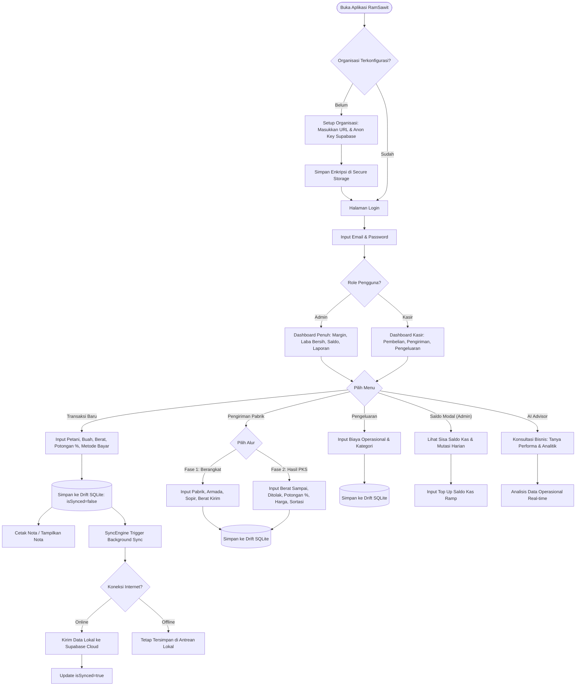

# Product Requirements Document (PRD) — RamSawit
## Sistem Aplikasi Kasir & Manajemen Loading Ramp Transaksi Buah Kelapa Sawit (TBS)

**Versi:** 2.5.4 (Build 9)  
**Status:** Production Ready  
**Target Platform:** Native Desktop Windows (`.exe` x64) & Native Mobile Android (`.apk`) — Single Responsive Codebase  
**Arsitektur Data:** Hybrid Offline-First (Drift SQLite Lokal + Supabase PostgreSQL Cloud + Riverpod SyncEngine)  
**Model Multi-Tenant:** Bring Your Own Database (BYOD) via Supabase Project Isolation per Organisasi  
**Distribusi & Pembaruan:** RamSawit Portal via Vercel ([https://ramsawit-portal.vercel.app](https://ramsawit-portal.vercel.app))  

---

## 1. Ringkasan Proyek

**RamSawit** adalah sistem aplikasi kasir, penimbangan, dan manajemen bisnis terpadu yang dirancang khusus untuk operasional **Loading Ramp / Pengepul Kelapa Sawit (TBS - Tandan Buah Segar)**. Sistem ini mendigitalkan seluruh mata rantai transaksi di loading ramp:
1. Pembelian buah kelapa sawit dari petani/pemasok harian dengan harga fluktuatif, potongan sampah/tangkai per item, serta metode pembayaran tunai maupun transfer non-tunai.
2. Pengiriman buah ke Pabrik Kelapa Sawit (PKS) menggunakan alur 2-fase (Keberangkatan armada dan Rekonsiliasi slip timbangan pabrik beserta audit susut buah dan sortasi mutu).
3. Pencatatan pengeluaran biaya operasional ramp secara fleksibel per kategori.
4. Pemantauan dana modal kas tunai timbangan secara real-time untuk mencegah defisit kasir di lapangan.
5. Dashboard analitik eksekutif yang menyajikan margin kotor, laba bersih, tren tonase, dan breakdown bisnis.
6. Konsultasi bisnis interaktif berbasis AI (*AI Analytics Advisor*) untuk analisis performa ramp.
7. Ketahanan operasional tanpa internet (*Offline-First*) berbasis SQLite lokal di wilayah pelosok perkebunan.

---

## 2. Tujuan & Masalah yang Diselesaikan

- **Menghilangkan Kesalahan Kalkulasi & Timbangan (Anti-Floating Point Error):** Kalkulasi berat kotor, persentase potongan, berat bersih, subtotal, dan pemotongan sortasi dihitung otomatis menggunakan presisi tinggi (`Decimal` & `BigInt`) tanpa kesalahan pembulatan komputer.
- **Transparansi Potongan Mutu:** Potongan mutu sampah/tangkai diterapkan per jenis buah secara transparan sehingga tidak merugikan petani maupun pemilik ramp.
- **Audit Susut Buah Pengiriman Pabrik:** Mengaudit selisih tonase antara jembatan timbang ramp dengan timbangan pabrik PKS secara otomatis untuk mendeteksi potensi kecurangan atau susut berlebih di perjalanan.
- **Pemisahan Kas Tunai & Non-Tunai:** Mengisolasi mutasi uang fisik kasir timbangan dari pembayaran transfer bank, menjamin saldo fisik kasir selalu sinkron dengan uang di laci kas.
- **Operasional Tanpa Ketergantungan Internet (Offline-First):** Memungkinkan kasir di pedalaman mencatat transaksi pembelian dan pengiriman pabrik secara lancar meski koneksi internet terputus, lalu otomatis tersinkron saat internet pulih.
- **Keamanan Data & Privasi Finansial (BYOD):** Setiap organisasi/ramp memiliki basis data Supabase cloud sendiri, menjamin kepemilikan data 100% di tangan pemilik ramp tanpa bercampur dengan tenant lain.

---

## 3. Target Pengguna & Role-Based Access Control (RBAC)

Aplikasi menerapkan kontrol hak akses berbasis peran (*Role-Based Access Control*) untuk menjaga kerahasiaan keuangan pemilik usaha:

| Modul & Fitur | Pemilik Usaha (`admin`) | Kasir Timbangan (`kasir`) | Keterangan Akses |
|---|:---:|:---:|---|
| **Setup Organisasi & Database (BYOD)** | Ya | Ya | Konfigurasi URL & Anon Key Supabase saat awal instalasi |
| **Transaksi Pembelian TBS** | Full Akses | Full Akses | Input timbangan, simpan, cetak nota, lihat riwayat |
| **Pembatalan Transaksi Pembelian (Void)** | Ya | Ya (Wajib Alasan) | Status berubah jadi `dibatalkan`, tercatat di audit trail |
| **Master Data Penjual (Petani)** | Full Akses | Full Akses | Tambah baru inline di form timbangan atau kelola list |
| **Master Jenis Buah** | Full Akses | Read-Only | TB (Tandan Besar), TK (Tandan Kecil), BR (Berondolan) |
| **Pengiriman Buah ke Pabrik (PKS)** | Full Akses | Full Akses | Input Fase 1 (berangkat) dan Fase 2 (hasil slip PKS) |
| **Master Data Pabrik (PKS)** | Full Akses | Read-Only | Pendaftaran mitra pabrik kelapa sawit tujuan |
| **Pencatatan Pengeluaran Operasional** | Full Akses | Full Akses | Kasir dapat mencatat operasional harian (BBM, konsumsi) |
| **Kelola Jenis Pengeluaran (Kategori)** | Full Akses | **Disembunyikan** | Hanya admin yang boleh menambah/mengubah kategori biaya |
| **Saldo / Dana Modal Kasir** | Full Akses | **Disembunyikan** | Monitoring kas masuk, kas terpakai, dan sisa modal |
| **Dashboard — Tab Pembelian & Pabrik** | Full Akses | Terbatas (≤ 1 Bulan) | Kasir melihat kartu ringkasan & pie chart operasional |
| **Dashboard — Tab Margin & Laba Bersih** | Full Akses | **Disembunyikan** | Tab laba, omzet, dan margin kotor disembunyikan dari kasir |
| **Dashboard — Grafik Tren Nilai & Tonase** | Full Akses | **Disembunyikan** | Kasir tidak memiliki akses ke grafik tren finansial |
| **Ekspor Laporan Finansial (Laba/Rugi)** | Full Akses | **Disembunyikan** | Laporan pendapatan berjenjang hanya untuk pemilik |
| **Ekspor Laporan Operasional (Excel/PDF)**| Full Akses | Full Akses | Laporan nota timbangan dan pengeluaran harian |
| **AI Analytics Advisor** | Full Akses | Full Akses | Asisten konsultasi bisnis & analisis data ramp |

---

## 4. Tech Stack & Arsitektur Sistem

- **Framework:** Flutter 3.x (Dart SDK 3.x) — Single Responsive Codebase untuk Desktop Windows & Mobile Android.
- **Target Platform Utama:**
  - **Windows Desktop:** Native executable (`.exe` x64 release), mendukung window sizing, keyboard shortcut (`Ctrl+N`, `Ctrl+F`, `Esc`), navigasi sidebar enterprise, dan printer kasir.
  - **Android Mobile:** Native package (`.apk` arm64/armeabi-v7a), responsive touch UI, bottom navigation, share sheet PDF, dan layout adaptif portrait.
- **Database Cloud:** Supabase (PostgreSQL 15+, Supabase Auth, Row Level Security, Realtime, Trigram search `pg_trgm`, `pgcrypto`).
- **Database Lokal (Offline-First):** Drift (SQLite engine via `drift` & `drift_flutter`) — berkas basis data `sawit_offline_db.sqlite`, schema version 2.
- **State Management & Sinkronisasi:** Flutter Riverpod (`flutter_riverpod` / `riverpod_annotation`) menggerakkan `SyncEngine` (`StateNotifier`), background sync periodic timer 30 detik, antrean data lokal `isSynced`, dan komponen `SyncStatusBar`.
- **Tipe Data Finansial:** Package `decimal` & `BigInt` untuk seluruh kalkulasi uang dan berat sebelum disimpan ke database (`numeric(12,2)` / `numeric(14,2)`). Dilarang menggunakan `double` primitif.
- **Visualisasi & Grafik:** `fl_chart` (Time-series multiline tren tonase/nilai dan pie chart persentase distribusi).
- **Format & Lokalisasi:** Package `intl` dengan format standar Indonesia (Rupiah `Rp 1.250.000` dan berat `1.250,50 kg`).
- **AI Analytics Engine:** Client HTTP OpenAI-compatible menuju endpoint gateway AI (default: 9Router port 20128 / Ollama), dengan lapisan fallback deterministik `AiBusinessQueryService`. Kredensial disimpan via `flutter_secure_storage`.
- **Distribusi & Auto-Update:** Website portal statis di Vercel (`https://ramsawit-portal.vercel.app`) mendistribusikan berkas rilis dan melayani endpoint metadata versi `version.json` yang diakses oleh `AppUpdateService`.
- **Desain UI/UX:** IBM Carbon Design System (Font: IBM Plex Sans, flat corners 0–4px, aksen IBM Blue `#0f62fe`, clean enterprise aesthetic).

---

## 5. Ruang Lingkup Sistem (v2.5.4)

### 5.1 In Scope
1. **Setup Organisasi & Multi-Tenant (BYOD):** Input URL Supabase dan public anon key organisasi, tersimpan aman di `flutter_secure_storage`.
2. **Autentikasi & Keamanan Sesi 24 Jam:** Login email/password via Supabase Auth dengan auto-logout ketat setelah 24 jam.
3. **Offline-First Mode:** Seluruh data tersimpan ke SQLite lokal terlebih dahulu, lalu otomatis disinkronkan ke Supabase cloud via `SyncEngine` saat online.
4. **Master Data:** Penjual/Petani (trigram search), Jenis Buah (TB, TK, BR), Pabrik Kelapa Sawit (PKS), dan Kategori Pengeluaran.
5. **Modul Pembelian TBS Petani:**
   - Input transaksi multi-item (1–3 jenis buah).
   - Potongan berat (%) diterapkan per jenis buah secara transparan.
   - Pilihan metode pembayaran: **Tunai** atau **Non Tunai (Transfer)**.
   - Kode transaksi otomatis `TRX-YYYYMMDD-XXXX`.
   - Cetak struk nota timbangan dan audit pembatalan (void).
6. **Modul Penjualan ke Pabrik (Alur 2 Fase):**
   - Fase 1 (Keberangkatan): Pabrik tujuan, armada, sopir, berat dikirim dari ramp (`berangkat`).
   - Fase 2 (Rekonsiliasi PKS): Berat sampai, berat ditolak, potongan wajib %, harga jual/kg, potongan sortasi (Rp/kg), potongan lainnya (Rp), audit susut buah (`selesai`).
   - Kode pengiriman otomatis `KRM-YYYYMMDD-XXXX`.
7. **Modul Pengeluaran Biaya Operasional:**
   - Pencatatan biaya operasional ramp (BBM, gaji harian, perawatan, kantor, dll).
   - Pilihan metode pembayaran: **Tunai** atau **Non Tunai**.
   - Pengelolaan kategori pengeluaran oleh Admin.
8. **Modul Saldo & Kas Modal Kasir (Admin Only):**
   - Pencatatan Top Up dana kas modal timbangan.
   - Perhitungan otomatis Sisa Saldo Kas = `Total Top Up − Total Pembelian TUNAI`.
   - Linimasa mutasi harian kas tunai terpadu.
   - Tab informatif transaksi Non Tunai (transfer bank).
9. **Dashboard Analitik Eksekutif:**
   - Kartu ringkasan tonase (kotor, bersih) dan rupiah untuk Pembelian dan Pabrik.
   - Kartu Margin Kotor dan Kartu Laba Bersih harian/mingguan/bulanan.
   - Filter periode standar: Hari Ini, 1 Minggu, 2 Minggu, 1 Bulan, 3 Bulan, 6 Bulan, 1 Tahun, dan Kustom Tanggal.
   - Filter khusus bulan/tahun pada kartu "Bulan Ini" bagi Admin.
   - Pie chart breakdown buah, pabrik tujuan, dan kategori pengeluaran.
   - Grafik tren multiline (Pembelian vs Penjualan, Berat Kotor vs Bersih).
10. **Laporan & Ekspor Cerdas (Excel & PDF):**
    - Laporan Pembelian (rincian per jenis buah per transaksi).
    - Laporan Penjualan Pabrik (lengkap dengan audit susut dan sortasi).
    - Laporan Pengeluaran Operasional.
    - Laporan Saldo Kas & Mutasi Modal.
    - Laporan Pendapatan Berjenjang (Kuartalan untuk filter 1 tahun, Bulanan untuk filter 3 bulan, Mingguan untuk filter 1 bulan).
11. **AI Analytics Advisor:**
    - Chat konsultasi bisnis interaktif berbasis LLM (read-only context injection).
    - Shortcut pertanyaan bisnis cepat (analisis margin, evaluasi pabrik, tren tonase).
    - Fallback mesin query deterministik lokal (`AiBusinessQueryService`).
12. **Auto-Update Lifecycle:**
    - Pengecekan otomatis versi aplikasi terhadap `version.json` di Vercel Portal saat start-up.
    - Dialog pembaruan interaktif dengan tautan unduhan langsung APK / ZIP Windows.

### 5.2 Out of Scope
- Integrasi direct API hardware jembatan timbang (input berat masih diketik manual kasir dari indikator timbangan digital).
- Integrasi Payment Gateway / Bank Transfer API otomatis (pembayaran non-tunai diverifikasi manual oleh kasir/admin).
- Multi-warehouse transit inventory (di luar loading ramp langsung kirim ke pabrik).

---

## 6. Alur Pengguna (User Flow)



---

## 7. Spesifikasi Fitur & Functional Requirements (FR)

### 7.1 Autentikasi & Keamanan Sesi
- **FR-1.1:** Login menggunakan email dan kata sandi terdaftar pada Supabase Auth.
- **FR-1.2:** Sesi login dibatasi maksimal **24 jam sejak waktu login**. Jika melebihi 24 jam, sistem secara otomatis melakukan logout paksa dan menampilkan pesan: *"Sesi login Anda telah berakhir demi keamanan (maksimal 24 jam). Silakan masuk kembali."*
- **FR-1.3:** Pengecekan usia sesi dilakukan pada saat aplikasi dibuka dan secara periodik setiap 15 menit selama aplikasi aktif di background/foreground.
- **FR-1.4:** Role pengguna (`admin` atau `kasir`) disimpan pada tabel `profiles` dan diverifikasi di setiap modul antarmuka.

### 7.2 Manajemen Data Penjual (Petani)
- **FR-2.1:** Master data penjual mencakup: Nama Lengkap (wajib), Nomor Telepon, Alamat, Catatan, dan status `is_active` (soft delete).
- **FR-2.2:** Form transaksi pembelian menyediakan fitur pendaftaran petani baru secara instan (*inline dialog*) tanpa perlu keluar dari form penimbangan.
- **FR-2.3:** Pencarian petani menggunakan algoritma Trigram Fuzzy Search (`pg_trgm` di cloud dan query teks di Drift lokal) untuk mempercepat pencarian ratusan petani di lapangan.

### 7.3 Modul Transaksi Pembelian TBS Petani
- **FR-3.1:** Input transaksi mendukung multi-item (1 transaksi dapat memuat kombinasi Tandan Besar, Tandan Kecil, dan Berondolan).
- **FR-3.2:** Setiap baris item mewajibkan pengisian:
  - Jenis Buah (dropdown master)
  - Harga per kg (manual/fluktuatif harian, nominal ≥ 0)
  - Berat Kotor (kg) (timbangan bruto, numeric > 0)
  - Potongan (%) (persentase sampah/tangkai 0 s.d. 100%, default 0%)
- **FR-3.3:** Nilai kalkulasi item dihitung otomatis secara live preview:
  - $\text{Potongan (kg)} = \text{Berat Kotor} \times \left(\frac{\text{Potongan \%}}{100}\right)$
  - $\text{Berat Bersih (kg)} = \text{Berat Kotor} - \text{Potongan (kg)}$
  - $\text{Subtotal (Rp)} = \text{Harga per kg} \times \text{Berat Bersih}$
- **FR-3.4:** Total Transaksi (Total Berat Kotor, Total Berat Bersih, Total Potongan, dan Total Pembayaran Rp) diakumulasikan secara otomatis.
- **FR-3.5:** Format kode transaksi unik digenerate otomatis harian: `TRX-YYYYMMDD-XXXX`.
- **FR-3.6:** **Pilihan Metode Pembayaran:** Kasir wajib memilih **Tunai** atau **Non Tunai (Transfer)**:
  - **Tunai (Default):** Mengurangi Sisa Saldo Kas Modal timbangan pada modul Saldo (§7.10).
  - **Non Tunai:** Pembayaran melalui transfer rekening bank; **TIDAK mengurangi** saldo fisik kas modal timbangan.
- **FR-3.7:** Pembatalan transaksi (status `dibatalkan`) wajib menyertakan alasan pembatalan dan tidak menghapus baris data fisik untuk kebutuhan audit.

### 7.4 Modul Pengiriman TBS ke Pabrik Kelapa Sawit (PKS - 2 Fase)
- **FR-4.1:** Alur pencatatan pengiriman pabrik dibagi menjadi 2 fase yang independen:
  - **Fase 1 (Keberangkatan):** Diisi saat armada truk berangkat dari loading ramp. Field: Pabrik Tujuan, Nomor Polisi Armada, Nama Sopir, Tanggal Kirim, dan **Berat Dikirim (kg)** (timbangan bruto ramp). Status: `berangkat`.
  - **Fase 2 (Penyelesaian / Rekonsiliasi PKS):** Diisi setelah sopir kembali membawa nota/slip timbangan resmi PKS. Field: **Berat Sampai (kg)**, **Berat Ditolak (kg)**, **Potongan Pabrik (%)**, **Harga Jual per kg**, **Potongan Lainnya (Rp)**, dan **Potongan Sortasi (Rp/kg)**. Status berubah menjadi: `selesai`.
- **FR-4.2:** Nilai turunan pengiriman pabrik dihitung secara otomatis dan disimpan di database:
  - $\text{Berat Diterima (kg)} = \text{Berat Sampai} - \text{Berat Ditolak}$
  - $\text{Berat Bersih (kg)} = \text{Berat Diterima} \times \left(1 - \frac{\text{Potongan Pabrik \%}}{100}\right)$
  - $\text{Susut Buah (kg)} = \text{Berat Dikirim} - \text{Berat Sampai}$ (audit susut transportasi)
  - $\text{Nilai Potongan Sortasi (Rp)} = \text{Potongan Sortasi (Rp/kg)} \times \text{Berat Sampai}$
  - $\text{Total Nilai Jual (Rp)} = (\text{Harga Jual/kg} \times \text{Berat Bersih}) - \text{Potongan Lainnya} - \text{Nilai Potongan Sortasi}$
- **FR-4.3:** Format kode pengiriman unik harian: `KRM-YYYYMMDD-XXXX`.
- **FR-4.4:** Riwayat pengiriman memisahkan tab "Dalam Perjalanan" (`berangkat`) dan tab "Selesai" (`selesai`) untuk memudahkan pemantauan armada di jalan.

### 7.5 Modul Pengeluaran Biaya Operasional
- **FR-5.1:** Pencatatan biaya operasional ramp mencakup: Tanggal, Kategori Pengeluaran (dropdown master), Keterangan, Nominal (Rp > 0), dan **Metode Pembayaran (Tunai / Non Tunai)**.
- **FR-5.2:** Master Kategori Pengeluaran dikelola secara mandiri oleh Admin melalui menu "Kelola Jenis Pengeluaran" (tambah, edit, nonaktifkan).
- **FR-5.3:** Kasir berhak mencatat dan melihat riwayat pengeluaran harian, namun tidak berhak melihat agregat total pengeluaran di dashboard eksekutif.

### 7.6 Modul Saldo & Dana Modal Kasir (Khusus Admin)
- **FR-6.1:** Admin mencatat dana modal yang diserahkan ke kasir melalui form **Top Up Saldo** (Tanggal, Nominal, Keterangan).
- **FR-6.2:** Sistem menghitung saldo kas aktif secara real-time:
  $$\text{Sisa Saldo Kas} = \sum \text{Nominal Top Up} - \sum \text{Total Pembelian TUNAI (status selesai)}$$
- **FR-6.3:** Transaksi berjenis **Non Tunai (Transfer)** TIDAK mengurangi Sisa Saldo Kas fisik, dan dikelompokkan tersendiri pada tab informatif **Non Tunai**.
- **FR-6.4:** Linimasa mutasi menyajikan rekapitulasi harian kas tunai terpakai dan daftar riwayat top up dana modal.
- **FR-6.5:** Jika Sisa Saldo Kas ≤ 0, sistem memunculkan indikator peringatan visual berwarna merah tanpa memblokir input transaksi timbangan kasir.

### 7.7 Dashboard & Visualisasi Analitik Bisnis
- **FR-7.1:** Komponen filter periode terpadu dan reusable dengan pilihan: **Hari Ini (Default), 1 Minggu, 2 Minggu, 1 Bulan, 3 Bulan, 6 Bulan, 1 Tahun, dan Kustom Tanggal**.
- **FR-7.2:** **Struktur Tab Dashboard:**
  - **Tab Pembelian Petani (Admin & Kasir):** Kartu Berat Kotor, Berat Bersih, Total Pembelian (Rp), pie chart breakdown per jenis buah, dan list transaksi terbaru.
  - **Tab Penjualan Pabrik (Admin & Kasir):** Kartu Berat Dikirim, Berat Bersih PKS, Total Penjualan (Rp), pie chart pabrik tujuan, dan list pengiriman terbaru.
  - **Tab Margin & Laba Bersih (Khusus Admin):**
    - Kartu Margin Kotor = $\text{Total Penjualan} - \text{Total Pembelian}$
    - Kartu Laba Bersih = $\text{Margin Kotor} - \text{Total Pengeluaran Operasional}$
    - Grafik Tren Multiline Finansial (Pembelian vs Penjualan)
    - Grafik Tren Multiline Berat (Kotor vs Bersih)
    - Pie chart breakdown kategori pengeluaran operasional
- **FR-7.3:** **Filter Khusus "Bulan Ini":** Khusus Admin pada kartu "Bulan Ini", tersedia pemilih bulan dan tahun spesifik untuk komparasi performa historis.
- **FR-7.4:** **Restriksi Role Kasir:** Kasir dibatasi maksimal melihat data 1 bulan terakhir, tab Margin & Laba Bersih disembunyikan sepenuhnya, serta grafik tren finansial tidak ditampilkan.

### 7.8 Laporan & Ekspor Cerdas (Excel & PDF)
- **FR-8.1:** Seluruh halaman riwayat (Pembelian, Pabrik, Pengeluaran, dan Saldo) dilengkapi fitur ekspor **Excel (`.xlsx`)** dan **PDF** siap cetak.
- **FR-8.2:** Format laporan pembelian menyajikan **satu baris per jenis buah per transaksi**, merinci berat kotor, potongan %, potongan kg, berat bersih, harga/kg, dan subtotal, diakhiri baris total agregat.
- **FR-8.3:** **Laporan Pendapatan Berjenjang (Khusus Admin):** Merangkum omzet pembelian, penjualan pabrik, pengeluaran, margin, dan laba bersih secara adaptif sesuai rentang filter:
  - Rentang 1 Tahun $\rightarrow$ Rangkuman per 3 bulan (Kuartalan)
  - Rentang 3 Bulan $\rightarrow$ Rangkuman per 1 bulan
  - Rentang 1 Bulan $\rightarrow$ Rangkuman per minggu

### 7.9 Offline-First Engine & Status Sinkronisasi
- **FR-9.1:** Aplikasi menggunakan basis data lokal SQLite via Drift (`sawit_offline_db.sqlite`) sebagai penyimpanan primer di perangkat pengguna.
- **FR-9.2:** Setiap mutasi data diberi tanda status `isSynced = false` dan dicatat dengan timestamp `localUpdatedAt`.
- **FR-9.3:** `SyncEngine` menjalankan background periodic timer setiap 30 detik untuk mendeteksi ketersediaan internet dan mengirim data yang belum tersinkron ke cloud Supabase.
- **FR-9.4:** Komponen `SyncStatusBar` selalu terlihat di antarmuka pengguna untuk menampilkan status live:
  - *Tersinkron Penuh* (ikon hijau, waktu sinkron terakhir)
  - *Menyinkronkan...* (animasi loading, jumlah item dalam antrean)
  - *Mode Offline* (ikon oranye/abu-abu, jumlah antrean pending)
  - *Gagal Sinkron* (ikon merah, pesan error, tombol "Coba Lagi")

### 7.10 Asisten AI Analytics Advisor
- **FR-10.1:** Modul percakapan cerdas yang menginjeksi ringkasan data operasional ramp (tonase, margin, biaya, mitra aktif) sebagai konteks analitik secara *read-only*. AI **dilarang memutasi data**.
- **FR-10.2:** Terhubung ke endpoint OpenAI-compatible (default: 9Router lokal atau Ollama).
- **FR-10.3:** Menyediakan tombol jalan pintas pertanyaan populer: "Evaluasi Margin Minggu Ini", "Pabrik Mana Paling Menguntungkan?", "Analisis Tren Susut Buah".
- **FR-10.4:** Apabila endpoint AI nonaktif atau koneksi internet terputus, sistem otomatis mengalihkan permintaan ke mesin query deterministik lokal (`AiBusinessQueryService`).
- **FR-10.5:** Seluruh output AI wajib disajikan dalam bahasa Indonesia baku dan komunikatif.

### 7.11 Setup Organisasi BYOD & Pembaruan Sistem (Auto-Update)
- **FR-11.1:** Halaman setup organisasi memungkinkan pemilik memasukkan URL project Supabase dan anon API key mereka sendiri, tersimpan terenkripsi di `flutter_secure_storage`.
- **FR-11.2:** `AppUpdateService` secara otomatis mengecek rilis baru ke endpoint `https://ramsawit-portal.vercel.app/version.json` saat aplikasi diluncurkan.
- **FR-11.3:** Jika tersedia versi baru, aplikasi menampilkan modal update yang merinci changelog, nomor versi, dan tombol unduh langsung paket instalasi Windows / APK.

---

## 8. Spesifikasi Non-Fungsional (NFR)

- **NFR-1 Presisi Finansial Tanpa Kompromi:** Dilarang keras menggunakan tipe `double` untuk kalkulasi akumulasi uang dan berat. Wajib menggunakan `Decimal` atau `BigInt` untuk mencegah floating-point rounding error.
- **NFR-2 Performa Rendah Latensi:** Respon UI input timbangan harus instan (< 16ms, 60 FPS) karena penulisan diarahkan ke SQLite lokal di memori/SSD perangkat.
- **NFR-3 Keamanan Row-Level Security (RLS):** Seluruh tabel di cloud Supabase dilindungi RLS policies ketat untuk membatasi akses hanya bagi pengguna yang terautentikasi sesuai perannya.
- **NFR-4 Ketahanan Jaringan:** Sistem mampu beroperasi 100% offline selama berhari-hari tanpa batas waktu, dan antrean transaksi lokal dijamin tidak hilang meskipun perangkat dimatikan.
- **NFR-5 Tampilan Adaptif Responsif:** Layout aplikasi beradaptasi mulus dari layar ponsel Android (portrait) hingga monitor layar lebar desktop Windows (landscape), mengikuti prinsip grid IBM Carbon Design System.
- **NFR-6 Audit Trail Permanen:** Transaksi yang dibatalkan tidak boleh dihapus secara fisik (`hard delete`), melainkan diubah statusnya menjadi `'dibatalkan'` disertai ID pembuat dan timestamp.

---

## 9. Struktur Folder Arsitektur Flutter

```
lib/
 ├─ core/
 │   ├─ database/                  # Drift SQLite Engine (AppDatabase, tables.dart, version 2)
 │   ├─ services/                  # AI endpoint, update service, session storage
 │   ├─ sync/                      # SyncEngine (StateNotifier), SyncStatusBar widget
 │   ├─ theme/                     # IBM Carbon Design tokens, typography IBM Plex Sans
 │   ├─ utils/                     # Formatter Rupiah, berat (kg), validator, currency helper
 │   ├─ widgets/                   # Komponen reusable (filter periode, kartu ringkasan, empty state)
 │   ├─ supabase_client.dart       # Client inisialisasi cloud Supabase
 │   └─ tenant_config_service.dart # Layanan konfigurasi multi-tenant terenkripsi
 ├─ models/
 │   ├─ penjual.dart               # Model petani / penjual
 │   ├─ jenis_buah.dart            # Model master buah (TB, TK, BR)
 │   ├─ pabrik.dart                # Model pabrik kelapa sawit
 │   ├─ pengeluaran.dart           # Model transaksi pengeluaran operasional
 │   ├─ pengiriman_pabrik.dart     # Model alur 2-fase pengiriman pabrik
 │   ├─ saldo.dart                 # Model topup kas modal & ringkasan saldo
 │   ├─ transaksi.dart             # Model header transaksi & v_transaksi_ringkasan
 │   └─ transaksi_item.dart        # Model baris detail per jenis buah
 ├─ features/
 │   ├─ ai_analytics/              # Chat Advisor AI: page, controller, deterministic fallback
 │   ├─ auth/                      # Login email/password, auth gate, cek sesi 24 jam
 │   ├─ dashboard/                 # Dashboard eksekutif: kartu, fl_chart tren, pie breakdown
 │   ├─ pabrik/                    # Master pabrik & kelola data PKS
 │   ├─ pengeluaran/               # Pencatatan biaya operasional & kelola jenis pengeluaran
 │   ├─ pengiriman_pabrik/         # Alur 2-fase: form keberangkatan, form hasil PKS, riwayat
 │   ├─ penjual/                   # Master penjual, pencarian trigram, form modal/inline
 │   ├─ saldo/                     # Modul dana kas modal, linimasa mutasi tunai, tab non-tunai
 │   ├─ tenant/                    # Halaman setup organisasi & database BYOD
 │   └─ transaksi/                 # Form input timbangan multi-item, riwayat, detail, nota void
 └─ main.dart                      # Entry point aplikasi RamSawit
```

---

## 10. Kriteria Penerimaan & Verifikasi Mutu (Acceptance Criteria)

1. **Integritas Kalkulasi Timbangan:**
   - Input Berat Kotor 2.500 kg, Potongan 3%, Harga Rp 2.400/kg menghasilkan:
     - Potongan kg = 75,00 kg
     - Berat Bersih = 2.425,00 kg
     - Subtotal = Rp 5.820.000,00 secara presisi tanpa desimal liar.
2. **Kepatuhan Isolasi Kas Tunai:**
   - Transaksi Non Tunai (transfer) berhasil tersimpan dan tampil di riwayat, namun nilai nominalnya terbukti tidak mengurangi Sisa Saldo Kas Modal di modul Saldo.
3. **Audit Susut Buah Pengiriman:**
   - Form Fase 2 Pabrik secara otomatis menghitung Susut Buah = Berat Dikirim (Ramp) − Berat Sampai (PKS), serta memvalidasi bahwa Berat Ditolak tidak boleh melebihi Berat Sampai.
4. **Ketahanan Offline-First:**
   - Dalam kondisi mode pesawat / kabel LAN dicabut, pengguna dapat menginput 10 transaksi secara beruntun. Seluruh data tersimpan di SQLite lokal dengan indikator *Mode Offline (10 antrean)*. Begitu internet terhubung, `SyncEngine` otomatis mengirimkan seluruh 10 transaksi ke Supabase cloud dan mengubah status menjadi *Tersinkron Penuh*.
5. **Keamanan Hak Akses Kasir:**
   - Akun dengan role `kasir` tidak dapat melihat tab Margin Keuntungan, tidak melihat kartu Laba Bersih, tidak dapat mengakses modul Saldo Modal, dan tidak dapat mengekspor laporan pendapatan laba/rugi.
6. **Stabilitas Binary Multi-Platform:**
   - Kompilasi Windows Desktop Release (`RamSawit.exe`) berjalan mulus tanpa crash memory leak.
   - Kompilasi Android Release (`RamSawit_V.2.5.4.apk`) terpasang dan berjalan lancar di perangkat fisik Android.
7. **Pembaruan Sistem Terdistribusi:**
   - Saat file `version.json` di Vercel Portal dinaikkan, aplikasi mendeteksi versi baru dan menampilkan dialog pembaruan dengan tautan unduhan yang valid.

---
*Dokumen ini merupakan spesifikasi kebutuhan produk resmi aplikasi RamSawit v2.5.4 dan berlaku sebagai pedoman tunggal bagi seluruh tim pengembang dan AI coding agent.*
